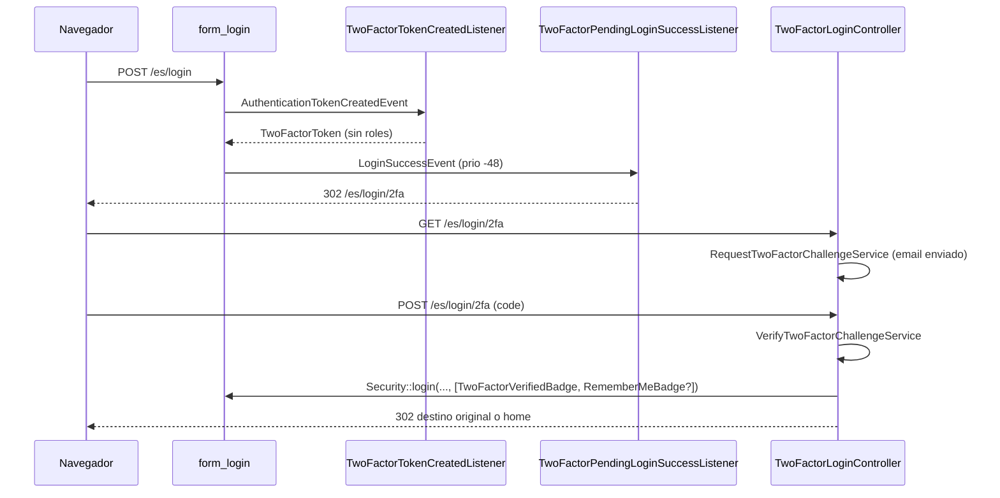

# Segundo factor de autenticación (2FA) — manual técnico

- **Plan:** `plan.md` (misma carpeta) · **Revisión:** `review.md`, `review-fix.md` · **Implementado:** 2026-09-24 · **Bounded Context:** `Security` · **Migración:** `migrations/Version20260924111031.php` (equivalente a `migration.sql`)

## Qué hace y por qué

Tras validar la contraseña en `/{_locale}/login`, el usuario puede tener que confirmar su identidad con un segundo factor: un código de 6 dígitos enviado por **email** o un código de una **aplicación de autenticación** TOTP (Google Authenticator o compatible). El flag `TWO_FACTOR_REQUIRED` decide el modo del despliegue: `false` (opcional, cada usuario lo activa en su perfil) o `true` (obligatorio; quien no ha elegido método recibe el código por email). El acceso SSO (Google/Microsoft) no pide segundo factor salvo con `TWO_FACTOR_SSO_ENABLED=true` **y** un TOTP activo y legible. El acceso posterior por cookie `remember_me` y el cambio de usuario (`switch_user`) no lo piden. `/api/login` (JWT) queda fuera: la contraseña sola sigue emitiendo un JWT (riesgo aceptado, ver *Riesgos* del plan).

La pieza central es la sustitución del token de Symfony: en `AuthenticationTokenCreatedEvent` el token creado por `form_login` (o por `SsoAuthenticator`) se envuelve en un `TwoFactorToken` **sin roles**. Con ese token todo `access_control` `ROLE_USER` lanza `AccessDeniedException`, que se convierte en redirección a la pantalla del código. Al verificar, `Security::login()` crea el token definitivo con un `TwoFactorVerifiedBadge`, dispara el `LoginSuccessEvent` "real" (auditoría `UserLogged`, idioma preferido, cookie remember-me) y redirige al destino original. No se usa `scheb/2fa-bundle` porque persiste con setters sobre la entidad y choca con el `User` basado en eventos (decisión del plan).

Todo el estado vive en el agregado `User` (método, secreto TOTP cifrado, secreto pendiente de confirmar y reto embebido con hash, caducidad e intentos) y cambia por eventos de dominio. Si el secreto TOTP no se puede descifrar (p. ej. tras rotar `APP_SECRET`), el *método efectivo* pasa a Email sin tocar la preferencia guardada.

## Mapa de piezas

### Dominio — `src/Security/Domain/Model/User/`

| Fichero | Rol | Estado |
|---|---|---|
| `User.php` | Cuatro campos nuevos en el constructor promovido (`twoFactorMethod`, `totpSecret`, `pendingTotpSecret`, `twoFactorChallenge`), getters, comandos (`:260-373`) y `apply*` (`:438-479`) | Modificado |
| `TwoFactorMethod.php` | Enum string `Email`, `Totp` | Nuevo |
| `TwoFactorChallenge.php` | VO embebido: código de 6 dígitos, HMAC-SHA256 con clave HKDF (`two-factor-challenge`), 10 min, 3 intentos | Nuevo |
| `TotpAuthenticator.php` | Puerto: `generateSecret()`, `provisioningUri()`, `manualKey()`, `verify()`, `isReadable()`; el secreto que cruza el dominio va cifrado | Nuevo |
| `TwoFactorChallengeRequested.php`, `TwoFactorVerified.php`, `TwoFactorVerificationFailed.php`, `TwoFactorEnrolmentRequested.php`, `TwoFactorEnrolmentConfirmed.php`, `TwoFactorEnrolmentCancelled.php`, `TwoFactorDisabled.php` | Eventos de dominio | Nuevos |
| `TwoFactorCodeInvalidException.php` | `attemptsLeft()`, `isLocked()` | Nuevo |
| `TwoFactorNotPendingException.php` | No hay reto/activación pendiente (o ha caducado) | Nuevo |

### Aplicación — `src/Security/Application/User/`

| Fichero | Rol | Estado |
|---|---|---|
| `TwoFactor/TwoFactorPolicy.php` | Puerto `isRequired()`, `isSsoEnabled()` | Nuevo |
| `TwoFactor/EffectiveTwoFactorMethod.php` | `resolve()`, `resolveForSso()`, `isFallback()` | Nuevo |
| `TwoFactor/MaskedDestination.php` | `email()` → `u***@dominio` | Nuevo |
| `RequestTwoFactorChallenge/*` | Genera (o reutiliza) el reto de login | Nuevo |
| `VerifyTwoFactorChallenge/*` | Verifica el código de login | Nuevo |
| `RequestTwoFactorEnrolment/*` | Activa Email o inicia la activación TOTP | Nuevo |
| `ConfirmTwoFactorEnrolment/*` | Confirma la activación TOTP con un código de la app | Nuevo |
| `CancelTwoFactorEnrolment/*` | Descarta una activación TOTP pendiente **sin** tocar el método activo | Nuevo (no estaba en el plan) |
| `DisableTwoFactor/*` | Borra método, secretos y reto (perfil en modo opcional y restablecimiento desde administración) | Nuevo |

### Infraestructura

| Fichero | Rol | Estado |
|---|---|---|
| `src/Security/Infrastructure/Symfony/Security/TwoFactor/TwoFactorToken.php` | Token pendiente, sin roles, envuelve el original; guarda `firewallName`, `rememberMeRequested` y el atributo `TARGET_PATH_ATTRIBUTE` | Nuevo |
| `.../TwoFactor/TwoFactorVerifiedBadge.php`, `.../TwoFactor/SsoBadge.php` | Badges resueltos que marcan "ya verificado" y "viene de SSO" | Nuevos |
| `.../TwoFactor/EnvTwoFactorPolicy.php` | Implementación de `TwoFactorPolicy` desde env | Nuevo |
| `.../TwoFactor/OtphpTotpAuthenticator.php` | `spomky-labs/otphp` + `sodium_crypto_secretbox` (clave HKDF `two-factor-totp` de `%kernel.secret%`, nonce antepuesto, base64); tolerancia 29 s | Nuevo |
| `.../TwoFactor/InMemoryTwoFactorPolicy.php`, `.../TwoFactor/InMemoryTotpAuthenticator.php` | Dobles de test (`VALID_CODE = '123456'`, `UNREADABLE_SECRET = 'unreadable'`) | Nuevos |
| `src/Security/Infrastructure/Symfony/Event/TwoFactorTokenCreatedListener.php` | Sustituye el token en `AuthenticationTokenCreatedEvent` | Nuevo |
| `src/Security/Infrastructure/Symfony/Event/TwoFactorPendingLoginSuccessListener.php` | `LoginSuccessEvent` (prioridad -48): desactiva remember-me, restaura el target path y redirige al reto | Nuevo |
| `src/Security/Infrastructure/Symfony/Event/TwoFactorPendingAccessDeniedListener.php` | `kernel.exception` (prioridad 10): `AccessDeniedException` + `TwoFactorToken` → redirección al reto | Nuevo |
| `src/Security/Infrastructure/Symfony/Event/LoginSuccessEventListener.php`, `SetPreferredLocaleOnLoginListener.php` | Return temprano con `TwoFactorToken` | Modificados |
| `src/Security/Infrastructure/Symfony/Security/SsoAuthenticator.php` | Añade `new SsoBadge()` al passport | Modificado |
| `src/Security/Infrastructure/Symfony/Security/SecurityUser.php` | Copia los cuatro campos 2FA | Modificado |
| `src/Security/Infrastructure/Notification/TwoFactorCodeNotifier.php` | Envía el código por `EmailSender` (plantilla `@security/two-factor/code.email.html.twig`) | Nuevo |
| `src/Security/Infrastructure/Symfony/Form/TwoFactorCodeType.php` | Campo `code` (6 dígitos) + botón `verify` | Nuevo |
| `src/Security/Infrastructure/UI/Web/TwoFactorLoginController.php` | `GET`/`POST /{_locale}/login/2fa` | Nuevo |
| `src/Security/Infrastructure/UI/Web/ProfileTwoFactorController.php` | Pantallas de perfil `/{_locale}/profile/two-factor*` | Nuevo |
| `src/Security/Infrastructure/UI/Web/Admin/User/ResetTwoFactorController.php` | `GET /{_locale}/admin/users/{userId}/two-factor/reset` | Nuevo |
| `src/Security/Infrastructure/Persistence/Doctrine/Type/TwoFactorMethodType.php` | Tipo Doctrine `two_factor_method` | Nuevo |
| `src/Security/Infrastructure/Persistence/Doctrine/Mapping/User.User.orm.xml`, `User.TwoFactorChallenge.orm.xml` | Campos y embebido `two_factor_*` | Modificado / nuevo |
| `src/Security/Infrastructure/Persistence/Doctrine/Repository/DoctrineUserRepository.php` | La reconstrucción `new User(...)` de `add()` pasa los campos nuevos | Modificado |
| `templates/security/login/two-factor.html.twig` | Pantalla "Verificación en dos pasos" | Nueva |
| `templates/security/profile/two-factor.html.twig` | "Segundo factor" (layout `@shared/layout/action.html.twig`, acciones en el desplegable **Acciones**) | Nueva |
| `templates/security/profile/two-factor-confirm.html.twig` | QR, clave manual y código de confirmación | Nueva |
| `templates/security/two-factor/code.email.html.twig` | Email "Código de acceso" | Nueva |
| `templates/security/admin/users/edit.html.twig` | Campo "Segundo factor" y acción "Restablecer segundo factor" | Modificada |
| `templates/components/Topbar/Profile.html.twig:48-56` | Entrada "Segundo factor" del desplegable de perfil | Modificada |
| `templates/security/translations/twoFactorMethod.html.twig`, `twoFactorSecurity.html.twig` | Plantillas de extracción de traducciones | Nuevas |
| `translations/twoFactorMethod+intl-icu.{es,en}.xlf`, `translations/security.{es,en}.xlf`, `translations/messages+intl-icu.{es,en}.xlf` | Textos | Nuevos / modificados |
| `config/packages/{csrf,rate_limiter,doctrine}.yaml`, `.env`, `.env.test`, `composer.json`, `phpstan.dist.neon`, `src/Security/Infrastructure/Symfony/DependencyInjection/services.yaml` | Configuración (ver abajo) | Modificados |
| `assets/icons/solar/{letter,refresh,shield-cross,smartphone}-line-duotone.svg` | Iconos UX | Nuevos |

## Modelo de dominio

### Estado en `User`

| Campo | Columna | Significado |
|---|---|---|
| `twoFactorMethod` | `two_factor_method` (VARCHAR 16) | Preferencia guardada: `null`, `Email` o `Totp` |
| `totpSecret` | `two_factor_totp_secret` | Secreto TOTP activo, cifrado |
| `pendingTotpSecret` | `two_factor_pending_totp_secret` | Secreto de una activación TOTP sin confirmar, cifrado |
| `twoFactorChallenge` | `two_factor_code_hash`, `two_factor_expires_at`, `two_factor_attempts` | Reto en curso (login o activación TOTP) |

`twoFactorChallenge()` devuelve `TwoFactorChallenge::none()` si el embebido es nulo. `TwoFactorChallenge` (`TwoFactorChallenge.php`): `generate()` (código aleatorio 100000-999999, hash, +10 min), `withoutCode()` (sin hash: retos TOTP, solo cuentan intentos y caducidad), `none()`; `isPending()` = hay caducidad, no ha caducado y no está bloqueado; `isLocked()` con `attempts >= 3` (`:72-75`); `verify()` devuelve `false` si está caducado, bloqueado o sin hash (`:53-60`). El código en claro (`plainCode`) solo existe en memoria: `withFailedAttempt()` lo vacía.

### Comandos

| Comando | Evento | Reglas |
|---|---|---|
| `enableTwoFactorByEmail()` (`User.php:260`) | `TwoFactorEnrolmentConfirmed(Email)` | Sin confirmación; `apply` borra `totpSecret` y `pendingTotpSecret` |
| `requestTotpEnrolment($secret)` (`:270`) | `TwoFactorEnrolmentRequested` | Guarda `pendingTotpSecret` y un reto `withoutCode()`; el método activo no cambia |
| `confirmTotpEnrolment($code, $totp)` (`:282`) | `TwoFactorEnrolmentConfirmed(Totp)` o `TwoFactorVerificationFailed` + `TwoFactorCodeInvalidException` | Sin pendiente o reto no pendiente → `TwoFactorNotPendingException`; `apply` copia `pendingTotpSecret` a `totpSecret` |
| `cancelTotpEnrolment()` (`:300`) | `TwoFactorEnrolmentCancelled` | No-op sin activación pendiente; `apply` solo limpia pendiente y reto (`:452-456`) |
| `disableTwoFactor()` (`:313`) | `TwoFactorDisabled` | No-op si no hay método, pendiente ni reto; `apply` limpia todo (`:458-464`) |
| `requestTwoFactorChallenge($method, $challenge, $masked)` (`:326`) | `TwoFactorChallengeRequested` | Sustituye el reto |
| `verifyTwoFactor($code, $method, $appSecret, $totp)` (`:339`) | `TwoFactorVerified` o `TwoFactorVerificationFailed` + excepción | Reto no pendiente → `TwoFactorNotPendingException`; `Totp` verifica con `totpSecret`, `Email` con el hash del reto |

`failTwoFactorVerification()` (`:362`) registra el fallo (que incrementa `attempts` en `apply`) y lanza `TwoFactorCodeInvalidException` con los intentos restantes y si queda bloqueado.

### Eventos y auditoría

Todos los payloads llevan `userId`; `method` donde aplica; `TwoFactorChallengeRequested` añade `maskedDestination` y `expiresAt`, y `TwoFactorEnrolmentRequested` `expiresAt`. **Ningún payload contiene el código, su hash ni el secreto**: el reto con `plainCode` y el secreto cifrado viajan solo en el objeto en memoria (lo necesita `TwoFactorCodeNotifier`). `RecordEventSubscriber` los audita como cualquier evento. `UserLogged` solo se publica tras superar el segundo factor, porque `LoginSuccessEventListener` ignora el `TwoFactorToken`.

### Método efectivo

`EffectiveTwoFactorMethod::resolve()` (`src/Security/Application/User/TwoFactor/EffectiveTwoFactorMethod.php:15-22`):

| Guardado | Modo opcional | Modo obligatorio |
|---|---|---|
| `null` | ninguno | `Email` |
| `Email` | `Email` | `Email` |
| `Totp` legible | `Totp` | `Totp` |
| `Totp` ilegible | `Email` (`isFallback() = true`) | `Email` (`isFallback() = true`) |

`resolveForSso()` (`:24-31`) devuelve `Totp` solo si `isSsoEnabled()` y `resolve()` es `Totp`; en cualquier otro caso `null` (entra sin reto, también en modo obligatorio).

## Flujo de una operación

### Login con contraseña

1. **Sustitución del token** — `TwoFactorTokenCreatedListener::__invoke()` (`src/Security/Infrastructure/Symfony/Event/TwoFactorTokenCreatedListener.php:36-75`): sale si el passport lleva `TwoFactorVerifiedBadge` (`:41`), si el token es `RememberMeToken` o el usuario no es `SecurityUser` (`:47`). Con `PasswordCredentials` usa `resolve()`, con `SsoBadge` `resolveForSso()`, si no nada (`:51-55`). Si hay método: calcula `rememberMe` con `isEnabled()` **o** el parámetro `_remember_me` de la petición (`:62`, porque en `form_login` el badge aún está desactivado en este punto y `CheckRememberMeConditionsListener` lo activa después, prioridad -32), desactiva el badge, guarda el target path de sesión como atributo del token (`:68-72`, porque `DefaultAuthenticationSuccessHandler` lo borra antes del `LoginSuccessEvent`) y coloca el `TwoFactorToken`.
2. **Redirección al reto** — `TwoFactorPendingLoginSuccessListener` (prioridad -48, entre `CheckRememberMeConditionsListener` -32 y `RememberMeListener` -64): vuelve a desactivar el `RememberMeBadge` (`:31-35`), restaura el target path en sesión (`:37-41`) y sustituye la respuesta por `302 app_login_two_factor` (`:43`). No para la propagación: `LoginSuccessEventListener` y `SetPreferredLocaleOnLoginListener` ven el token y salen.
3. **Bloqueo mientras está pendiente** — el `TwoFactorToken` no tiene roles, así que cualquier ruta `ROLE_USER` (incluidos `/profile/two-factor` y `?_switch_user=`) lanza `AccessDeniedException`; `TwoFactorPendingAccessDeniedListener` (prioridad 10, antes del `ExceptionListener` del firewall y del de `Shared`) redirige al reto. `/login*` y `/logout` son públicos (`config/packages/security.yaml`, regex `/login` sin anclar).
4. **Pantalla** — `TwoFactorLoginController::show()` (`src/Security/Infrastructure/UI/Web/TwoFactorLoginController.php:42-63`): sin `TwoFactorToken` → `app_login`. Llama a `RequestTwoFactorChallengeService`, que reutiliza el reto si sigue pendiente y si no genera uno (`RequestTwoFactorChallengeService.php:52-60`): `Email` → `generate()` + email por `TwoFactorCodeNotifier`; `Totp` → `withoutCode()`. `TwoFactorNotPendingException` (el método dejó de aplicar) → vuelta al login con error.
5. **Verificación** — `verify()` (`:65-127`): rate limiter `two_factor_code` por IP → 429 "Demasiados intentos. Por favor espere." (`:80-84`); CSRF `two-factor` inválido → re-renderiza con aviso y 200 (`:89-91`, desviación B1 del plan, asumible); `action=resend` → reto forzado, solo regenera con Email y `resent` solo con Email (`:93-97`, corrección M1); si no, `VerifyTwoFactorChallengeService`, que persiste también tras el fallo (`VerifyTwoFactorChallengeService.php:51-59`).
   - Código erróneo no bloqueado → pantalla con "Código incorrecto. Te quedan {n} intentos." (`:100-107`).
   - Bloqueado (3.er fallo) o reto caducado → `failAndReturnToLogin()` (`:145-152`): `logout(false)`, `AUTHENTICATION_ERROR` en sesión con `Two-factor verification failed. Please sign in again.` y `302 app_login`.
   - Éxito → `Security::login(new SecurityUser($user), 'form_login', firewall, [TwoFactorVerifiedBadge, RememberMeBadge->enable()?])` (`:114-120`). Si había target path se devuelve la respuesta del success handler; si no, `home` en `preferredLocale` o el idioma por defecto (`:122-126`).
6. **Email** — `TwoFactorCodeNotifier` (`src/Security/Infrastructure/Notification/TwoFactorCodeNotifier.php:40-63`) ignora retos sin `plainCode`, carga el usuario y envía "Código de acceso" al `username`, en el idioma de la petición. No pasa por el BC `Notifications` (no aparece en "Mis notificaciones").

### Login SSO

`SsoAuthenticator` añade `SsoBadge`; el listener usa `resolveForSso()`. Con TOTP legible y el flag activo el flujo es idéntico al de contraseña (el passport SSO siempre habilita `RememberMeBadge`, así que la cookie se emite tras el código). El `Security::login()` de éxito usa igualmente `'form_login'`, que no añade `SsoBadge` y no repite el reto.

### Configuración desde el perfil

`ProfileTwoFactorController` (`#[IsGranted('ROLE_USER')]`), todos los casos de uso con el propio usuario como `performBy`:

| Ruta | Nombre | Comportamiento |
|---|---|---|
| `GET /profile/two-factor` | `profile_two_factor` (`:43-53`) | Estado + acciones en el desplegable **Acciones** |
| `GET /profile/two-factor/email` | `profile_two_factor_email` (`:55-76`), `#[CsrfProtected('two-factor-email')]` | Si ya es Email, redirige; si no, `enableTwoFactorByEmail()` y flash "Segundo factor activado por email" |
| `GET /profile/two-factor/totp` | `profile_two_factor_totp` (`:78-93`), `#[CsrfProtected('two-factor-totp')]` | Genera secreto nuevo y redirige a la confirmación (sirve también para "Vincular otro dispositivo") |
| `GET/POST /profile/two-factor/confirm` | `profile_two_factor_confirm` (`:95-149`) | Sin pendiente → `profile_two_factor`. QR SVG (`bacon/bacon-qr-code`, `:207-212`) + clave manual + `TwoFactorCodeType`. Éxito → flash success; error → "Código incorrecto. Te quedan {n} intentos." en el campo; bloqueo o caducidad (10 min) → `CancelTwoFactorEnrolmentService` + flash danger "Demasiados intentos. Vuelve a empezar la activación" (`:198-205`) |
| `GET /profile/two-factor/cancel` | `profile_two_factor_cancel` (`:151-172`), `#[CsrfProtected('two-factor-cancel')]` | `CancelTwoFactorEnrolmentService`: el método activo se conserva |
| `GET /profile/two-factor/disable` | `profile_two_factor_disable` (`:174-196`), `#[CsrfProtected('two-factor-disable')]` | 403 en modo obligatorio; si no, `DisableTwoFactorService` |

La plantilla `profile/two-factor.html.twig` muestra "Desactivar segundo factor" solo con método y en modo opcional, "Email" salvo que ya sea Email, "Aplicación de autenticación" sin TOTP o "Vincular otro dispositivo" con TOTP, y "Volver".

### Restablecimiento desde administración

`ResetTwoFactorController` (`src/Security/Infrastructure/UI/Web/Admin/User/ResetTwoFactorController.php:21-48`): `#[CsrfProtected('two-factor-reset')]`, `denyAccessUnlessGranted(Action::Edit)` sobre el usuario objetivo (`:36`), `DisableTwoFactorService` con `performBy = LoggedUser`, flash "Segundo factor restablecido" y vuelta a `admin_users_edit`. La acción aparece en `admin/users/edit.html.twig:6-16` si el usuario tiene método y el editor está autorizado.

## Autorización y ámbito

- Todos los casos de uso autorizan `UserAuthorizer::denyUnlessCanDoThat($user, Action::Edit, $performBy)` antes de tocar el agregado. `canEdit` (`src/Security/Application/User/UserAuthorizer.php:38-47`): Admin, SuperAdmin, Owner cuya **cuenta actual** (`currentAccountId()`, respeta la suplantación de cuenta) es la del usuario, o el propio usuario.
- En el login el `performBy` es el propio usuario pendiente (`LoggedUser` relee de base de datos, no del token).
- **Owner**: autorizado a restablecer usuarios de su cuenta (`user-two-factor-reset.feature`), pero la acción solo está en `admin/users/edit.html.twig`; su menú lleva a `users` / `users_edit`, que no la muestran. Solo la alcanza con la URL directa.
- **`switch_user`**: `SwitchUserListener` no despacha `AuthenticationTokenCreatedEvent`, así que entrar como otro usuario no pide su segundo factor (Q1, aceptado en `review-fix.md`). Durante un reto pendiente `?_switch_user=` redirige al reto.
- **API**: `/api/login` no está afectado.

## Persistencia y migración

Seis columnas `NULL` en `user`, sin backfill: `two_factor_method` (VARCHAR 16, `DC2Type:two_factor_method`), `two_factor_totp_secret` y `two_factor_pending_totp_secret` (VARCHAR 255), `two_factor_code_hash` (VARCHAR 64), `two_factor_expires_at` (DATETIME, `datetime_immutable`), `two_factor_attempts` (SMALLINT). Migración: `migrations/Version20260924111031.php` (fuente: `migration.sql`). En proyectos derivados, comprobar antes que no existan columnas `two_factor_%`.

`DoctrineUserRepository::add()` reconstruye el `User` con `new User(...)` cuando falta la `Account`: los cuatro campos 2FA se pasan explícitamente (cubierto en `tests/Unit/Security/Domain/Model/User/UserRepositoryTest.php`). `SecurityUser` también los copia.

## Configuración y operación

| Elemento | Valor |
|---|---|
| `TWO_FACTOR_REQUIRED` | `false` en `.env` → parámetro `app.two_factor_required` → `EnvTwoFactorPolicy::$twoFactorRequired` |
| `TWO_FACTOR_SSO_ENABLED` | `false` en `.env` → `app.two_factor_sso_enabled` → `EnvTwoFactorPolicy::$twoFactorSsoEnabled` |
| `APP_SECRET` (`%kernel.secret%`) | Clave de los hashes de código y del cifrado TOTP. **Rotarlo invalida todos los TOTP**: esos usuarios pasan a recibir el código por email hasta volver a vincular la app |
| `%company.name%` | `issuer` del URI TOTP (nombre que muestra la app) |
| Rate limiter `two_factor_code` | `sliding_window`, 10/min por IP (500 en `when@test`) — `config/packages/rate_limiter.yaml` |
| CSRF stateless | `two-factor`, `two-factor-cancel`, `two-factor-disable`, `two-factor-email`, `two-factor-totp`, `two-factor-reset` — `config/packages/csrf.yaml` |
| Tipo Doctrine | `two_factor_method` — `config/packages/doctrine.yaml` |
| Alias de servicios | `TwoFactorPolicy` → `EnvTwoFactorPolicy`, `TotpAuthenticator` → `OtphpTotpAuthenticator`; en `when@test`, a los dobles `InMemory*` públicos (`src/Security/Infrastructure/Symfony/DependencyInjection/services.yaml`) |
| Dependencias | `spomky-labs/otphp` ^11.5, `bacon/bacon-qr-code` ^3.1; extensión `sodium` |

`config/packages/security.yaml` no cambia. No hay comandos de consola, colas ni tareas programadas; el email del código es síncrono. Para verificar el orden de listeners: `make sf c="debug:event-dispatcher kernel.exception"` y `make sf c="debug:event-dispatcher 'Symfony\Component\Security\Http\Event\LoginSuccessEvent'"` (en el firewall `main`).

## Cómo extenderlo

**Añadir un método nuevo (p. ej. SMS):**
1. Caso nuevo en `TwoFactorMethod` y su traducción en `translations/twoFactorMethod+intl-icu.*.xlf` (+ `templates/security/translations/twoFactorMethod.html.twig`).
2. Rama en `EffectiveTwoFactorMethod::resolve()` (el `match` es exhaustivo: PHPStan lo marcará) y en `User::verifyTwoFactor()`.
3. En `RequestTwoFactorChallengeService`, decidir si genera código (`generate()`) y el destino enmascarado; el reenvío forzado solo regenera cuando hay código que enviar (hoy `Email`, `:52`): ampliar esa condición, no quitarla (M1).
4. Un notificador como `TwoFactorCodeNotifier` suscrito a `TwoFactorChallengeRequested` que filtre por `method()`.
5. Ruta de activación en `ProfileTwoFactorController` con su `#[CsrfProtected]` (id en `stateless_token_ids`) y su acción en `profile/two-factor.html.twig`; si exige confirmación, reutilizar el patrón `requestTotpEnrolment` / `confirmTotpEnrolment` / `cancelTotpEnrolment`.
6. SMS/WhatsApp requieren antes un teléfono verificado en `User` y corregir que `services.yaml` de `Security` sustituye `SmsSender`/`WhatsAppSender` por los `InMemory*` en todos los entornos (fuera de alcance del plan).

**Trampas conocidas:**
- Todo listener nuevo de `LoginSuccessEvent` debe ignorar `TwoFactorToken` o actuará antes de verificar el código.
- No cambiar la prioridad -48 de `TwoFactorPendingLoginSuccessListener`: por encima de -32 la cookie remember-me se emitiría antes del segundo factor.
- `DefaultAuthenticationSuccessHandler` borra el target path antes del `LoginSuccessEvent`: por eso viaja como atributo del token.
- Un campo nuevo del `User` debe añadirse también a la reconstrucción de `DoctrineUserRepository::add()` y a `SecurityUser`.
- `qrSvg` se pasa siempre (cadena vacía si no hay URI) por `twig.strict_variables`.
- En Behat, `AcceptanceClient` trabaja con `catchExceptions(false)`, así que los listeners de `kernel.exception` no se ejecutan: usar `Then going to :path redirects to :target`, que los activa para una petición.

## Tests

**Unitarios** (`make test-unit options="--filter TwoFactor"`):
- `tests/Unit/Security/Domain/Model/User/TwoFactorChallengeTest.php`, `UserTwoFactorTest.php` — VO y comandos del agregado; `UserRepositoryTest.php` — conservación de los campos en la reconstrucción.
- `tests/Unit/Security/Application/User/TwoFactor/{EffectiveTwoFactorMethodTest,MaskedDestinationTest}.php` — tabla del método efectivo (incluido SSO y fallback).
- `tests/Unit/Security/Application/User/{RequestTwoFactorChallenge,VerifyTwoFactorChallenge,RequestTwoFactorEnrolment,ConfirmTwoFactorEnrolment,CancelTwoFactorEnrolment,DisableTwoFactor}/*ServiceTest.php` — casos de uso y autorización (Owner de la cuenta actual con `UserAuthorizerMother::withCurrentAccount()`); `testForceDoesNotRegenerateAPendingTotpChallenge` fija la corrección M1.
- `tests/Unit/Security/Infrastructure/Symfony/Security/TwoFactor/{TwoFactorTokenTest,OtphpTotpAuthenticatorTest}.php`, `tests/Unit/Security/Infrastructure/Symfony/Event/TwoFactorTokenCreatedListenerTest.php` (incluye `testRememberMeLoginIsNotReplaced`, B3), `tests/Unit/Security/Infrastructure/Notification/TwoFactorCodeNotifierTest.php`.

**Aceptación** (`make test-acceptance options="tests/Acceptance/Security/login-two-factor.feature"`, ídem `profile-two-factor.feature` y `user-two-factor-reset.feature`):
- `login-two-factor.feature` — sin 2FA, Email, CSRF inválido, modo obligatorio, código erróneo, bloqueo, reenvío, TOTP, fallback, destino original, `_switch_user` y logout durante el reto, cinco escenarios SSO, cookie remember-me (emisión y acceso posterior).
- `profile-two-factor.feature` — enlace del desplegable, activar Email/TOTP, código erróneo, cancelar (con y sin método previo), cambiar de TOTP a Email, CSRF, desactivar y modo obligatorio.
- `user-two-factor-reset.feature` — Admin, Owner de la cuenta, Owner de otra cuenta (403), CSRF.
- Pasos nuevos en `tests/Acceptance/Security/SecurityContext.php` (`two factor authentication is required|optional`, `for SSO is enabled`, `user ... with two factor method ...`, `I sign in with ... [remembering me]`, `I submit the two factor code from the last email`, `I submit the valid authenticator code`, `my session expires`, `going to :path redirects to :target`, etc.); `InMemoryTwoFactorPolicy::reset()` en `AfterScenario`. `AcceptanceClient` gana `catchExceptions()` y `clearCookiesExcept()`; `WebContext`, `I do not see a link with name`.
- Los escenarios con `I am logged as` usan `KernelBrowser::loginUser()` y no pasan por el reto.

Huecos: no hay escenario del Owner que llegue a la acción desde su propia interfaz (no existe), ni test de la caducidad de 10 minutos en aceptación.

## Desviaciones y deuda

Declaradas en `## Implementación` de `plan.md`, en `review.md` y en `review-fix.md`:

- **Pantalla "Segundo factor" con acciones en lugar de formulario** (M2): rediseño deliberado del usuario (enlaces GET con `#[CsrfProtected]` `two-factor-email` / `two-factor-totp`, sin `TwoFactorMethodType`). Pendiente de aprobación: mover `TopAction:Return` al principio de `top_actions` (hoy va al final, `templates/security/profile/two-factor.html.twig:39`). `plan.md` no está actualizado.
- **Cancelar la activación TOTP conserva el método activo**: `CancelTwoFactorEnrolmentService` y `TwoFactorEnrolmentCancelled` no están en el plan (que usaba `DisableTwoFactorService` y avisaba de que se perdía el método). La pantalla de confirmación lo indica.
- **CSRF inválido en el POST del reto → 200 con aviso** en lugar de 403 (B1, asumible pendiente de validar).
- **`templates/security/public/sign/otp.html.twig:37`** corregido (`{n}` ICU) pese a figurar como deuda "no corregida" en el plan (B2, asumible pendiente de validar).
- **Owner sin acceso visual** al restablecimiento (ver *Autorización*).
- **`switch_user` sin segundo factor** (Q1, aceptado) y **`/api/login` exento** (riesgo del plan).
- Deuda heredada: singleton `KernelBrowser` en `tests/Acceptance/Shared/AcceptanceClient.php`, icono `solar:eye-closed-line-duotone` sin bloquear, aviso de `composer audit` en `symfony/ux-icons`.
