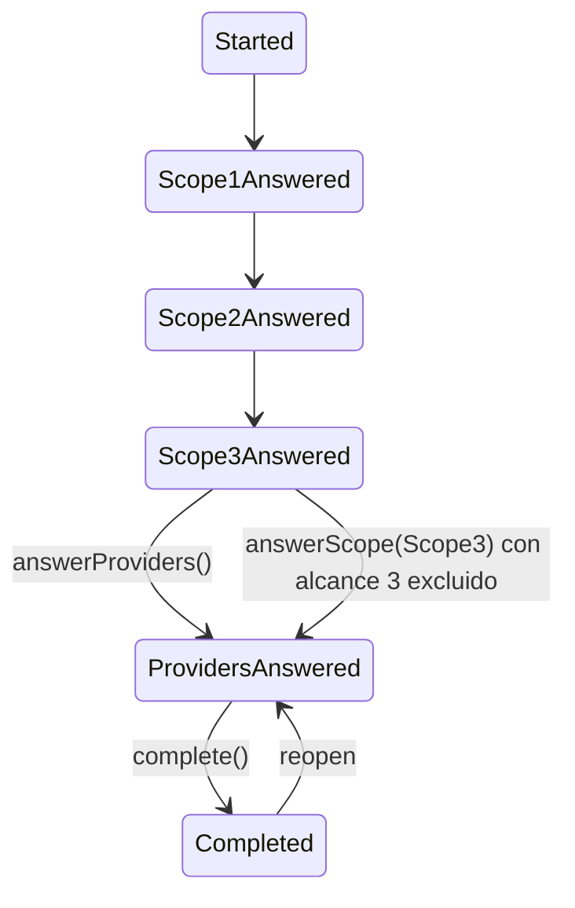

# Alcance 3 · Recogida de datos de proveedores — manual técnico

- **Plan:** `plan.md` (misma carpeta) · **Implementado:** 2026-10-27 (correcciones de la review hasta 2026-10-28) · **Bounded Contexts:** `CarbonFootprint`, `EventOperations`, `Shared`

## Qué hace y por qué

El paso «Alcance 3» de las huellas de propiedad y de empresa solo admitía actividades tecleadas por el Propietario. Esta funcionalidad añade dos vías para incorporar datos que conoce el proveedor:

1. **Modo `manual`**: el Propietario teclea las emisiones que el proveedor le ha comunicado (concepto + cantidad en `kg` o `t` de CO₂eq).
2. **Modo `requested`**: el proveedor recibe un correo con un enlace público (`/carbon-footprint/provider-contribution/{token}`), acepta el tratamiento de datos y, por cada categoría, comunica emisiones o detalla actividades con las mismas tablas del Propietario.

Ambas vías se gestionan desde un paso nuevo del asistente, «Proveedores» (paso 4 de 6), que solo existe si el alcance 3 no está excluido por completo. Las decisiones están en la tabla «Decisiones tomadas» de `plan.md`. Las claves de diseño son:

- **El dato manual es una `Activity`** (`ReportedEmissionsActivity`, factor identidad), de modo que desglose, informe y mitigación lo suman sin tocar sus fórmulas.
- **Todo dato de proveedor se guarda en la huella con `ActivityPlacement::$providerId`** (y `propertyId` en empresa). Esto exigió añadir `providerId` a las actividades hijas de las huellas de propiedad y de empresa.
- **Agregado propio `OrganizationalProviderContribution`**, independiente de `ProviderContribution` (eventos), identificado por `CarbonFootprintReportSubjectType` + id de huella en texto (mismo esquema que `MitigationAction`).
- **El paso `Proveedores` es un estado nuevo** (`ProvidersAnswered`) entre `Scope3Answered` y `Completed`.

## Mapa de piezas

### Dominio (`src/CarbonFootprint/Domain/Model/`)

| Fichero | Rol | Estado |
|---|---|---|
| `Activity/ReportedEmissionsActivity.php` (+ `…Registered`, `…Updated`, `…Removed`, `Answer/ReportedEmissionsAnswer.php`) | Tipo de actividad «emisiones comunicadas»: `description` ≤ 255 (`MAX_DESCRIPTION_LENGTH`, `:16`), unidades `kg`/`t` (`allowedUnits()`, `:81`), `ensureValidDescription()` público | Nuevo |
| `Activity/ActivityType.php:25,46` | Caso `ReportedEmissions = 'reported_emissions'` y rama en `fromActivity()` | Modificado |
| `OrganizationalCarbonFootprint/OrganizationalCarbonFootprintStatus.php:13,40,53,65` | Estado `ProvidersAnswered`, `isProvidersAnswered()`, `stepNumber()` (1-6), `activeStepKey()` (`Scope3Answered` → `providers`, `ProvidersAnswered` → `mitigation-plan`) | Modificado |
| `OrganizationalCarbonFootprint/Scope.php:150,167,181` | `providerSources()`, `reportedSectionFor()`, `providerSectionsFor()` | Modificado |
| `OrganizationalCarbonFootprint/OrganizationalCarbonFootprintTrait.php:62,120,129` | `scope3Excluded()`, `removeActivitiesOfSource()` (movido desde empresa), `removeActivitiesOfProvider()` | Modificado |
| `PropertyCarbonFootprint/PropertyCarbonFootprint.php` (`:85` `answerScope`, `:109` `answerProviders`, `:164` `excludeSource`, `:217` `excludeStage`, `:269` `complete`) y `CompanyCarbonFootprint/CompanyCarbonFootprint.php` (`:92`, `:116`, `:429`) | Transición `ProvidersAnswered`, `complete()` exige ese estado, `reopen` vuelve a él | Modificado |
| `…/PropertyCarbonFootprintActivity.php`, `…/CompanyCarbonFootprintActivity.php`, `…ActivityAdded.php` ×2 | `providerId` nullable en la entidad hija, su placement y el payload del evento | Modificado |
| `…/PropertyCarbonFootprintProvidersAnswered.php`, `…/CompanyCarbonFootprintProvidersAnswered.php` | Eventos del paso | Nuevo |
| `OrganizationalProviderContribution/` (agregado, `…Source` hija, `…Id`, `…Repository`, `…Filter`, `ProviderContributionMode`, 8 eventos, 5 excepciones) | Agregado de la aportación | Nuevo |
| `ProviderContribution/ProviderContributionStatus.php:28` | `style()` (clase del badge); el enum se reutiliza | Modificado |

### Aplicación (`src/CarbonFootprint/Application/`)

| Fichero | Rol | Estado |
|---|---|---|
| `Activity/ReportedEmissionsEmissionFactorSelector.php`, `Activity/Catalog/ReportedEmissionsCatalogProvider.php`, `Activity/Answer/ReportedEmissionsAnswerHandler.php`, `Activity/Register|Update/…ReportedEmissionsActivity{Request,Response,Service}.php` | Piezas enchufables del tipo de actividad | Nuevo |
| `PropertyCarbonFootprint/AnswerProviders/`, `CompanyCarbonFootprint/AnswerProviders/` | Caso de uso del botón «Siguiente» del paso | Nuevo |
| `OrganizationalProviderContribution/OrganizationalCarbonFootprintLocator.php`, `LocatedOrganizationalCarbonFootprint.php` | Resuelve la huella (propiedad o empresa), delega la autorización en su authorizer, `ensureIsEditable()`, `save()` | Nuevo |
| `OrganizationalProviderContribution/OrganizationalProviderContributionAuthorizer.php` | `Owner` de la cuenta actual | Nuevo |
| `OrganizationalProviderContribution/{Register,ChangeSources,RecordManualEmissions,List,Show,Ignore,Resend,Remove}/` | Casos de uso del Propietario | Nuevo |
| `OrganizationalProviderContribution/{GetGeneralInfo,AnswerGeneralInfo,GetEmissions,AnswerEmissions,CalculateEmissions}/`, `OrganizationalProviderContributionAuthenticator.php` | Casos de uso del proveedor (sin `User`; autenticación por token) | Nuevo |
| `OrganizationalProviderContribution/ProviderContributionEmissionsCalculator.php`, `OrganizationalProviderContributionSummary.php` | Emisiones por categoría de una aportación (0 si está descartada) | Nuevo |
| `OrganizationalProviderContribution/CountedActivityReferences.php` | Quita de `activityReferences()` las actividades de proveedores con aportación descartada | Nuevo |
| `CarbonFootprint/EmissionsBreakdownBuilder.php`, `CarbonFootprint/DerivedSourceEmissionsCalculator.php`, `CarbonFootprintReport/Data/OrganizationalCarbonFootprintReportLinesBuilder.php`, `MitigationAction/MitigationEmissionSourcesBuilder.php` | Usan `CountedActivityReferences`; informe y mitigación nombran las comunicadas con el proveedor | Modificado |
| `CarbonFootprintReport/Data/ActivityItemNameResolver.php` | Para `ReportedEmissionsActivity`, `itemId()` nulo y nombre = `description()` | Modificado |
| `PropertyCarbonFootprint/GetScope/`, `CompanyCarbonFootprint/GetScope/` (Service + Response) | `providerContributions` en el alcance 3 | Modificado |

### Infraestructura

| Fichero | Rol | Estado |
|---|---|---|
| `Infrastructure/Persistence/Doctrine/Mapping/OrganizationalProviderContribution.*.orm.xml`, `Activity.ReportedEmissionsActivity.orm.xml`, `…PropertyCarbonFootprintActivity.orm.xml`, `…CompanyCarbonFootprintActivity.orm.xml`, `Activity.Activity.orm.xml` | Mappings y discriminador `reported_emissions` | Nuevo / Modificado |
| `Infrastructure/Persistence/Doctrine/Type/OrganizationalProviderContribution{,Source}IdType.php`, `config/packages/doctrine.yaml` | Tipos de id | Nuevo / Modificado |
| `Infrastructure/Persistence/Doctrine/Repository/DoctrineOrganizationalProviderContributionRepository.php`, `Infrastructure/Persistence/InMemory/Repository/InMemoryOrganizationalProviderContributionRepository.php` | Repositorios (filtran `removed`) | Nuevo |
| `Infrastructure/UI/Web/{Property,Company}CarbonFootprint/Step/ProvidersController.php` | Paso «Proveedores» | Nuevo |
| `Infrastructure/UI/Web/{Property,Company}CarbonFootprint/Step/{Scope3,MitigationPlan,Results}Controller.php`, `…/EditController.php` | Redirecciones del asistente | Modificado |
| `Infrastructure/UI/Web/OrganizationalProviderContribution/{Register,Edit,Show,Resend,Ignore,Unignore,Remove}Controller.php`, `GetOrganizationalProviderContributionFromIdTrait.php`, `OrganizationalProviderContributionRoutes.php` | Pantallas de la aportación (una clase, dos `#[Route]` con `defaults.subjectType`) | Nuevo |
| `Infrastructure/UI/Web/Public/OrganizationalProviderContribution/{Entry,General,Emissions,Answered,CalculateEmissions}Controller.php`, `OrganizationalProviderContributionPublicControllerTrait.php` | Flujo público del proveedor | Nuevo |
| `Infrastructure/Symfony/Form/RegisterOrganizationalProviderContributionType.php`, `ChangeOrganizationalProviderContributionSourcesType.php` | Formularios de alta y de categorías | Nuevo |
| `Infrastructure/UI/Web/EventCarbonFootprint/Step/Answer/ReportedEmissionsAnswerHttpMapper.php`, `Step/View/ReportedEmissionsRowViewFactory.php`, `Step/View/ActivityRowView.php` | Mapeo HTTP y fila (`description`) | Nuevo / Modificado |
| `Infrastructure/Notification/OrganizationalProviderContributionNotifiedMailer.php` | Correo directo al proveedor | Nuevo |
| `src/EventOperations/Domain/Event/Provider/RegisterUserOnProviderRegisteredSubscriber.php:63` | `welcome: false` | Modificado |
| `src/Shared/Infrastructure/UI/Web/Navigation/NodeLister.php:600` | Nodo de primer nivel «Proveedores» para el Propietario | Modificado |
| `config/packages/security.yaml:74` | `PUBLIC_ACCESS` para `^/[a-z]{2}/carbon-footprint/provider-contribution` | Modificado |
| `assets/controllers/source_mode_controller.js` | Stimulus `source-mode` (muestra el bloque del modo elegido y deshabilita el oculto) | Nuevo |

### Plantillas (`templates/`)

`carbon_footprint/{property,company}_carbon_footprints/step/providers.html.twig`, `…/wizard-layout.html.twig` ×2, `…/step/{mitigation-plan,results}.html.twig` ×2, `carbon_footprint/organizational_carbon_footprints/provider_contributions/{register,edit,show,_macros}.html.twig`, `…/_scope_3_provider_contributions.html.twig`, `…/_scope_3_tables.html.twig` (mapa categoría → tablas compartido por Alcance 3, detalle y flujo público), `carbon_footprint/public/provider_contribution/{layout,general,emissions,answered,closed,invalid,_source_mode}.html.twig`, `carbon_footprint/emails/organizational_provider_contribution_requested.html.twig`, `carbon_footprint/translations/{providerContributionMode,providerContributionStatus}.html.twig`, `components/CarbonFootprint/ReportedEmissionsActivity{Table,Row}.html.twig`, `components/List/Action/{Resend,Ignore,Unignore}.html.twig`.

## Modelo de dominio

### Estado del asistente



- `advancedTo()` nunca retrocede (`OrganizationalCarbonFootprintStatus.php:77`), por lo que volver a incluir el alcance 3 no devuelve la huella a `Scope3Answered`.
- `answerProviders()` (`PropertyCarbonFootprint.php:109`, `CompanyCarbonFootprint.php:116`) exige edición, es idempotente y publica `…ProvidersAnswered`.
- `answerScope(Scope3)` con `scope3Excluded` llama a `answerProviders()` en el mismo comando. `AnswerXxxScopeService` aplica antes la exclusión, así que el flag ya está fijado.
- `complete()` lanza `OrganizationalCarbonFootprintNotReadyToCompleteException` si el estado no es `ProvidersAnswered` (`PropertyCarbonFootprint.php:273`, `CompanyCarbonFootprint.php:433`).
- `isScope3Answered()` incluye `ProvidersAnswered`; `isProvidersAnswered()` es verdadero en `ProvidersAnswered` y `Completed`.

### Categorías ofrecidas

`Scope::providerSources()` (`Scope.php:150`) devuelve solo para `Scope3`: bienes y servicios (1), bienes de capital (2), transporte aguas arriba (4), residuos (5), viajes de negocios (6), desplazamientos de empleados (7), transporte aguas abajo (9) y fin de vida de productos vendidos (12). `reportedSectionFor($source)` crea la sección `"{source}_reported"` de tipo `ReportedEmissions` y lanza `InvalidArgumentException` fuera de esa lista. `providerSectionsFor($sources)` concatena las secciones normales de cada fuente y su sección comunicada.

### `ReportedEmissionsActivity`

Hereda de `Activity` (herencia `JOINED`, tabla `reported_emissions_activities`). Emisiones = cantidad convertida a kg × 1: el factor es identidad (año y grupo de la huella, `Unit::Kilogram`, fuente `reported`, ver `ReportedEmissionsEmissionFactorSelector`). El manejador (`ReportedEmissionsAnswerHandler`) convierte con `Quantity::convertTo(Unit::Kilogram)` y rechaza unidades distintas de `kg`/`t`. `description` vacía tras `trim` o > 255 lanza `InvalidArgumentException`.

### `OrganizationalProviderContribution`

Campos relevantes (`OrganizationalProviderContribution.php:28`): `subjectType`, `carbonFootprintId` (string), `accountId`, `providerId`, `propertyId` (solo huella de empresa), `mode`, `token` (nulo en `manual`; `token()` devuelve `''`), `status` (`ProviderContributionStatus`), `answeredAt`, `ignoredAt`, `companyName`, `service`, `consentProof`, `removed`, colección `sources`.

| Operación | Evento | Reglas |
|---|---|---|
| `register()` | `…Registered` | `sources` no vacío y ⊆ `providerSources()` (`assertValidSources`, `:393`); en `requested` el token no puede ser vacío. En `manual` nace `Answered` con `answeredAt` (`:326`) |
| `changeSources()` | `…SourcesChanged` | Mismas validaciones |
| `answer()` | `…Answered` | Idempotente |
| `ignore()` / `unignore()` | `…Ignored` / `…Unignored` | `unignore` vuelve a `Answered` si hay `answeredAt`, si no a `Pending` (`:354`) |
| `resendNotification()` | `…NotificationResent` | `\LogicException` si es `manual` o está descartada |
| `updateGeneralInfo()`, `grantConsent()` | `…GeneralInfoUpdated`, `…ConsentGranted` | Flujo público |
| `remove()` | `…Removed` | Baja lógica (`removed`) |

Excepciones de dominio: `…TokenInvalidException`, `…IgnoredException`, `…ClosedException` (huella completada), `…AlreadyExistsException`, `…ConsentRequiredException`.

Una aportación activa por (huella, proveedor): la garantiza `RegisterOrganizationalProviderContributionService` con `findActiveByFootprintAndProvider()`; no hay índice único porque la baja es lógica.

### Efecto de «descartar»

`CountedActivityReferences::of()` filtra las `ActivityReference` cuyo `providerId` tiene una aportación `Ignored` de esa huella. Solo se aplica a huellas de propiedad y de empresa. `ProviderContributionEmissionsCalculator` devuelve 0 por categoría si la aportación está descartada. Las actividades siguen guardadas; al reactivar vuelven a contar.

## Flujo de una operación

### Alta (Propietario)

`RegisterController` (`/property-carbon-footprints/{carbonFootprintId}/providers/register` y su equivalente `company-…`) → `OrganizationalCarbonFootprintLocator::locate()` + `denyUnlessCanDoThat(Edit)` → formulario `RegisterOrganizationalProviderContributionType` (proveedores de la cuenta vía `ListProvidersService`, propiedades consolidadas vía `CompanyProperties::consolidated()` solo en empresa) → `RegisterOrganizationalProviderContributionService`:

1. Autoriza `Edit` sobre la huella y `ensureIsEditable()` (huella no completada).
2. Valida proveedor existente, no eliminado y de la misma cuenta; en `requested`, con `userId()` (si no, «Provider has no linked user»).
3. `ensureValidProperty()`: en huella de propiedad `propertyId` debe ser nulo; en empresa, nulo o consolidada.
4. Rechaza duplicado activo (`AlreadyExistsException`).
5. `register()` con `generateToken()` (`bin2hex(random_bytes(32))`) si `requested`, `companyName = provider->name()`.
6. Redirección: `manual` → pantalla de edición; `requested` → paso «Proveedores».

El suscriptor `OrganizationalProviderContributionNotifiedMailer` escucha `…Registered` (solo `requested`) y `…NotificationResent`, y envía el correo con `EmailSender` dentro de `LocaleSwitcher::runWithLocale()` en el idioma preferido del contacto, con `BrandingResolver` de la cuenta del proveedor. No envía si el proveedor no tiene email. El HTML del correo escapa los nombres con `|e` (review M2).

### Edición y datos manuales (Propietario)

`EditController`: formulario `ChangeOrganizationalProviderContributionSourcesType` + tablas `reported[<source>][i][description|quantity|unit|activityId]` en POST crudo dentro del mismo `<form>`.
En modo manual, antes de tocar nada, mapea las filas con `StageAnswerHttpMapper` contra las secciones de las categorías **nuevas** y las valida con `ensureValidRows()` (cobertura, tipo y `ReportedEmissionsActivity::ensureValidDescription()`). Después llama a `ChangeOrganizationalProviderContributionSourcesService` (retira de la huella las actividades de las categorías que dejan de cubrirse) y a `RecordOrganizationalProviderContributionManualEmissionsService`, que sincroniza con `StageAnswersSynchronizer::sync(huella, Scope3, respuestas, $user, providerSectionsFor(fuentes), providerId, false, propertyId)` y guarda la huella. Si algo falla (`\InvalidArgumentException`) se muestra el flash de error y se repinta el formulario con las filas tecleadas (`submittedReportedRows()`); no hay redirección. Con la huella completada el formulario se pinta deshabilitado y el POST redirige al paso con aviso.

### Flujo público (proveedor)

| Ruta (`/carbon-footprint/provider-contribution/{token}`) | Controlador | Comportamiento |
|---|---|---|
| `` (GET) | `EntryController` | Autentica; si la huella está completada responde `closed` (409); redirige a `/general` si no hay consentimiento, si no a `/emissions` |
| `/general` (GET, POST) | `GeneralController` | Empresa, servicio y consentimiento (`ConsentRequestReader`); CSRF `provider_contribution_general_<token>`; `AnswerOrganizationalProviderContributionGeneralInfoService` registra `ConsentProof` con `%app.consent_policy_version%` |
| `/emissions` (GET, POST) | `EmissionsController` | Por categoría, radio `mode[<source>]` = `reported` \| `activities`. El POST exige modo en todas las categorías (`hasModeForEverySource()`), vacía las secciones del modo no elegido (`isChosen()`) y llama a `AnswerOrganizationalProviderContributionEmissionsService`. CSRF `provider_contribution_emissions_<token>` |
| `/answered` (GET) | `AnsweredController` | Agradecimiento |
| `/emissions/calculate` (POST) | `CalculateEmissionsController` | Vista previa AJAX de una actividad; error de divisa → JSON 422 |

`AnswerOrganizationalProviderContributionEmissionsService` valida en este orden: token (`authenticate()`) → `ensureIsEditable()` (409 si la huella está completada) → `hasConsent()` (si no, `ConsentRequiredException`, que el controlador convierte en redirección a `/general`) → coherencia de secciones y tipos → `sync()` con el `User` técnico del proveedor → guarda huella → `answer()` → guarda aportación. Los GET de `Entry`, `General` y `Emissions` con huella completada devuelven `closed.html.twig` con 409 (review B2).

`OrganizationalProviderContributionAuthenticator::authenticate()` responde con `TokenInvalidException` (404 `invalid.html.twig`) si el token no existe o la aportación es `manual`, `IgnoredException` (también 404) si está descartada, y `TokenInvalidException` si el proveedor ya no tiene usuario técnico. Los limitadores son los de eventos (`provider_contribution_token`, `provider_contribution_invalid_token`, `config/packages/rate_limiter.yaml`).

### Paso «Proveedores»

`ProvidersController` (`property_carbon_footprints_providers`, `company_carbon_footprints_providers`):

- Si el alcance 3 no está respondido, redirige hacia atrás. Si `scope3Excluded()` y el estado aún no es `ProvidersAnswered` (huella antigua), redirige a `_scope_3` para que se guarde de nuevo (desviación registrada en `plan.md`).
- POST (CSRF `providers_<id>`): con la huella completada, aviso y redirección a resultados; si no, `AnswerXxxCarbonFootprintProvidersService` y redirección a «Medidas».
- GET: `ListOrganizationalProviderContributionsService` (resumen por aportación con proveedor, propiedad, emisiones por categoría y total, y `pendingCount()`).

Otras redirecciones: `Scope3Controller` ×2 va a `_providers` salvo `scope3Excluded()`, que va a `_mitigation_plan` (`PropertyCarbonFootprint/Step/Scope3Controller.php:89`). `MitigationPlanController` y `ResultsController` exigen `isProvidersAnswered()`. `EditController` ×2 resuelve `activeStepKey() === 'providers'`.

`wizard-layout.html.twig` ×2 oculta «Proveedores» con `providersStepShown = not scope3Excluded` y resta 1 a `wizard_active` cuando está oculto (condición `stepNumber >= 4`, review B10). Las plantillas de medidas y resultados calculan su `wizard_selected` por su cuenta porque la variable del layout no es visible en las hijas. El enlace «Anterior» de «Medidas» apunta a «Proveedores» o a «Alcance 3» según `scope3Excluded` (review M5).

### Exclusiones y bajas

`excludeSource()` y `excludeStage()` de la huella de propiedad usan ahora `removeActivitiesOfSource()` (en el trait), que recorre `activityReferences()` por alcance y fuente y por tanto también retira las actividades con proveedor. `RemoveOrganizationalProviderContributionService` llama a `removeActivitiesOfProvider()`, guarda la huella y da de baja la aportación. Las aportaciones y sus categorías se conservan al excluir.

## Autorización y ámbito

- **Pantallas del Propietario:** doble comprobación. `OrganizationalProviderContributionAuthorizer` (`canEdit`: rol `Owner` vía `userHasRole()` y `currentAccountId()` igual a la cuenta de la aportación; `canRegister`, `canView`, `canList` y `canRemove` delegan en `canEdit`) y el authorizer de la huella (`Action::Edit` para alterar, `View` para consultar) a través de `LocatedOrganizationalCarbonFootprint::denyUnlessCanDoThat()`. `Admin` y `User` reciben 403 (`PropertyCarbonFootprintAuthorizer.php:38-42` exige `Owner` para editar). Los controladores validan además que la aportación pertenece a la huella de la URL (404 si no, `GetOrganizationalProviderContributionFromIdTrait`).
- **Flujo público:** sin sesión; el token identifica la aportación y el usuario técnico del proveedor (rol `Provider`) firma las actividades. `ActivityAuthorizer` ya aceptaba al `Provider` de la misma cuenta. La ruta pública entra por `config/packages/security.yaml:74`.
- **Impersonación:** nada específico; se usa `currentAccountId()` y `userHasRole()` del `AbstractAuthorizer`.
- **Cierre de la huella:** con la huella completada, `ensureIsEditable()` lanza `OrganizationalProviderContributionClosedException` en todos los casos de uso que alteran. Las consultas siguen funcionando, incluida la de una aportación manual (review B3).
- **Correo de bienvenida:** `RegisterUserOnProviderRegisteredSubscriber.php:63` registra el usuario técnico con `welcome: false`.
- **Menú:** `NodeLister.php:600` añade «Proveedores» como nodo propio del Propietario, tras «Empresas» y antes de «Eventos»; el nodo «Eventos» ya no lo contiene.

## Persistencia y migración

Migración aplicada: `migrations/Version20261027181825.php` (la crea el usuario a mano; el borrador original estaba en `migration.sql`). Contiene:

- `organizational_provider_contributions`: `subject_type`, `carbon_footprint_id`, `account_id`, `provider_id`, `property_id` (nulo), `mode`, `token` (nulo, `UNIQUE`), `status`, fechas, `company_name`, `service`, columnas `consent_*`, `removed`; índices `IDX_opc_footprint (subject_type, carbon_footprint_id)` e `IDX_opc_account`.
- `organizational_provider_contribution_sources`: `contribution_id` (FK con `ON DELETE CASCADE`), `source`; único `UNIQ_opcs_contribution_source (contribution_id, source)`.
- `reported_emissions_activities` (`description` varchar 255).
- Columna `provider_id` nullable en `property_carbon_footprint_activities` y `company_carbon_footprint_activities`.

Sin columnas JSON y sin backfill: las huellas existentes en `scope_3_answered` quedan con el paso «Proveedores» pendiente y deben pulsar «Siguiente» (o guardar de nuevo el alcance 3 si está excluido) antes de completarse.

## Configuración y operación

- No hay variables de entorno nuevas. El consentimiento usa el parámetro existente `%app.consent_policy_version%`.
- Colas y comandos: no se añaden. El correo se envía de forma síncrona desde el suscriptor del evento (no es un `DeferredCommand`).
- Traducciones: dominios `providerContributionMode` y `providerContributionStatus` (con plantillas en `templates/carbon_footprint/translations/` y catálogos ES/EN/TR), claves nuevas en `messages`, `activityType` (`reported_emissions`) y `organizationalCarbonFootprintStatusType` (`providers_answered`). Se regeneran con `make translation`.
- Correo: plantilla `organizational_provider_contribution_requested.html.twig`; asunto «Aporta tus datos de emisiones de {year} para {subject}».
- Despliegue: ejecutar la migración (`make migrate`) y avisar a los Propietarios de que las huellas abiertas necesitan un clic en «Proveedores».

## Cómo extenderlo

**Ofrecer otra categoría a los proveedores:** 1) añadirla a `Scope::providerSources()` (`Scope.php:150`); 2) comprobar que la categoría tiene sección propia en `Scope::sections()` y rama en `_scope_3_tables.html.twig`; 3) no hace falta migración (la fuente se guarda como string). Los tests de `ScopeTest` fijan hoy el número de fuentes.

**Añadir un tipo de actividad detallable por el proveedor:** el proveedor solo ve las secciones que devuelve `providerSectionsFor()`; basta con que la categoría tenga la sección y el tipo esté registrado (selector, catálogo, manejador, mapeador, fábrica de fila y componentes Twig, con las etiquetas `AutoconfigureTag`).

**Pasar la funcionalidad a otro sujeto (p. ej. otro tipo de huella organizacional):** extender `CarbonFootprintReportSubjectType`, `OrganizationalCarbonFootprintLocator::locate()` y `OrganizationalProviderContributionRoutes`, y añadir `providerId` a la actividad hija de esa huella.

Trampas conocidas:

- Todo consumidor que sume actividades de una huella organizacional debe usar `CountedActivityReferences::of()` y no `activityReferences()`, o las aportaciones descartadas volverán a contar.
- `ActivityPlacement::equals()` distingue `providerId` nulo de informado: recuperar o retirar actividades exige el placement completo (incluido `propertyId` en empresa).
- Las rutas de las pantallas de aportación comparten clase para propiedad y empresa; los nombres de ruta de redirección deben salir de `OrganizationalProviderContributionRoutes`.
- `ActivityRowView::$itemId` es obligatorio: la fila comunicada usa `''` y `description`.
- `ShowController` tiene `requirements` en `contributionId` para no capturar `register`; mantenerlo si se cambia el orden de rutas.

## Tests

Unitarios (`tests/Unit/CarbonFootprint/`): `Domain/Model/Activity/ReportedEmissionsActivityTest`, `Domain/Model/OrganizationalProviderContribution/*` (agregado, repositorio Doctrine/InMemory), `Application/Activity/**/ReportedEmissions*`, `Application/{Property,Company}CarbonFootprint/AnswerProviders/*`, `Application/OrganizationalProviderContribution/**` (authorizer, authenticator, cada caso de uso, `CountedActivityReferencesTest`), `Application/CarbonFootprint/EmissionsBreakdownBuilderTest`, `Application/MitigationAction/MitigationEmissionSourcesBuilderTest`, `Application/CarbonFootprintReport/Data/OrganizationalCarbonFootprintReportLinesBuilderTest`, `Infrastructure/Notification/OrganizationalProviderContributionNotifiedMailerTest`, `Infrastructure/UI/Web/EventCarbonFootprint/Step/{Answer,View}/ReportedEmissions*Test`; y `tests/Unit/EventOperations/Domain/Event/Provider/RegisterUserOnProviderRegisteredSubscriberTest` (cobertura real del `welcome: false`).

Behat (`tests/Acceptance/CarbonFootprint/`): `property-carbon-footprint-providers-step.feature`, `company-carbon-footprint-providers-step.feature`, `organizational-provider-contribution-owner.feature`, `…-manual.feature`, `…-public.feature`, `company-carbon-footprint-provider-contribution.feature`; los pasos están en `CarbonFootprintContext.php`. Las features de mitigación, completar e informe usan ahora «with providers answered exists» como precondición.

Ejecución (objetivos del `Makefile`):

```
make test-unit options="--filter=OrganizationalProviderContribution"
make test-acceptance options="tests/Acceptance/CarbonFootprint/organizational-provider-contribution-public.feature"
make test-parallel
```

Huecos: el POST público sin consentimiento solo se cubre en unitario (sin consentimiento no hay token CSRF de sesión en Behat); el fallo propio de `RecordManualEmissions` dentro de la edición no tiene escenario (descartado como inalcanzable en la review, B17).

## Desviaciones y deuda

Ver `plan.md` (`## Implementación`) y `review.md`. Resumen del estado final:

- No quedan hallazgos abiertos en `review.md`. Descartados: B6 (el cálculo público admite tipos de actividad no cubiertos, por paridad con eventos) y B17.
- Q4 (aceptada): el flujo público de **eventos** sigue sin comprobar el consentimiento antes de guardar. Q5 (aceptada): al descartar una aportación su elemento desaparece de «Medidas» y las medidas con efectos sobre él quedan sin elemento hasta reactivarla.
- Diferencia con el plan, por M6: «Medidas» nombra las emisiones comunicadas de cada proveedor «{proveedor} · Emisiones comunicadas», con un elemento por proveedor y categoría (`MitigationEmissionSourcesBuilder.php:64-75,119`); el informe usa «{proveedor} · {concepto}» por fila (`OrganizationalCarbonFootprintReportLinesBuilder.php:57`).
- Deuda del `plan.md` no corregida: el usuario técnico del proveedor se registra antes de que el proveedor esté persistido (`RegisterUserOnProviderRegisteredSubscriber`).
