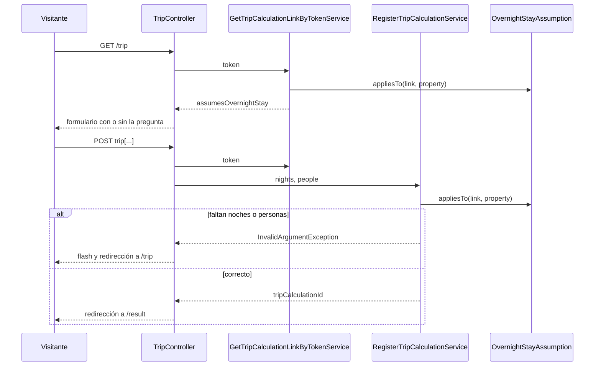

# Asumir la pernoctación en la calculadora de una propiedad de alojamiento — manual técnico

- **Plan:** [`plan.md`](plan.md) (misma carpeta) · **Revisión:** [`review.md`](review.md) · **Implementado:** 2026-11-27 · **Bounded Contexts:** `CarbonFootprint`, `Property`
- **Migración:** ninguna

## Qué hace y por qué

La calculadora pública de huella de una propiedad, con alcance `TripCalculationScope::Both`, preguntaba «¿Dormiste alguna noche fuera de tu casa?» y solo con «Sí» recogía noches y personas alojadas. En un alojamiento la pregunta sobra: ahora no se pinta, las noches y las personas se muestran desde el principio y son obligatorias (mínimo 1).

La condición no se configura ni se persiste: se deriva en cada petición del tipo de la propiedad.

```
asume pernoctación = enlace de propiedad ∧ alcance = both ∧ tipo ≠ null ∧ tipo ≠ Other
```

| Enlace | Alcance | Tipo de propiedad | ¿Pregunta por la pernoctación? | Noches y personas |
|---|---|---|---|---|
| Propiedad | `both` | cualquiera salvo `Other` | No | Visibles; noches ≥ 1 y personas exigidas |
| Propiedad | `both` | `Other` o `null` | Sí («No» por defecto) | Visibles con «Sí»; se acepta 0 noches |
| Propiedad | `overnight_stay` | cualquiera | No | Visibles; noches ≥ 1 y personas exigidas |
| Propiedad | `transport` | cualquiera | No | No se piden |
| Cuenta | `both` | — | Sí («¿Incluye noches de alojamiento?») | Visibles con «Sí»; se acepta 0 noches |

Las decisiones (qué cuenta como alojamiento, tratamiento del tipo nulo, noches obligatorias, calculadora de cuenta fuera) están justificadas en la tabla «Decisiones tomadas» del plan.

## Mapa de piezas

| Capa | Fichero | Rol | Estado |
|---|---|---|---|
| Dominio `Property` | `src/Property/Domain/Model/Property/PropertyType.php` | `isAccommodation()`: `match` exhaustivo sin `default` (`:63-81`) | Modificado |
| Dominio `Property` | `src/Property/Domain/Model/Property/PropertyInfo.php` | `isAccommodation()`: tipo nulo ⇒ `false` (`:56-59`) | Modificado |
| Aplicación | `src/CarbonFootprint/Application/TripCalculationLink/OvernightStayAssumption.php` | Regla única: `appliesTo(TripCalculationLink, ?Property): bool` | Nuevo |
| Aplicación | `src/CarbonFootprint/Application/TripCalculationLink/GetByToken/GetTripCalculationLinkByTokenResponse.php` | `bool $assumesOvernightStay = false` (último parámetro) | Modificado |
| Aplicación | `src/CarbonFootprint/Application/TripCalculationLink/GetByToken/GetTripCalculationLinkByTokenService.php` | Calcula el indicador en el enlace de propiedad (`:84`) | Modificado |
| Aplicación | `src/CarbonFootprint/Application/TripCalculation/Register/RegisterTripCalculationService.php` | Exige noches cuando se asume; carga la propiedad una sola vez | Modificado |
| UI pública | `src/CarbonFootprint/Infrastructure/UI/Web/Public/PropertyTrip/Step/TripController.php` | Interpreta el POST sin respuesta de pernoctación y pasa el indicador a la vista | Modificado |
| Plantilla | `templates/carbon_footprint/public/property_trip/step/trip.html.twig` | Oculta los radios, marca `required`, script tolerante | Modificado |

Sin cambios en agregados persistidos, `TripCalculationLink`, `TripCalculationScope`, `RegisterTripCalculationRequest`, rutas, `services.yaml` (la clase nueva es estática), traducciones, mappings ni pantallas privadas.

## Modelo de dominio

### `PropertyType::isAccommodation()`

Devuelven `true`: `Hotel`, `Aparthotel`, `VacationalHotel`, `ResortHotel`, `BusinessHotel`, `SpaHotel`, `RuralAccommodation`, `Camping`, `CityHotel`, `Flat`, `Hostel`, `Apartment`, `Motel`. Solo `Other` devuelve `false`. Al no haber rama `default`, un caso nuevo sin clasificar lo detecta PHPStan (y en ejecución lanzaría `\UnhandledMatchError`).

### `PropertyInfo::isAccommodation()`

`$this->propertyType?->isAccommodation() ?? false`. Ojo: `propertyType` es nulable pero su valor por defecto en el constructor es `PropertyType::Hotel` (`PropertyInfo.php:15`), y `Property` nunca devuelve un `info()` nulo.

### De dónde sale el tipo de cada propiedad

| Origen | Tipo resultante | Evidencia |
|---|---|---|
| Alta y edición web | El elegido en «Tipo de propiedad» (obligatorio; las opciones siguen el orden del enum, con `Hotel` primero) | `src/Property/Infrastructure/Symfony/Form/Type/PropertyInfoType.php:96-104`, `PropertyTypeType.php:19` |
| `new PropertyInfo()` sin tipo | `Hotel` | `PropertyInfo.php:15` |
| API de alta sin `propertyType` | `null` ⇒ no es alojamiento | `src/Property/Infrastructure/UI/Api/PropertyRegister/PropertyRegisterController.php:83` |
| API de casado (*match*) | El payload no lleva tipo, luego `Hotel`; al combinar prevalece el tipo que ya tuviera la propiedad, pero un tipo `null` pasa a `Hotel` | `PropertyMatchController.php:60`, `PropertyInfo.php:251`, `Property.php:216-236` |
| Importación sin tipo | `Other` | `src/Property/Application/Property/Import/PropertyInfoExtractor.php:79` |
| Importación con «riad» o «pensión» | `Other` | `PropertyType.php:51` |
| Importación con un texto no reconocido | `Hotel` | `PropertyType.php:39,57` |
| Importación de la plataforma Balance anterior | `Hotel` | `src/Balance/Infrastructure/UI/Console/LegacyImport/ImportLegacyBalanceCommand.php:759-760` |

El tipo también segmenta la referencia sectorial de indicadores (`KpiSubjectResolver::segmentKeyOf()`, `src/CarbonFootprint/Application/CarbonFootprintKpi/KpiSubjectResolver.php:34-37`): reclasificar una propiedad para recuperar la pregunta cambia también su segmento de comparación.

## Flujo de una operación

Rutas (`TripController.php:25-26`): `public_carbon_footprint_property_trip_trip` (`/carbon-footprint/property-trip/{token}/trip`) y `public_carbon_footprint_trip_trip` (`/carbon-footprint/trip/{token}/trip`), con el mismo controlador.



### Pintar el formulario

1. `TripController` aplica el limitador y llama a `GetTripCalculationLinkByTokenService`.
2. Para un enlace de propiedad el servicio carga la `Property`, comprueba `AccountFeature::PropertyTripCalculators` y rellena `assumesOvernightStay` (`GetTripCalculationLinkByTokenService.php:65-85`). El enlace de cuenta (`:42-63`) deja el `false` por defecto.
3. La plantilla define `asks_for_overnight = scope.asksForBoth and not assumesOvernightStay` (`trip.html.twig:26`), que gobierna:
   - los radios `trip[overnight]` (`:100-110`);
   - el atributo `required` de `trip[nights]` y `trip[people]` (`:116`, `:121`), ambos con `min="1"` y `value="1"`.
4. El script en línea (`:137-171`) se sigue emitiendo con `scope.asksForBoth` porque los radios de desplazamiento existen siempre. Solo toca `#trip-nights-block` si hay radios de pernoctación (`:154`, `:163`); sin esa guarda, `isYes()` fallaría al leer `radios[0]`.

La plantilla usa `strict_variables`: cualquier controlador que la renderice debe pasar `assumesOvernightStay`. Hoy solo lo hace `TripController.php:103-114`.

### Registrar el cálculo

1. El controlador deduce `$overnight` (`TripController.php:69-70`): alcance con pernoctación y (no es `both`, o se asume, o `trip[overnight] === 'yes'`). Con `$overnight` falso envía `nights: 0` y `people: null`; con `$overnight` verdadero, un campo vacío o `0` llega como `nights: 0` o `people: null` (`:78-79`).
2. `RegisterTripCalculationService` carga la propiedad justo después de obtener el alcance, con `propertyOf()` (`:63`, `:205-219`). Devuelve `null` para un enlace de cuenta y lanza `TripCalculationLinkTokenInvalidException` si la propiedad no existe.
3. Las noches son obligatorias si el alcance es `OvernightStay` **o** `OvernightStayAssumption::appliesTo()` (`:88-93`): `InvalidArgumentException('Debes indicar cuántas noches.')`. La regla preexistente de noches sin personas (`:95-97`) cubre «Debes indicar cuántas personas se alojaron.».
4. `destination()` (`:221-232`) reutiliza la propiedad ya cargada. Su guarda `null === $property` solo estrecha el tipo.
5. El controlador convierte la `InvalidArgumentException` en el flash «No se ha podido calcular tu huella: {error}» y redirige al formulario, que se pinta de nuevo con sus valores iniciales (`TripController.php:88-91`).

Consecuencia del orden: en un enlace cuya propiedad ya no existe, el error de token inválido se lanza antes que las validaciones de viajes y noches.

## Autorización y ámbito

- Casos de uso públicos por token: sin `Authorizer`, sin cuenta actual y sin roles. El acceso sigue dependiendo del token, de `AccountFeature::PropertyTripCalculators` (comprobada al leer el enlace), del CSRF `property_trip_{token}` y del limitador `carbon_footprint.property_trip_rate_limiter`.
- La validación en servidor impide saltarse la regla manipulando el POST.
- Quién puede cambiar el tipo no cambia: lo gobierna `PropertyAuthorizer` (`canEdit` = Owner de la cuenta con alguna funcionalidad de propiedades, o Admin; un distribuidor nunca edita propiedades adheridas).

## Persistencia y migración

Sin cambios de esquema ni de datos y sin backfill. El tipo ya se persistía en el embebido `PropertyInfo` (`src/Property/Infrastructure/Persistence/Doctrine/Mapping/Property.PropertyInfo.orm.xml:9`, `nullable="true"`). Los cálculos guardados no se tocan.

## Configuración y operación

- Sin variables de entorno, feature flags, colas, comandos ni tareas programadas nuevas.
- El cambio aplica en el despliegue a todos los enlaces y QR de propiedad ya publicados con alcance `both`.
- Conviene revisar antes de desplegar qué propiedades con calculadora activa tienen tipo `Hotel` sin ser alojamientos (es el valor por defecto): pasarán a exigir noches.
- Comprobación manual pendiente según `## Implementación` del plan: en un alojamiento con alcance `both`, el bloque de noches se ve al cargar y el de desplazamiento se sigue ocultando mientras no se conteste «Sí». Los tests no ejecutan el JavaScript.

## Cómo extenderlo

### Añadir un tipo de propiedad

1. Añadir el caso a `PropertyType`.
2. Clasificarlo en `PropertyType::isAccommodation()`; sin ello PHPStan marca el `match` incompleto.
3. Añadirlo en `PropertyTypeTest`: a `accommodationTypes()` si es alojamiento; si no, junto a `Other` en `testEveryTypeIsClassified` (y su propio test negativo). El test falla mientras la lista no cubra `PropertyType::cases()`.
4. Añadir su etiqueta en los catálogos `translations/propertyType+intl-icu.*.xlf`.
5. Si llega por importación, añadir su texto a `PropertyType::translate()`; un texto no reconocido acaba como `Hotel`.

No hace falta tocar `CarbonFootprint`: la regla se deriva del enum.

### Cambiar la condición de asunción

Tocar solo `OvernightStayAssumption::appliesTo()`. La consumen el servicio que pinta el formulario y el que registra el cálculo, así que no pueden divergir. No replicar la condición en Twig ni en el controlador.

### Extenderla a la calculadora de cuenta

No es un cambio de una línea: el destino lo elige el visitante en el mismo formulario, así que al pintarlo no se conoce la propiedad. Está fuera de alcance en el plan.

### Trampas conocidas

- Los pasos Behat `property :id is located at` y `property :id is in country` sustituyen el `PropertyInfo` entero (`tests/Acceptance/CarbonFootprint/CarbonFootprintContext.php:1941-1973`) y devuelven el tipo a `Hotel`: `property :id has type :type` se escribe siempre después.
- Las propiedades de test creadas sin `PropertyInfo` son `Hotel`, es decir, alojamientos.
- Un escenario que envíe `overnight:…` al formulario de un alojamiento falla porque el campo no existe, no en una aserción.
- «Debes indicar cuántas noches.» y «Debes indicar cuántas personas se alojaron.» no tienen entrada en los catálogos de `translations/`: se muestran en español en cualquier idioma. En el navegador, `required` y `min="1"` impiden normalmente llegar a ellos.

## Tests

| Fichero | Qué cubre |
|---|---|
| `tests/Unit/Property/Domain/Model/Property/PropertyTypeTest.php` | Clasificación de los 14 tipos y que la lista del test cubre el enum |
| `tests/Unit/Property/Domain/Model/Property/PropertyInfoTest.php` | Tipo por defecto, `Other` y sin tipo |
| `tests/Unit/CarbonFootprint/Application/TripCalculationLink/OvernightStayAssumptionTest.php` | Todas las combinaciones de la regla, incluido el enlace de cuenta |
| `tests/Unit/CarbonFootprint/Application/TripCalculationLink/GetByToken/GetTripCalculationLinkByTokenServiceTest.php` | Valor de `assumesOvernightStay` |
| `tests/Unit/CarbonFootprint/Application/TripCalculation/Register/RegisterTripCalculationServiceTest.php` | Noches y personas exigidas en alojamiento; 0 noches aceptadas en `Other` y con alcance `transport` |
| `tests/Acceptance/CarbonFootprint/property-trip-public.feature` | Alojamiento sin pregunta, noches obligatorias y propiedad `Other` que sigue preguntando |
| `tests/Acceptance/Property/PropertyContext.php:119-156` | Paso `property :id has type :type`, que conserva el resto de datos de la propiedad |

El resto de escenarios que contestaban «No» a la pernoctación declaran ahora la propiedad como `Other` (`property-trip-calculations.feature`, `property-trip-contact-request.feature`, `public-consent.feature`, `tests/Acceptance/Balance/project-contributions.feature` y `shared-credit-distributor.feature`).

Cómo ejecutarlos:

```bash
make test-unit options=tests/Unit/CarbonFootprint/Application/TripCalculationLink
make test-unit options=tests/Unit/CarbonFootprint/Application/TripCalculation/Register
make test-unit options=tests/Unit/Property/Domain/Model/Property
make test-acceptance options=tests/Acceptance/CarbonFootprint/property-trip-public.feature
make test-parallel
```

Huecos: el script de la plantilla no tiene cobertura automática.

## Desviaciones y deuda

Declarado en `## Implementación` de [`plan.md`](plan.md):

- `PropertyTypeTest` no usa un data provider sobre `cases()` (PHPStan rechazaba `assertIsBool`).
- En las features de `Balance` el paso `has type "Other"` va en el `Background`.
- `destination()` conserva la guarda de propiedad nula.
- `make test-this` no existe en el `Makefile`.
- Deuda no corregida: los pasos «is located at» e «is in country» reinician el `PropertyInfo`.

De [`review.md`](review.md): sin hallazgos abiertos. Los dos de severidad baja se corrigieron en la revisión 2:

- **B1**: `testEveryTypeIsClassified` compara ahora la lista del test con `PropertyType::cases()`.
- **B2**: el paso `property :id has type :type` conserva todos los datos de la propiedad. Se aparta de lo que prescribe el plan (§ Tests, que solo conservaba coordenadas y país); lo desfasado es el plan.
