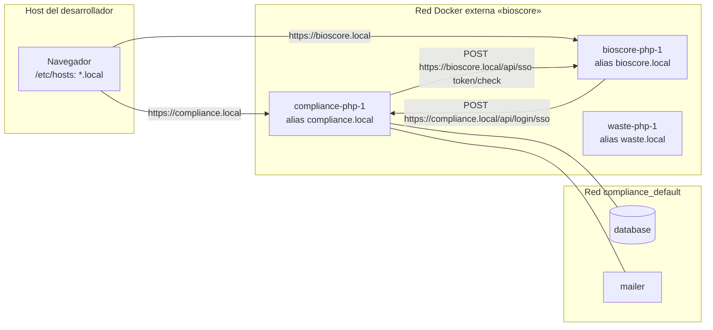

# SSO de Bioscore en local para todos los proyectos a la vez — manual técnico

- **Plan:** `plan.md` (misma carpeta) · **Implementado:** 2026-10-14 · **Bounded Contexts:** ninguno (entorno Docker de desarrollo). Consumidor: `Security` (`src/Security/Infrastructure/Sso/Bioscore/`, `src/Security/Infrastructure/UI/Api/LoginSso/`).

## Qué hace y por qué

La integración con Bioscore tiene dos sentidos: el proyecto valida contra Bioscore el token del inicio de sesión SSO (proyecto → Bioscore) y Bioscore llama a la API del proyecto (`POST /api/login/sso`, `/api/accounts`…) para sincronizar datos (Bioscore → proyecto). En local ninguno funcionaba: cada checkout levantaba su propio contenedor `bioscore-proxy` (`alpine/socat` en `network_mode: host`, escuchando en el 8088 del host), todos competían por ese puerto y el que lo ganaba reenviaba a `127.0.0.1:80`, donde no escuchaba nadie. En sentido inverso, Bioscore no alcanzaba los proyectos.

La solución sustituye el proxy por una **red Docker externa compartida llamada `bioscore`**. El contenedor `php` de Bioscore se une con el alias `bioscore.local` (plan `local-sso-shared-network` del repo de Bioscore, requisito previo) y el `php` de cada proyecto se une con un alias igual a su `SERVER_NAME` (`compliance.local`, `waste.local`…). Navegador (vía `/etc/hosts`) y servidores (vía el DNS embebido de Docker) usan las mismas URLs `https://<host>.local`, sin puertos publicados para Bioscore ni conflictos entre checkouts.

Las decisiones (mecanismo, nombre fijo de la red, creación idempotente desde `make up`, uso de `SERVER_NAME` como alias, esquema `https`, alcance solo de desarrollo) están razonadas en la tabla *Decisiones tomadas* de `plan.md`. Producción no cambia: `compose.prod.yaml`, `bin/deploy` y `.env` quedan intactos.

## Mapa de piezas

| Fichero | Rol | Estado |
|---|---|---|
| `Makefile:19` | `.PHONY` incluye `bioscore-network` | Modificado |
| `Makefile:29-30` | Target `bioscore-network`: crea la red `bioscore` si no existe (idempotente) | Nuevo target |
| `Makefile:32-33` | `up: bioscore-network` — la red se crea antes de `docker compose up --detach`; `start` (`Makefile:35`, `build up`) lo hereda | Modificado |
| `compose.override.yaml:20-22` | `extra_hosts` conserva solo `host.docker.internal:host-gateway`; se elimina `bioscore.local:host-gateway` | Modificado |
| `compose.override.yaml:24-28` | `php` se une a `default` y a `bioscore` con alias `${SERVER_NAME:-localhost}` | Nuevo bloque |
| `compose.override.yaml:50-52` | Declaración de la red `bioscore` como `external: true` | Nuevo bloque |
| `compose.override.yaml` | Eliminados `depends_on: [bioscore-proxy]` y el servicio `bioscore-proxy` | Eliminado |
| `.env.local` (no versionado, por checkout) | `SSO_URL=https://bioscore.local`, `SSO_API_URL=https://bioscore.local/api` | Manual |

Sin cambios, pero en los que se apoya la funcionalidad:

| Fichero | Por qué importa |
|---|---|
| `compose.yaml:5-9` | `env_file` inyecta `.env` y `.env.local` como variables reales del contenedor: `SSO_URL`/`SSO_API_URL` solo se sobrescriben en local desde `.env.local` (no desde `.env.dev`). |
| `Makefile:2` | `DOCKER_COMP = docker compose --env-file .env [--env-file .env.local]`: la interpolación de `${SERVER_NAME}` en `compose.override.yaml` ve el valor de `.env.local`. |
| `.env:52` | `SERVER_NAME=localhost` por defecto. |
| `.env:127-129` | `SSO_URL`, `SSO_PLATFORM=biohydra`, `SSO_API_URL` de producción (`https://sostenibilidad.bioscore.info`). |
| `config/packages/framework.yaml:20-25` | `when@dev`: `http_client.default_options.verify_peer/verify_host: false`, necesario para los certificados autofirmados de Caddy. |
| `src/Security/Infrastructure/Sso/Bioscore/HttpBioscoreClient.php` | Cliente que usa ambas URLs; registrado solo en `dev` y `prod` (`:11-12`). |
| `src/Security/Infrastructure/Symfony/DependencyInjection/services.yaml:190-194`, `:214-218` | Inyección de `$ssoUrl`, `$apiBaseUrl`, `$origin` en `when@dev` y `when@prod`. |

## Topología resultante



Solo `php` se une a la red compartida; `database` y `mailer` siguen únicamente en la red `default` del proyecto (`compose.override.yaml` no les añade `networks`).

## Flujo de una operación

### Arranque del entorno

1. `make up` → dependencia `bioscore-network` (`Makefile:29-30`): `docker network inspect bioscore` y, si falla, `docker network create bioscore`. Idéntico al target del repo de Bioscore, así que da igual cuál se arranque primero.
2. `$(DOCKER_COMP) up --detach` (`Makefile:33`): Compose resuelve la red `bioscore` como externa (`compose.override.yaml:50-52`) y conecta `php` con el alias `${SERVER_NAME:-localhost}` (`:24-28`).
3. Si Bioscore está apagado, el proyecto arranca igual: la red existe y el alias `bioscore.local` simplemente no resuelve.

### Inicio de sesión SSO (proyecto → Bioscore)

1. Navegador → `GET /login/sso/bioscore` (`src/Security/Infrastructure/UI/Web/Sso/SsoController.php:23`, sin prefijo de locale por el recurso `security-sso` de `config/routes.yaml:44-48`).
2. `HttpBioscoreClient::loginUrl()` (`HttpBioscoreClient.php:22-29`) construye `{SSO_URL}/{locale}/login-sso/{SSO_PLATFORM}` → `https://bioscore.local/es/login-sso/biohydra`. La resuelve **el navegador** por `/etc/hosts`.
3. Bioscore devuelve el navegador a `/login/sso/bioscore/callback?token=…` (`SsoController.php:41`).
4. `HttpBioscoreClient::checkToken()` (`:32-49`) hace `POST {SSO_API_URL}/sso-token/check` **desde el contenedor**: `bioscore.local` lo resuelve el DNS de Docker en la red `bioscore`. En `dev` el certificado autofirmado se acepta por `framework.yaml:20-25`. Cualquier excepción (DNS, TLS, timeout) se traga en el `catch (\Throwable)` y devuelve `false` (`:46-48`).

### Llamada de Bioscore al proyecto (Bioscore → proyecto)

`bioscore-php-1` resuelve `https://<SERVER_NAME>/` por el alias de la red y llega al Caddy del proyecto, que enruta por `Host: <SERVER_NAME>`. El endpoint de login es `POST /api/login/sso` (`src/Security/Infrastructure/UI/Api/LoginSso/LoginSsoController.php:20`, bajo el prefijo de la API).

## Configuración y operación

### `.env.local` de cada checkout (no versionado)

```dotenv
SERVER_NAME=compliance.local
SSO_URL=https://bioscore.local
SSO_API_URL=https://bioscore.local/api
```

- `SERVER_NAME` debe ser **un único host**: es el alias de red. Con el formato múltiple de Caddy (`a, http://a`) el alias sería inválido.
- `SSO_PLATFORM` no cambia (`biohydra`, `.env:128`).
- El host necesita `bioscore.local` y `<proyecto>.local` en `/etc/hosts`, y confiar en la CA local de Caddy de cada contenedor (`make trust`, `Makefile:55-56`) o aceptar la excepción del navegador.

### Comandos

| Comando | Efecto |
|---|---|
| `make bioscore-network` | Crea la red `bioscore` si no existe; idempotente |
| `make up` / `make start` | Crean la red y levantan los contenedores |
| `make down` | `down --remove-orphans` (`Makefile:38`): elimina también el `*-bioscore-proxy-*` huérfano de versiones anteriores |

Para migrar un checkout existente: ajustar `.env.local` y ejecutar `make down && make up`.

### Diagnóstico

- `docker network inspect bioscore` — debe listar `bioscore-php-1` y el `php` de cada proyecto levantado, con sus alias.
- Desde `make sh`: `getent hosts bioscore.local` y `curl -sk -o /dev/null -w '%{http_code}' https://bioscore.local/` (cualquier código distinto de `000`).
- Desde `bioscore-php-1`: `curl -sk -o /dev/null -w '%{http_code}' https://<SERVER_NAME>/`.

## Cómo extenderlo

- **Nuevo proyecto derivado de biohydra:** hereda `Makefile` y `compose.override.yaml`; basta con un `SERVER_NAME` único en su `.env.local`, la entrada en `/etc/hosts` y las URLs de Bioscore en `.env.local`. Del lado de Bioscore, sus URLs hacia el proyecto deben usar `https://<SERVER_NAME>`.
- **Otro servicio que deba hablar con Bioscore:** añadirle el mismo bloque `networks` (`default` + `bioscore`) en `compose.override.yaml`. Hoy solo `php` lo necesita.
- **Merge de biohydra en waste / food-loss / events:** en `compose.override.yaml` tomar la versión de biohydra del bloque de Bioscore y conservar lo propio de cada proyecto; después `make down && make up` para retirar su `bioscore-proxy`.

### Trampas conocidas

- **`docker compose up` sin `make`:** si la red no existe, Compose falla con `network bioscore declared as external, but could not be found`. `make up` la crea antes (verificado en `review.md`, Q2).
- **`extra_hosts` gana al DNS de Docker:** no volver a añadir `bioscore.local:host-gateway`, o el alias de la red nunca se usaría.
- **Nombre de servicio `php` compartido:** Compose registra también el nombre del servicio en la red compartida, así que en `bioscore` el nombre `php` resuelve a varios contenedores (el de Bioscore y el de cada proyecto). Hoy nada lo consume (la única referencia es `MERCURE_URL: ${CADDY_MERCURE_URL:-http://php/.well-known/mercure}`, `compose.yaml:14`, sin Mercure instalado), pero cualquier llamada futura por nombre de servicio debe apuntar al dominio `.local` del proyecto o a `localhost`, nunca a `php` (`review.md` B1, asumido en `review-fix.md`).
- **Dos checkouts con el mismo `SERVER_NAME`:** el DNS de Docker reparte entre ellos; levantar un checkout por host.
- **Sin `.env.local`:** el alias es `localhost`, inofensivo, pero Bioscore no alcanzará ese checkout.
- **`APP_ENV=prod` en local:** `verify_peer: false` solo aplica en `when@dev`; `checkToken()` fallaría por TLS y devolvería `false` sin error visible.

## Tests

No hay tests automáticos del entorno Docker. `HttpBioscoreClient` solo se registra en `dev` y `prod` (`#[When]`, `HttpBioscoreClient.php:11-12`); en `test` se usan los dobles `InMemory`, de modo que la suite no depende de la red. La suite completa se valida con `make test-parallel` (en verde según `## Implementación` y `review.md`: 1283 tests unitarios y 459 escenarios Behat). La verificación de la funcionalidad es manual, con los comandos de *Diagnóstico*.

## Desviaciones y deuda

- **Implementación** (`plan.md`, `## Implementación`): sin desviaciones en el repo. En el `.env.local` de compliance `SSO_URL`/`SSO_API_URL` se añadieron en vez de sustituirse, porque no existían.
- **No verificado:** dos checkouts levantados a la vez ni el callback con un token real (`review.md`, Q1, abierta en `review-fix.md`).
- **`review.md` B1** (colisión del nombre DNS `php` en la red compartida): asumible propuesto en `review-fix.md`, pendiente de validación del usuario; sin impacto hoy.
- Fuera de alcance: lado de Bioscore (su propio plan), rating y reporting (conservan sus proxies en Bioscore), producción y preproducción.
