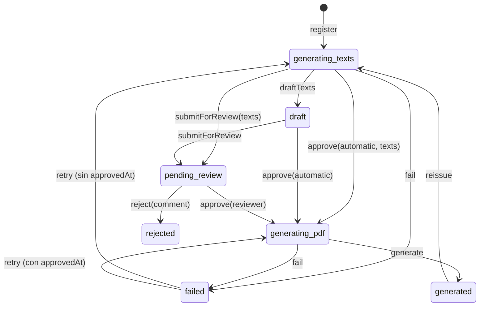

# Informe de huella de carbono con textos IA revisables y aprobación — manual técnico

- **Plan:** `plan.md` (misma carpeta) · **Implementado:** 2026-09-18 (revisado 2026-09-23) · **Bounded Contexts:** `CarbonFootprint` (informe genérico, completar/reabrir huellas organizacionales), `Security` (permisos de informe de la cuenta), `Shared` (motor PDF: índice, cifras clave, orientación; tema `Classic`), `EventOperations` (desbloqueo del evento por un Admin) · **Migración:** sí (`migrations/Version20260918170000.php`, a partir de `migration.sql`)

## Qué hace y por qué

Antes solo la huella de **eventos** tenía informe PDF: al completarse, un trabajo asíncrono pedía los textos a Gemini, los traducía y pintaba el PDF sin guardar los textos ni revisarlos. Ahora un único agregado `CarbonFootprintReport` sirve a las tres huellas (evento, propiedad y empresa), identificadas por `subjectType` + `carbonFootprintId`. Los textos que genera la IA se **persisten como secciones** en el idioma base y pasan por un flujo de estados gobernado por dos permisos de la cuenta que configura un Admin: **puede editar textos** (`canEditTexts`, por defecto `false`) y **autorrevisión** (`autoReview`, por defecto `true`). Con los valores por defecto el comportamiento visible para los clientes actuales no cambia: el informe se aprueba solo y se emite.

Si la cuenta puede editar, el Propietario corrige el borrador y lo envía a revisión o lo emite (si además tiene autorrevisión). Sin autorrevisión, un Admin o SuperAdmin lo revisa en el panel («Informes de huella»), puede editar los textos, y lo aprueba o lo rechaza con comentario obligatorio; **rechazar reabre la huella completa**. Tras aprobar, la IA traduce los textos al resto de idiomas y se genera un PDF por idioma, con índice y página de cifras clave. Las huellas de propiedad y empresa se **completan automáticamente al guardar el Alcance 2** (bloqueando la edición) y se pueden reabrir.

El PDF tiene dos maquetaciones elegidas por el **tema del branding** de la cuenta: la vertical de siempre (tema `default` y cualquier tema sin generador propio) y una **apaisada** que imita los informes corporativos de Bioscore (tema nuevo `Classic`, idéntico a `default` en colores y tipografía). Los colores y logotipos del PDF son siempre los de la plataforma (`PdfBranding::bioscore()`), no los de la marca blanca. Las justificaciones de cada decisión están en la tabla *Decisiones tomadas* de `plan.md`.

## Mapa de piezas

### `Security`

| Fichero | Rol | Estado |
|---|---|---|
| `src/Security/Domain/Model/Account/AccountReportPermissions.php` | Embeddable `canEditTexts` (false) / `autoReview` (true), `equals()` | nuevo |
| `src/Security/Domain/Model/Account/AccountReportPermissionsChanged.php` | Evento con `accountId`, `canEditTexts`, `autoReview` | nuevo |
| `src/Security/Domain/Model/Account/Account.php` | `reportPermissions()` (`:79`), `changeReportPermissions()` (`:155`, no publica si no cambia), `applyAccountReportPermissionsChanged` (`:214`) | modificado |
| `src/Security/Infrastructure/Persistence/Doctrine/Mapping/Account.AccountReportPermissions.orm.xml` | Mapping embebido con prefijo `report_` | nuevo |
| `src/Security/Application/Account/Update/UpdateAccountService.php` | `updateReportPermissions()` (`:101-112`): exige `Action::Admin` solo si cambian | modificado |
| `src/Security/Infrastructure/Symfony/Form/UpdateAccountType.php` (`:50-57`), `.../UI/Web/Admin/Account/EditController.php` (`:51-52`), `templates/security/admin/accounts/edit.html.twig` (`:24-26`) | Dos `BooleanType` bajo el título «Informe de huella de carbono» | modificados |

### `CarbonFootprint` — dominio

| Fichero | Rol | Estado |
|---|---|---|
| `Domain/Model/CarbonFootprintReport/CarbonFootprintReport.php` | Agregado translatable (un fichero por idioma) con secciones hijas y máquina de estados | renombrado y ampliado |
| `.../CarbonFootprintReportStatus.php` | `generating_texts`, `draft`, `pending_review`, `generating_pdf`, `generated`, `rejected`, `failed`; `style()` y predicados | renombrado |
| `.../CarbonFootprintReportSubjectType.php` | `event`, `property`, `company` | nuevo |
| `.../CarbonFootprintReportSectionKey.php` | Claves de sección, `requiredFor()`, `optionalFor()`, `label()` | nuevo |
| `.../CarbonFootprintReportSection.php` | Entidad hija (`report`, `key` como string, `content`, `position`) | nuevo |
| `.../CarbonFootprintReportTexts.php` | VO `sections: array<string,string>`, `get`, `has`, `isCompleteFor` | nuevo |
| `.../CarbonFootprintReportData.php`, `EventCarbonFootprintReportData.php`, `OrganizationalCarbonFootprintReportData.php` (+ `...ActivityLine`, `...ExclusionLine`) | Datos del informe por tipo | nuevo / movido |
| `.../CarbonFootprintReport{TextsGenerator,ChartsGenerator,PdfGenerator}.php` | Puertos genéricos | nuevos |
| `.../CarbonFootprintReport{Registered,TextsDrafted,TextsChanged,SubmittedForReview,Approved,Rejected,Translated,Generated,Reissued,Retried,Failed,Removed}.php` | Eventos | nuevos / renombrados |
| `.../CarbonFootprintReport{TransitionNotAllowed,TextsIncomplete,RejectionCommentRequired,AlreadyExists}Exception.php` | Excepciones | nuevas / renombrada |
| `.../CarbonFootprintReportFilter.php`, `...Repository.php`, `...Storage.php` | Filtro (`status`, `subjectType`, `accountId`), repositorio con `findBySubject`, almacenamiento de ficheros | nuevo / renombrados |
| `Domain/Model/CarbonFootprint/CarbonFootprint.php` | `isCompleted()` en la interfaz común | modificado |
| `Domain/Model/PropertyCarbonFootprint/PropertyCarbonFootprint.php` (`complete` `:176`, `reopen` `:192`), `CompanyCarbonFootprint/CompanyCarbonFootprint.php` | Completar y reabrir; eventos `*Completed` / `*Reopened` | modificados |
| `Domain/Model/OrganizationalCarbonFootprint/OrganizationalCarbonFootprint{NotReadyToComplete,NotCompleted}Exception.php` | Excepciones de completar/reabrir | nuevas |

### `CarbonFootprint` — suscriptores (`src/CarbonFootprint/Domain/Event/`)

| Fichero | Rol | Estado |
|---|---|---|
| `{Property,Company}CarbonFootprint/Complete*OnScopeAnsweredSubscriber.php` | Completa la huella al contestar `Scope2` con `LoggedUser` | nuevos |
| `{Event,Property,Company}CarbonFootprint/RegisterReportOn*CompletedSubscriber.php` | Registra informe; si hay uno en curso no hace nada; si hay otro lo elimina antes | nuevos / modificado |
| `{Event,Property,Company}CarbonFootprint/RemoveReportOn*ReopenedSubscriber.php` | Elimina el informe salvo que esté `rejected` | nuevos / modificado |
| `{Event,Property,Company}CarbonFootprint/RemoveReportOn*RemovedSubscriber.php` | Elimina informe y ficheros con `SystemActorResolver` | nuevos |
| `CarbonFootprintReport/ReopenCarbonFootprintOnCarbonFootprintReportRejectedSubscriber.php` | Reabre la huella del tipo correcto con el Admin que rechaza | nuevo |

### `CarbonFootprint` — aplicación

| Fichero | Rol | Estado |
|---|---|---|
| `Application/CarbonFootprintReport/CarbonFootprintReportAuthorizer.php` | Reglas por acción (ver *Autorización*) | renombrado |
| `.../CarbonFootprintReportSubjects.php` | Fachada `find()` / `reopen()` sobre las tres huellas | nuevo |
| `.../ReportPermissionsTrait.php` | `reportPermissions()` de la cuenta y `textsFrom()` (completa claves ausentes con el contenido actual) | nuevo |
| `.../Data/CarbonFootprintReportDataCollector{,Registry}.php` + `{Event,Property,Company}CarbonFootprintReportDataCollector.php`, `OrganizationalCarbonFootprintReportLinesBuilder.php`, `ActivityItemNameResolver.php`, `EventCompensationCollector.php` | Recogida de datos por tipo, sin authorizer de huella | nuevos / movidos |
| `.../{Register,GenerateTexts,UpdateTexts,SubmitForReview,Issue,Approve,Reject,GeneratePdf,Reissue,Retry,Download,Remove,List,GetForReview}/*` | Casos de uso | nuevos / renombrados |
| `Application/{Property,Company}CarbonFootprint/{Complete,Reopen}/*` | Completar y reabrir huellas organizacionales | nuevos |
| `Application/EventCarbonFootprint/Reopen/ReopenEventCarbonFootprintService.php` (`:34-38`) | Acepta `Edit` **o** `Admin` | modificado |
| `src/EventOperations/Application/Event/Unlock/UnlockEventService.php` (`:34-38`) | Acepta `Edit` **o** `Admin` (rechazo de informe de evento por un Admin) | modificado (review-fix D2) |

### `CarbonFootprint` — infraestructura

| Fichero | Rol | Estado |
|---|---|---|
| `Infrastructure/AI/GeminiCarbonFootprintReportTextsGenerator.php` | Genera y traduce; hasta 3 intentos (`MAX_ATTEMPTS`, `:22`) si faltan secciones obligatorias o hay caracteres de control | renombrado |
| `Infrastructure/AI/Gemini/{GenerateEventReportTextsPrompt,GenerateOrganizationalReportTextsPrompt,TranslateReportTextsPrompt}.php` | Prompts (organizacional: 4 claves obligatorias, `MAX_FACTOR_LINES = 120`, `temperature 0.3`, `GeminiModelTier::MEDIUM`) | renombrado / nuevo / modificado |
| `Infrastructure/Chart/ApexChartCarbonFootprintReportChartsGenerator.php` | Gráficas de evento y organizacionales (`bySource`, `byScope`, `byProperty`) | renombrado |
| `Infrastructure/Tcpdf/TcpdfCarbonFootprintReportPdfGenerator.php` | Maquetación vertical (evento y organizacional) | renombrado |
| `Infrastructure/Tcpdf/ClassicTcpdfCarbonFootprintReportPdfGenerator.php` | Maquetación apaisada Classic, sin gráficas | nuevo |
| `Infrastructure/Tcpdf/CarbonFootprintReportFiguresTrait.php` | Cifras clave y filas de tablas comunes a los dos generadores | nuevo |
| `Infrastructure/Tcpdf/ThemeAwareCarbonFootprintReportPdfGenerator.php` | Decorador que elige el generador por `themeSlug` | nuevo |
| `Infrastructure/Notification/CarbonFootprintReport{Generated,TextsDrafted,SubmittedForReview,Rejected}Notifier.php`, `EventCarbonFootprintReportOutdatedNotifier.php` | Avisos internos + email | nuevos / renombrado / modificado |
| `Infrastructure/Persistence/Doctrine/Mapping/CarbonFootprintReport.{CarbonFootprintReport,CarbonFootprintReportTranslation,CarbonFootprintReportSection}.orm.xml`, `Type/CarbonFootprintReportIdType.php`, `Repository/DoctrineCarbonFootprintReportRepository.php`, `InMemory/.../InMemoryCarbonFootprintReportRepository.php`, `Storage/{Local,InMemory}CarbonFootprintReportStorage.php` | Persistencia | renombrados / nuevo |
| `Infrastructure/Symfony/Form/{UpdateCarbonFootprintReportTextsType,ReviewCarbonFootprintReportType,ListCarbonFootprintReportsType}.php` | Formularios de textos, revisión y filtro | nuevos |
| `Infrastructure/Symfony/Twig/CarbonFootprintReportExtension.php` | `carbon_footprint_report(type, id)` y filtro `carbon_footprint_report_subject_name` | nuevo |
| `Infrastructure/UI/Web/CarbonFootprintReport/{Texts,Download,Reissue,Retry}Controller.php`, `CarbonFootprintReportResultsRoute.php`, `GetCarbonFootprintReportFromIdTrait.php` | UI del Propietario | nuevos |
| `Infrastructure/UI/Web/Admin/CarbonFootprintReport/{List,Review,Download}Controller.php` | UI Admin | nuevos |
| `Infrastructure/UI/Web/{Property,Company}CarbonFootprint/ReopenController.php`, `Step/{Scope1,Scope2,Results}Controller.php` | Reapertura y modo solo lectura | nuevos / modificados |
| `Infrastructure/Symfony/DependencyInjection/services.yaml` (`:34-60`) | Locales, storage, locator por tema, etiqueta Classic, alias del puerto PDF | modificado |

### `Shared`

| Fichero | Rol | Estado |
|---|---|---|
| `src/Shared/Infrastructure/Tcpdf/GenericGenerator.php` | `createPDF(..., $orientation)` (`:41`), `bookmark` (`:257`), `contentWidth` (`:262`), `renderTableOfContents` (`:269`), `renderKeyFigures` (`:285`), `renderKeyFigureValue` (`:343`), `renderSectionTitle(..., $bookmark)` (`:375`) | modificado |
| `src/Shared/Infrastructure/Tcpdf/PdfKeyFigure.php` | VO `label`, `value`, `unit` | nuevo |
| `src/Shared/Domain/Model/Branding/PdfBranding.php` | `secondaryHex()` | modificado |
| `src/Shared/Infrastructure/Theme/ClassicTheme.php` | Tema `classic` que delega `defaults()` en `DefaultTheme`, sin hoja de estilos | nuevo |
| `src/Shared/Infrastructure/UI/Web/Navigation/NodeLister.php` (`:361-365`) | Nodo «Informes de huella» en «Administración» | modificado |

### Plantillas y recursos

- `templates/components/CarbonFootprint/ReportStatus.html.twig` — tarjeta de estado del informe (una rama por estado).
- `templates/carbon_footprint/carbon_footprint_reports/texts.html.twig`, `templates/carbon_footprint/admin/carbon_footprint_reports/{list,review}.html.twig`, `templates/components/List/Action/Review.html.twig`.
- Asistentes: `templates/carbon_footprint/{event,property,company}_carbon_footprints/wizard-layout.html.twig` y `step/results.html.twig`; `step/scope-{1,2}.html.twig` de propiedad y empresa; listados `property_carbon_footprints/list.html.twig`, `company_carbon_footprints/list.html.twig`, `templates/event_operations/events/list.html.twig`.
- Notificaciones: `templates/carbon_footprint/notification/report-{generated,texts-drafted,submitted-for-review,rejected}.{notification,email}.html.twig`.
- Extracción de enums: `templates/carbon_footprint/translations/carbonFootprintReportStatus.html.twig`, `carbonFootprintReportSubjectType.html.twig`.
- `assets/images/carbon-footprint-report/classic/` — 17 imágenes copiadas de Bioscore.

## Modelo de dominio

### `CarbonFootprintReport`

Campos (`CarbonFootprintReport.php:27-45`): `id`, `subjectType`, `carbonFootprintId` (uuid como string), `accountId`, `status`, `requestedBy`, `baseLocale`, `errorMessage`, `submittedAt`, `approvedAt`, `autoApproved`, `reviewedBy`, `reviewedAt`, `reviewComment`, `registeredAt`, `generatedAt`, más `translations` (un `CarbonFootprintReportTranslation` con `filePath` por idioma) y `sections`. `texts()` (`:193`) devuelve las secciones ordenadas por `position`.

Transiciones (cualquier otra lanza `CarbonFootprintReportTransitionNotAllowedException` desde `ensureStatusIn`, `:518`):



Invariantes y dónde se validan:

- `changeTexts` solo en `draft` o `pending_review` (`:230-240`).
- `submitForReview` y `approve` exigen textos cuando el estado es `generating_texts` (`ensureTextsProvidedWhenGeneratingTexts`, `:525`) y que todas las claves de `CarbonFootprintReportSectionKey::requiredFor(subjectType)` tengan contenido tras `trim` (`ensureTextsAreComplete`, `:532` → `CarbonFootprintReportTextsIncompleteException`).
- `approve` (`:256-279`): la aprobación manual (`automatic: false`) solo desde `pending_review`; la automática nunca desde `pending_review` (guard de review-fix M1, `:265`), para que «Emitir informe» no pise una revisión en curso.
- `reject` (`:281-296`) solo desde `pending_review` y con comentario no vacío (`CarbonFootprintReportRejectionCommentRequiredException`).
- `reissue` borra secciones y datos de revisión pero **conserva las traducciones** (ficheros anteriores) hasta que se generan las nuevas (`applyCarbonFootprintReportReissued`, `:437`). `retry` vuelve a `generating_pdf` si hubo aprobación y a `generating_texts` (borrando secciones) si no (`:450-460`).
- Un informe por `(subject_type, carbon_footprint_id)` (índice único `UNIQ_CARBON_FOOTPRINT_REPORT_SUBJECT`).
- `replaceSections` (`:471-505`) elimina las secciones que no vienen, actualiza contenido y posición de las existentes (`CarbonFootprintReportSection::changeContent($content, $position)`) y crea las nuevas.

Secciones por tipo (`CarbonFootprintReportSectionKey.php`): evento → `executiveSummary`, `methodology`, `emissionFactorSources`, `analysisAndRecommendations` obligatorias y `compensation` opcional; propiedad y empresa → `purpose`, `regulatoryContext`, `sustainableDevelopmentGoals`, `conclusion`. `label()` da el rótulo ES que se usa como clave de traducción en formularios.

### Huellas organizacionales

`PropertyCarbonFootprint::complete(Emissions)` (`PropertyCarbonFootprint.php:176`) exige estado `Scope2Answered` (si no, `OrganizationalCarbonFootprintNotReadyToCompleteException`) y pasa a `Completed` con el total; `reopen()` (`:192`) exige `Completed` (`OrganizationalCarbonFootprintNotCompletedException`) y vuelve a `Scope2Answered` con total cero. Tras completar, `answerScope`, `addActivity`, `excludeSource`, etc. lanzan `OrganizationalCarbonFootprintAlreadyCompletedException` vía `ensureIsEditable()` (`OrganizationalCarbonFootprintTrait.php:212`). `CompanyCarbonFootprint` es idéntico.

### Permisos de informe de la cuenta

`AccountReportPermissions` (`canEditTexts = false`, `autoReview = true`). Se leen desde la aplicación con `ReportPermissionsTrait::reportPermissions()`: si la cuenta no existe, valores por defecto.

## Flujo de una operación

### Completar una huella → informe registrado

1. Evento: `CompleteEventCarbonFootprintOnEventCarbonFootprintAttendeesAnsweredSubscriber` (sin cambios). Propiedad/empresa: al guardar el Alcance 2, `Complete{Property,Company}CarbonFootprintOnScopeAnsweredSubscriber` (solo `Scope::Scope2`, `:33`) invoca `Complete*Service`, que autoriza `Edit`, calcula el total con `EmissionsBreakdownBuilder::build($fp, Scope::cases())->total` y llama a `complete()`.
2. `RegisterReportOn*CompletedSubscriber`: `findBySubject`; si hay informe `isInProgress()` no hace nada; si hay otro (p. ej. `rejected` o `generated`) lo elimina con `RemoveCarbonFootprintReportService`; después `RegisterCarbonFootprintReportService`.
3. `RegisterCarbonFootprintReportService` (`Register/...Service.php:43-86`): autoriza `View` con el authorizer de la huella del tipo, exige `isCompleted()` (`RuntimeException`), que no exista informe (`CarbonFootprintReportAlreadyExistsException`) y `accountId`; `register(..., baseLocale = primer locale de %app.locale_list%)`; despacha `DeferredCommand(GenerateCarbonFootprintReportTextsRequest, Priority::LOW)` (cola `async_low`).

### Generación de textos (asíncrona)

`GenerateCarbonFootprintReportTextsService` (`GenerateTexts/...Service.php`), sin authorizer:

1. Si el informe no está en `generating_texts`, sale (`:45`).
2. `CarbonFootprintReportDataCollectorRegistry::collect()` → datos del tipo; `textsGenerator->generate($data, baseLocale ?? primer locale)`; si faltan obligatorias, `RuntimeException`.
3. Reparto con los permisos vigentes **en ese momento** (`:83-89`): `canEditTexts` → `draftTexts` (`draft`); si no y `autoReview` → `approve(requestedBy, automatic: true, texts)` y se encola `GenerateCarbonFootprintReportPdfRequest`; si no → `submitForReview(texts)` (`pending_review`).
4. Ante excepción, `fail()` solo si el informe sigue en curso (`:52`, review-fix B2) y relanza.

### Edición del borrador por el Propietario

`TextsController` (`GET|POST /carbon-footprint-reports/{reportId}/texts`, `carbon_footprint_reports_texts`): `denyAccessUnlessGranted(Edit)`; si el informe no es `draft` o la cuenta no tiene `canEditTexts`, redirige a resultados con aviso (`:57-61`). El formulario `UpdateCarbonFootprintReportTextsType` pinta un `MarkdownEditorType` por clave (obligatorias con `NotBlank`, `compensation` opcional) y los botones `save`, `submitForReview` e `issue` (este último solo con `autoReview`). Según el botón:

- `save` → `UpdateCarbonFootprintReportTextsService` (`draft` exige `Edit` + `canEditTexts`; `pending_review` exige `Admin`) → `changeTexts`.
- `submitForReview` → `SubmitCarbonFootprintReportForReviewService` (`Edit` + `canEditTexts`).
- `issue` → `IssueCarbonFootprintReportService` (`Edit` + `canEditTexts` + `autoReview`) → `approve(automatic: true)` y encola el PDF.

`CarbonFootprintReportTextsIncompleteException` se muestra como error de formulario; `CarbonFootprintReportTransitionNotAllowedException` redirige con aviso (`:103-109`).

### Revisión del Admin

`ReviewController` (`GET|POST /admin/carbon-footprint-reports/{reportId}/review`, `#[IsGranted('ROLE_ADMIN')]`): si el informe no está `pending_review` redirige al listado con aviso (`:50-54`); carga la cabecera con `GetCarbonFootprintReportForReviewService` (`View`). Botones (`:83-98`):

- `approve` → `ApproveCarbonFootprintReportService` (`Admin`) con las secciones editadas → `generating_pdf` y encola el PDF.
- `reject` → si el comentario está vacío, `FormError` «Indica el motivo del rechazo.»; si no, guarda antes las ediciones (`UpdateTexts`) y llama a `RejectCarbonFootprintReportService` (`Admin`). `ReopenCarbonFootprintOnCarbonFootprintReportRejectedSubscriber` reabre la huella con el Admin (`CarbonFootprintReportSubjects::reopen`), lo que exige que los tres servicios de reapertura y `UnlockEventService` acepten `Admin`. El informe `rejected` sobrevive a la reapertura (`RemoveReportOn*ReopenedSubscriber` lo respeta) y se sustituye al volver a completar la huella.

### Generación del PDF (asíncrona)

`GenerateCarbonFootprintReportPdfService` (`GeneratePdf/...Service.php`), sin authorizer:

1. Solo en `generating_pdf` (`:45`).
2. Datos con el registry; tema con `BrandingResolver::resolve($report->accountId())->themeSlug` (`:64`).
3. Para cada locale: textos base o `textsGenerator->translate(base → locale)`; gráficas con `chartsGenerator->generate($data, $locale)`; `pdfGenerator->generate($data, $texts, $charts, $locale, $themeSlug)` (`:79-87`). Las traducciones no se guardan.
4. `storage->store()` + `translate()` por fichero, `generate()`, `add`; los temporales se borran en `finally` (`:95-99`).
5. `ThemeAwareCarbonFootprintReportPdfGenerator` (`#[AsDecorator]` sobre el generador vertical) busca en el locator `app.theme.report_generator` un generador para el slug que implemente el puerto; si no, usa el vertical.

### Otras operaciones del Propietario

- **Descargar** (`carbon_footprint_reports_download`): `DownloadCarbonFootprintReportService` exige `View` y `generated`; sirve `currentTranslation()` (idioma de la interfaz, con fallback al locale por defecto) como `informe-huella-carbono-{carbonFootprintId}-{locale}.pdf`. El Admin descarga por `admin_carbon_footprint_reports_download`.
- **Reemitir** (`carbon_footprint_reports_reissue`, GET con `#[CsrfProtected('carbon_footprint_report')]`): `Edit`, solo `generated`, vuelve a `generating_texts` y encola los textos.
- **Reintentar** (`carbon_footprint_reports_retry`, GET con el mismo CSRF): `Edit`, desde `failed`; encola PDF o textos según haya aprobación.
- **Reabrir cálculo** (`property_carbon_footprints_reopen` / `company_carbon_footprints_reopen`, POST con CSRF `reopen_{id}`): `Reopen*Service`, redirige al Alcance 1. `RemoveReportOn*ReopenedSubscriber` elimina el informe (salvo `rejected`).
- **Modo solo lectura**: `Step/Scope{1,2}Controller` de propiedad y empresa pasan `readOnly: isCompleted()` a la plantilla (sin botón de guardar ni «Cargar consumos de Bioscore») y rechazan el POST con aviso «La huella está completada. Reábrela para modificarla.» (`Scope1Controller.php:48-49,88`).

## Autorización y ámbito

`CarbonFootprintReportAuthorizer.php`:

| Acción | Regla |
|---|---|
| `List`, `Register` | Owner y cuenta actual (`currentAccountId`) igual a la del informe (`:25-36`) |
| `Edit` | Owner de la cuenta actual (`:38-53`) |
| `View` | `Edit` **o** `Admin` (`:20-23`) |
| `Remove` | `Edit` **o** `Admin` (`:55-58`; desviación declarada: los suscriptores de borrado actúan con el actor de sistema) |
| `Admin` | Por defecto de `AbstractAuthorizer`: `Admin` o `SuperAdmin` |

- El listado admin se autoriza con `Admin` sobre un agregado vacío (`ListCarbonFootprintReportsService`), además de `#[IsGranted('ROLE_ADMIN')]` en los controladores Admin.
- Editar textos exige además el flag de la cuenta (`canEditTexts`) en `draft`; en `pending_review` solo `Admin`. Un Admin no puede editar un borrador del Propietario ni un Propietario un informe en revisión.
- La impersonación funciona por `currentAccountId`: un Admin que impersona como Owner actúa como Propietario de esa cuenta.
- El rol `User` no tiene acceso al informe.
- Los flags de la cuenta solo los cambia un Admin/SuperAdmin (`UpdateAccountService::updateReportPermissions`, `Action::Admin`); el Propietario que edita su cuenta sin tocarlos no se ve afectado.
- Registrar el informe autoriza `View` sobre la **huella** con su propio authorizer; las recogidas de datos (textos, PDF, revisión) no llaman a servicios con authorizer de huella para que funcionen en la cola y con un Admin.

## Persistencia y migración

- `account`: `report_can_edit_texts` (0 por defecto al migrar) y `report_auto_review` (1), sin `DEFAULT` tras rellenar.
- `event_carbon_footprint_reports` → `carbon_footprint_reports`: `event_carbon_footprint_id` → `carbon_footprint_id`; nuevas `subject_type` (`event` para las filas existentes), `base_locale`, `submitted_at`, `approved_at`, `auto_approved`, `reviewed_by`, `reviewed_at`, `review_comment`; índice único `UNIQ_CARBON_FOOTPRINT_REPORT_SUBJECT (subject_type, carbon_footprint_id)` e índice `IDX_CARBON_FOOTPRINT_REPORT_STATUS`.
- `event_carbon_footprint_report_translation` → `carbon_footprint_report_translation` con índice `IDX_CARBON_FOOTPRINT_REPORT_TRANSLATION_REPORT` (declarado en el mapping, review-fix M2) y FK en cascada.
- Nueva `carbon_footprint_report_sections` con PK `(section_key, carbon_footprint_report_id)` (orden que deriva Doctrine, review-fix Q5), `content`, `position`, FK en cascada. `section_key` es `string` en el mapping (Doctrine no admite `enum-type` en un `<id>`); `CarbonFootprintReportSection::key()` devuelve el enum.
- Los informes `pending` pasan a `failed` con un mensaje que invita a reintentar. Sin backfill de huellas organizacionales: las que estaban en `scope_2_answered` se completan al volver a guardar el Alcance 2.
- Tipo Doctrine `carbon_footprint_report_id` en `config/packages/doctrine.yaml`.
- Ficheros: `%app.uploads_dir%/carbon-footprint-reports/{accountId}/{id}-{locale}.pdf` (`LocalCarbonFootprintReportStorage`).

La migración ya está creada como `migrations/Version20260918170000.php`. En la base de desarrollo donde se aplicó antes de la corrección Q5, `review-fix.md` («Migraciones pendientes») indica las dos sentencias para realinear la PK; `review.md` rev. 2 confirma que `doctrine:schema:validate` ya da el esquema sincronizado.

## Configuración y operación

- **Colas:** textos y PDF van a `async_low` (`Priority::LOW`). Antes de desplegar hay que vaciar `async_low`: la clase `GenerateEventCarbonFootprintReportRequest` ya no existe y el worker fallaría al deserializarla.
- **Locales:** `%app.locale_list%` (`LANGUAGE_LIST`) se inyecta en `Register`, `GenerateTexts` y `GeneratePdf` (`services.yaml:34-44`); el primero es el idioma base de los textos.
- **IA:** Gemini vía `GeminiClient` compartido; sin variables nuevas.
- **Gráficas:** ApexCharts por HTTP (`ApexChartHttpClient`), solo en la maquetación vertical.
- **Temas:** `ClassicTheme` se registra por el `_instanceof` de `Shared` (etiqueta `app.theme`) y aparece solo en el selector «Tema visual» de la personalización de la cuenta (Admin/SuperAdmin). El generador Classic lleva la etiqueta `{ name: 'app.theme.report_generator', theme: 'classic' }` y el puerto tiene alias explícito al generador vertical (`services.yaml:52-60`), obligatorio al haber dos implementaciones.
- **Notificaciones** (interna + email): `TextsDrafted` → solicitante («Textos del informe de huella listos para revisar», enlace a textos); `SubmittedForReview` → todos los Admin y SuperAdmin sin duplicados («Informe de huella pendiente de revisión», enlace a la revisión); `Rejected` → solicitante («Informe de huella rechazado», con comentario y enlace a resultados); `Generated` → solicitante («Informe de huella de carbono disponible», enlaces «Descargar informe» y «Ver resultados»). No se avisa al aprobar. El solicitante es el usuario que completó la huella (`requestedBy`), que no cambia al reemitir.
- **Previsualización de PDF:** `make test-unit` deja en `var/carbon-footprint-report-preview/{default,classic}/` `event-es.pdf`, `event-en.pdf`, `property-es.pdf` y `company-es.pdf` (`TcpdfCarbonFootprintReportPdfGeneratorTest`, `PREVIEW_DIRECTORY`).
- **Traducciones:** dominios nuevos `carbonFootprintReportStatus` y `carbonFootprintReportSubjectType`; se reutilizan `scope`, `source`, `phase` y `exclusionReason`. `make translation` necesita más memoria que la CLI dev por defecto (ver `## Implementación` del plan).
- **Documentación de temas:** `docs/themes.md` explica el punto de extensión del informe por tema.

## Maquetaciones del PDF

**Vertical** (`TcpdfCarbonFootprintReportPdfGenerator.php`): portada del trait con pie «BIOSCORE.INFO», páginas de contenido, **cifras clave** (tarjetas en 2 columnas), secciones que empiezan en página nueva y, al final, **índice** en la página 2 (`renderTableOfContents`, bookmarks desde `renderSectionTitle`). Evento (`:61-87`): datos del evento, resumen, metodología, resultados con gráficas, compensación, exclusiones, fuentes, análisis, anexo de factores y de trazabilidad. Organizacional (`:89-116`): datos de la huella, propósito, contexto normativo, ODS, emisiones incluidas por alcance, una tabla por fuente (instalaciones, vehículos, refrigerantes, electricidad con resultado por mercado y por localización), resultados con gráficas (por propiedad en empresa), conclusión y anexo.

**Classic** (`ClassicTcpdfCarbonFootprintReportPdfGenerator.php`): A4 apaisado (`createPDF(..., 'L')`, `:73`), sin gráficas. Portada (`renderClassicCover`, `:189`), primera página con el «1» (`:225`), cifras clave en 3 columnas con marcador (`renderClassicKeyFigures`, `:261`), páginas de texto con foto lateral (`renderTextPage`, `:268`), «Emisiones incluidas en cada alcance» (`:285`), páginas de datos con tablas de borde azul y cabeceras de grupo «Factores»/«Emisiones» (`renderDataPage`, `:352`; `buildClassicTableHtml`, `:549`), página «huella» con el total (`renderFootprintPage`, `:447`), tablas de resultados, conclusión, anexo sobre `no-background.jpg` (`:419`), contraportada con el lema (`:245`) e índice en la página 3 (`:92-94`). El chrome de página (`paintPageChrome`, `:609`) pinta cabecera «{sujeto}  |  {documento} {año}», logotipo, foto lateral opcional y «n / N»; los fondos alternos de las páginas de contenido son una **trama de puntos vectorial** (`paintDots`, `:662`, a izquierda o derecha según `nextDotsOnLeft`), no las imágenes `background-left.png`/`background-right.png`, que se copiaron pero no se usan. Los títulos largos se ajustan con `fitFont` (`:407`).

## Cómo extenderlo

**Nueva maquetación por tema:** 1) implementar `CarbonFootprintReportPdfGenerator` (puede usar `GenericGenerator` y `CarbonFootprintReportFiguresTrait`); 2) etiquetarlo en `services.yaml` con `app.theme.report_generator` y `theme: '<slug>'`; 3) si el tema es nuevo, crear la clase `Theme` en `Shared/Infrastructure/Theme/`. **No** declararlo alias del puerto. El decorador lo elegirá por el tema del branding de la cuenta.

**Nuevo tipo de sujeto** (p. ej. otra huella): 1) caso en `CarbonFootprintReportSubjectType` y en los `match` de `CarbonFootprintReportSectionKey::requiredFor/optionalFor`, `CarbonFootprintReportSubjects`, `RegisterCarbonFootprintReportService::authorizerFor` y `CarbonFootprintReportResultsRoute`; 2) un `CarbonFootprintReportDataCollector` (se autoetiqueta por interfaz) que devuelva un `CarbonFootprintReportData`; 3) prompt y rama en `GeminiCarbonFootprintReportTextsGenerator`, en las gráficas y en los dos generadores PDF (el `match` sobre el tipo de datos lanza `InvalidArgumentException` si no lo conoce); 4) suscriptores `RegisterReportOn*Completed`, `RemoveReportOn*Reopened` y `RemoveReportOn*Removed`; 5) el servicio de reapertura de la huella debe aceptar `Edit` o `Admin`; 6) traducción del caso en `carbonFootprintReportSubjectType`.

**Nueva sección de texto:** caso en `CarbonFootprintReportSectionKey` con `label()`, incluirlo en `requiredFor`/`optionalFor`, en el esquema del prompt correspondiente y en el pintado de los dos generadores. Los formularios de textos y revisión se generan a partir de las claves.

Trampas:

- Cualquier servicio que se ejecute en la cadena del rechazo (reapertura, desbloqueo de evento…) recibe al **Admin** como usuario: debe aceptar `Admin`, o el rechazo devuelve 403 (hallazgo D2).
- `LoggedUser` en los suscriptores de completado y rechazo exige sesión: no dispararlos desde consola o cola.
- `ReplaceScopeAnswers` (carga de consumos de Bioscore) **no** llama a `answerScope`, por eso cargar consumos no completa la huella; si se cambia, la completaría sin querer.
- `renderSectionTitle` añade un marcador de índice; el título del índice y las páginas sin entrada deben usar `bookmark: false`.
- El `CachedBrandingResolver` puede devolver el tema anterior durante su TTL en el worker si se acaba de cambiar el tema; se asume (basta reemitir).

## Tests

Unitarios (`tests/Unit/`):

- Dominio: `CarbonFootprint/Domain/Model/CarbonFootprintReport/{CarbonFootprintReportTest,CarbonFootprintReportSectionKeyTest,CarbonFootprintReportRepositoryTest,InMemoryCarbonFootprintReportRepositoryTest}.php`; `Infrastructure/Persistence/Doctrine/Repository/DoctrineCarbonFootprintReportRepositoryTest.php` (mismo contrato contra SQLite); tests de `complete`/`reopen` en las huellas de propiedad y empresa; `Security/Domain/Model/Account/AccountTest.php`.
- Aplicación: un test por servicio en `CarbonFootprint/Application/CarbonFootprintReport/**` (con `Fake*Generator` e `InMemoryCarbonFootprintReportStorage`), `CarbonFootprintReportAuthorizerTest`, colectores de datos (incluido el ejemplo numérico organizacional), `{Complete,Reopen}{Property,Company}CarbonFootprintServiceTest`, `ReopenEventCarbonFootprintServiceTest`, `UnlockEventServiceTest`, `UpdateAccountServiceTest`.
- Suscriptores: `CarbonFootprint/Domain/Event/**/{Complete*,RegisterReportOn*,RemoveReportOn*,ReopenCarbonFootprintOn*}Test.php`.
- Infraestructura: `GeminiCarbonFootprintReportTextsGeneratorTest` (reintentos, opcionales vacías), `ApexChartCarbonFootprintReportChartsGeneratorTest`, `TcpdfCarbonFootprintReportPdfGeneratorTest` (PDF reales y previsualización), `ThemeAwareCarbonFootprintReportPdfGeneratorTest`, los cinco notificadores, `Shared/Infrastructure/Theme/ClassicThemeTest.php`.

Aceptación (`tests/Acceptance/CarbonFootprint/`): `carbon-footprint-report-texts.feature`, `carbon-footprint-report-review.feature`, `carbon-footprint-report-status.feature` (una tarjeta por estado en los tres asistentes, rechazo real de propiedad y de evento, descargas desde los listados), `carbon-footprint-report-reissue.feature`, `property-carbon-footprint-complete.feature`, `company-carbon-footprint-complete.feature`; en `Security`, `account-edit.feature`, `branding-theme.feature` y `branding-edit.feature`.

Ejecución:

```bash
make test-this test=tests/Unit/CarbonFootprint/Application/CarbonFootprintReport
make test-acceptance options="tests/Acceptance/CarbonFootprint/carbon-footprint-report-review.feature"
make test
```

## Desviaciones y deuda

Declaradas en `## Implementación` de `plan.md` y en `review-fix.md`:

- `canRemove` admite `Edit` o `Admin`; `CarbonFootprintReportSection` guarda la clave como string; `changeContent` recibe la posición; `textsFrom()` completa cualquier clave ausente con el contenido actual (aceptado, Q2).
- En evento, el comentario de rechazo se muestra como alerta en todos los pasos del asistente (la huella reabierta vuelve a `Started` y Resultados no es accesible), no en la tarjeta de Resultados (A1).
- `UnlockEventService` acepta `Admin` para que el rechazo de un informe de evento desbloquee el evento (D2); el plan no lo contemplaba.
- La fila de total de las tablas Classic se marca por posición (`lastRowIsTotal`), no por el prefijo «Total» (B10).
- Acción de fila «Revisar» como componente propio `List/Action/Review.html.twig`.

Estado del código posterior a la revisión (no recogido en `plan.md`):

- El generador Classic sustituye los fondos `background-left.png`/`background-right.png` por una trama de puntos dibujada (`paintDots`); las dos imágenes siguen en `assets/images/carbon-footprint-report/classic/` sin uso.

Deuda abierta:

- Descartados por el usuario en `review-fix.md`: mensajes de `FormError` sin traducir (B6), orden de `TopAction:Return` en los asistentes (B8), dos tarjetas «Informe de huella de carbono» en resultados de evento cuando el informe está desactualizado (B9), `eventId` vacío en `CarbonFootprintReportResultsRoute` si no existe la huella (B15), consultas por fila del filtro de nombre en el listado admin (Q3).
- Un borrador de una cuenta a la que se retira «puede editar textos» queda sin salida hasta reabrir la huella (Q1, aceptado).
- Los residuos B3 y B16 que `review.md` rev. 2 marca como parciales están aplicados según `review-fix.md` (`generateByProperty` recibe el locale; existe `DoctrineCarbonFootprintReportRepositoryTest`).
- Duplicación entre `CarbonFootprintReportFiguresTrait`, el HTML de tablas Classic y `GenericGenerator` (`## Implementación`).
- El paso Behat `I go to :path with csrf token :tokenId` (`tests/Acceptance/Shared/WebContext.php:63`) solo funciona como primera petición tras el login.
