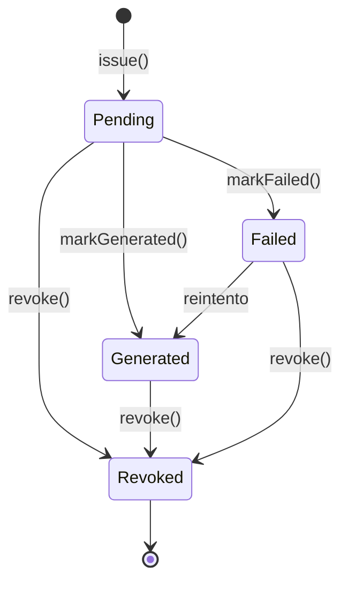

# Certificado de huella — manual técnico

- **Plan:** `plan.md` (misma carpeta) · **Implementado:** 2026-10-30 (con correcciones de `review.md` hasta la revisión 4) · **Bounded Contexts:** `CarbonFootprint` (todo el código), con reutilización de `Balance`, `Property`, `Security` y `Shared`

## Qué hace y por qué

Un hotel que ha completado la huella de carbono de una propiedad para un año puede emitir un **Certificado de huella**: un PDF por idioma que declara los kg de CO₂eq por **estancia** (pernoctación) del año, el total anual y su desglose por alcances 1, 2 y 3 (método de mercado), con un código legible y un QR. El QR y el código llevan a una página pública (`/{locale}/footprint-certificate/{token}`) cuyo único fin es confirmar que el PDF es auténtico y sigue vigente.

El agregado `PropertyCarbonFootprintCertificate` replica dentro de `CarbonFootprint` el patrón del certificado de aportación de `Balance` (`ContributionCertificate`): código y token generados, PDF por locale generado en diferido, almacenamiento local y verificación pública con límite de peticiones. Decisiones clave (tabla «Decisiones tomadas» de `plan.md`):

- Las estancias las teclea el Propietario al emitir; **no** se guardan en `PropertyCarbonFootprint`, solo en el certificado (foto fija). Los kg por estancia (`round(total / estancias, 2)`) se calculan y persisten al emitir.
- Solo se emite con la huella `completed` y su informe (`CarbonFootprintReport` de sujeto `property`) en `generated`, y solo si no hay ya un certificado vigente.
- No hay revocación manual: el certificado se revoca únicamente al reabrir la huella. Eliminar la huella borra certificados y ficheros.
- Sin caducidad, sin notificaciones y sin listado de administración (un Admin accede impersonando la cuenta).

## Mapa de piezas

| Capa | Fichero | Rol | Estado |
|---|---|---|---|
| Dominio | `src/CarbonFootprint/Domain/Model/PropertyCarbonFootprintCertificate/PropertyCarbonFootprintCertificate.php` | Agregado | Nuevo |
| Dominio | `…/PropertyCarbonFootprintCertificateFile.php`, `…FileId.php` | Entidad hija (locale + ruta) | Nuevo |
| Dominio | `…/PropertyCarbonFootprintCertificateId.php`, `…Status.php` | Id y enum `pending/generated/failed/revoked` | Nuevo |
| Dominio | `…/PropertyCarbonFootprintCertificateIssued.php`, `Generated`, `Failed`, `Revoked`, `Removed` | Eventos de dominio | Nuevo |
| Dominio | `…/PropertyCarbonFootprintCertificateRepository.php` | Puerto de persistencia | Nuevo |
| Dominio | `…/PropertyCarbonFootprintCertificateData.php`, `…PdfGenerator.php`, `…Storage.php`, `…CodeGenerator.php`, `…VerificationTokenGenerator.php`, `…VerificationUrlGenerator.php` | DTO del PDF y puertos | Nuevo |
| Dominio | `src/CarbonFootprint/Domain/Event/PropertyCarbonFootprint/RevokeCertificateOnPropertyCarbonFootprintReopenedSubscriber.php` | Revoca al reabrir | Nuevo |
| Dominio | `src/CarbonFootprint/Domain/Event/PropertyCarbonFootprint/RemoveCertificatesOnPropertyCarbonFootprintRemovedSubscriber.php` | Borra al eliminar la huella | Nuevo |
| Aplicación | `src/CarbonFootprint/Application/PropertyCarbonFootprintCertificate/PropertyCarbonFootprintCertificateAuthorizer.php` | Autorización del certificado | Nuevo |
| Aplicación | `…/PropertyCarbonFootprintNotCertifiableException.php`, `…AlreadyCertifiedException.php` | Excepciones de emisión | Nuevo |
| Aplicación | `…/Issue/`, `Generate/`, `Revoke/`, `Remove/`, `Download/`, `Verify/` (Request, Response, Service) | Casos de uso | Nuevo |
| Persistencia | `src/CarbonFootprint/Infrastructure/Persistence/Doctrine/Mapping/PropertyCarbonFootprintCertificate.PropertyCarbonFootprintCertificate.orm.xml`, `….PropertyCarbonFootprintCertificateFile.orm.xml` | Mappings | Nuevo |
| Persistencia | `…/Doctrine/Type/PropertyCarbonFootprintCertificateIdType.php`, `…FileIdType.php`; `config/packages/doctrine.yaml:84-85` | Tipos Doctrine | Nuevo / modificado |
| Persistencia | `…/Doctrine/Repository/DoctrinePropertyCarbonFootprintCertificateRepository.php`, `…/InMemory/Repository/InMemoryPropertyCarbonFootprintCertificateRepository.php` | Repositorios | Nuevo |
| Persistencia | `migrations/Version20261030085757.php` | Crea las dos tablas | Nuevo (aplicado por el usuario) |
| Infraestructura | `src/CarbonFootprint/Infrastructure/Tcpdf/TcpdfPropertyCarbonFootprintCertificatePdfGenerator.php`, `ThemeAwarePropertyCarbonFootprintCertificatePdfGenerator.php` | PDF A4 apaisado y decorador por tema | Nuevo |
| Infraestructura | `…/Storage/LocalPropertyCarbonFootprintCertificateStorage.php`, `InMemoryPropertyCarbonFootprintCertificateStorage.php` | Almacenamiento | Nuevo |
| Infraestructura | `…/Certificate/RandomPropertyCarbonFootprintCertificateCodeGenerator.php`, `…VerificationTokenGenerator.php`, `RouterPropertyCarbonFootprintCertificateVerificationUrlGenerator.php` | Generadores | Nuevo |
| Infraestructura | `…/Symfony/Form/IssuePropertyCarbonFootprintCertificateType.php`, `…/Symfony/Twig/PropertyCarbonFootprintCertificateExtension.php` | Formulario y función Twig | Nuevo |
| UI | `…/UI/Web/PropertyCarbonFootprintCertificate/IssueController.php`, `DownloadController.php`, `RetryController.php`, `GetPropertyCarbonFootprintCertificateFromIdTrait.php` | Controladores del Propietario | Nuevo |
| UI | `…/UI/Web/Public/PropertyCarbonFootprintCertificate/VerifyController.php` | Verificación pública | Nuevo |
| UI | `src/CarbonFootprint/Infrastructure/UI/Web/PropertyCarbonFootprint/Step/ResultsController.php` | Pasa `certificate`, `certificateForm`, `reportGenerated` | Modificado |
| Plantillas | `templates/carbon_footprint/property_carbon_footprints/step/_certificate.html.twig` | Tarjeta de Resultados | Nuevo |
| Plantillas | `…/step/results.html.twig`, `…/wizard-layout.html.twig`, `…/list.html.twig` | Include, acción de cabecera, acción de fila | Modificado |
| Plantillas | `templates/carbon_footprint/public/footprint_certificate/verify.html.twig`, `templates/components/List/Action/Certificate.html.twig`, `templates/carbon_footprint/translations/propertyCarbonFootprintCertificateStatus.html.twig` | Verificación, acción de fila, traducción del enum | Nuevo |
| Configuración | `src/CarbonFootprint/Infrastructure/Symfony/DependencyInjection/services.yaml:63-85`, `config/packages/security.yaml:81`, `translations/messages+intl-icu.{es,en,tr}.xlf` | Cableado, acceso público, textos | Modificado |

## Modelo de dominio

`PropertyCarbonFootprintCertificate` (`PropertyCarbonFootprintCertificate.php`) usa el trait `AggregateRoot`. Es una foto fija: copia de la huella el año, el nombre de la propiedad y de la cuenta, el total y los tres alcances (`scope3Co2eqKg` es `null` si el alcance 3 está excluido), más `stays` y `co2eqKgPerStay`. Guarda además `code`, `verificationToken`, `status`, `locale` de emisión, `failureReason`, `issuedAt`, `generatedAt`, `failedAt`, `revokedAt` y la colección `files` (`PropertyCarbonFootprintCertificateFile`, una por locale).

Eventos (todos con `propertyCarbonFootprintCertificateId`): `Issued` (payload completo, incluido `co2eqKgPerStay`), `Generated` (`files`: locale → ruta), `Failed` (`reason`), `Revoked`, `Removed`.

Invariantes y dónde se validan:

- `issue()` (`:195-243`) lanza `\InvalidArgumentException` con código o token vacíos o `stays < 1`; calcula `round($totalCo2eqKg / $stays, 2)`.
- `revoked` es terminal: `revoke()` (`:274`), `markGenerated()` (`:246`) y `markFailed()` (`:260`) retornan sin publicar si el estado ya es `Revoked`.
- `isValid()` equivale a `Generated`: al ser `Revoked` un estado propio, un certificado revocado nunca es válido.
- `fileFor(Locale)` (`:188`) devuelve el PDF del locale pedido, si no el del locale de emisión, si no `null`.

## Flujo de una operación

### Emitir

1. `POST /property-carbon-footprints/{propertyCarbonFootprintId}/certificate/issue` (`property_carbon_footprints_certificate_issue`, `IssueController.php:23`). Carga la huella, `denyAccessUnlessGranted(Edit)` y valida `IssuePropertyCarbonFootprintCertificateType`: `stays` con `NotNull`, `Positive` y `LessThanOrEqual(2147483647)` (límite del `INT` de la columna). Si el formulario no es válido, flash `danger` con el primer error y redirección a Resultados (`:44-50`).
2. `IssuePropertyCarbonFootprintCertificateService::__invoke` (`Issue/…Service.php:55`): autoriza con `PropertyCarbonFootprintAuthorizer` y `Action::Edit` sobre la huella (`:63`); `ensureCertifiable` (`:123-138`) exige huella completada, informe `generated` (`CarbonFootprintReportRepository::findBySubject`) y ausencia de certificado vigente (`findCurrentByPropertyCarbonFootprintId`); lanza `PropertyCarbonFootprintNotCertifiableException` o `PropertyCarbonFootprintAlreadyCertifiedException`.
3. El desglose por alcance sale de `EmissionsBreakdownBuilder::build($footprint, Scope::cases())->byStage` (`:67-70`); el total es `totalEmissions()->co2eq()`, el fijado al completar. El alcance 3 es `null` si `scope3Excluded()`.
4. Se crea el agregado con `PropertyCarbonFootprintCertificateId::generate()`, se llama a `issue()` con el locale actual (`LocaleGetter::locale()`) y se persiste. Después se encola `DeferredCommand(GeneratePropertyCarbonFootprintCertificateRequest, Priority::LOW)` (`:107-113`).
5. El controlador captura `UnauthorizedActionException` (403), `PropertyCarbonFootprintAlreadyCertifiedException` (flash «La huella ya tiene un certificado vigente.») y `PropertyCarbonFootprintNotCertifiableException` (flash «La huella debe estar completada y su informe generado para emitir el certificado.»), y siempre redirige a `property_carbon_footprints_results`.

### Generar (cola `async_low`)

`GeneratePropertyCarbonFootprintCertificateService` (`Generate/…Service.php:51`): sale sin hacer nada si el certificado ya está generado o revocado (`:59`). Resuelve marca blanca y tema (`BrandingResolver`, `CertificateLogoDownloader` de `Balance` inyectado, `ThemeRegistry`, `PdfBranding::fromTokens(...)->withThemeLogos(...)`, `:72-75`). Por cada locale de `%app.locale_list%` fija el locale, compone `PropertyCarbonFootprintCertificateData` (la dirección une dirección, código postal, destino y país no vacíos, `:168-186`), genera el PDF y lo almacena. Antes de marcar, consulta `isRevoked(id)` directamente en base de datos: si se revocó durante la generación, borra lo almacenado y sale sin persistir (`:100-106`). En un `\Throwable` borra lo almacenado y, si entretanto se revocó, relanza sin `markFailed`; si no, `markFailed($e->getMessage())`, persiste y relanza (`:109-121`). Restaura el locale y borra el logotipo temporal en `finally`.

### Descargar

`GET /property-carbon-footprint-certificates/{certificateId}/download` (`DownloadController.php:19`). `DownloadPropertyCarbonFootprintCertificateService` exige `Action::View` con el usuario (no hay descarga pública), `isValid()` y un fichero para el locale pedido (por defecto el actual, con el fallback de `fileFor`). Cualquier `\InvalidArgumentException` se traduce en 404; la respuesta es un `StreamedResponse` `attachment` con nombre `certificado-huella-<código>-<locale>.pdf`.

### Reintentar

`GET /property-carbon-footprint-certificates/{certificateId}/retry` con `#[CsrfProtected('retry')]` (`RetryController.php:20-21`): exige `View` y, solo si el estado es `failed`, reencola `Generate` con prioridad `LOW`.

### Verificar (pública)

`GET /{locale}/footprint-certificate/{token}` (`VerifyController.php:16`), con `token` limitado por `requirements` a `[A-Za-z0-9_-]{22,64}`. Aplica el limitador `certificate_verification` por IP (30 por minuto, `config/packages/rate_limiter.yaml:51`; responde 429 al excederlo), `VerifyPropertyCarbonFootprintCertificateService` (sin usuario; `null` si el token es vacío o no existe, que da 404), `brandFor($accountId)` para marca blanca y las cabeceras `X-Robots-Tag: noindex, nofollow` y `Referrer-Policy: no-referrer`. La plantilla muestra «Certificado válido», «Certificado en preparación» (pendiente o fallido) o «Certificado revocado» (con fecha de revocación), junto con las cifras. El acceso público se abre en `config/packages/security.yaml:81`.

### Revocar y eliminar

- `RevokeCertificateOnPropertyCarbonFootprintReopenedSubscriber` escucha `PropertyCarbonFootprintReopened`, busca el vigente y llama a `RevokePropertyCarbonFootprintCertificateService` (sin Authorizer propio: la reapertura ya se autorizó con `Edit` sobre la huella).
- `RemoveCertificatesOnPropertyCarbonFootprintRemovedSubscriber` escucha `PropertyCarbonFootprintRemoved`; sale antes si la huella no tiene certificados (`:36`), porque `SystemActorResolver` exige un usuario de sistema y rompería el borrado de huellas sin certificado. `RemovePropertyCarbonFootprintCertificatesService` borra los ficheros del almacenamiento, publica `Removed` y elimina cada certificado.

## Autorización y ámbito

- **Emitir:** `PropertyCarbonFootprintAuthorizer` con `Action::Edit` sobre la huella: Propietario de la cuenta actual (`currentAccountId()`, por tanto también impersonando). Un Propietario de otra cuenta recibe 403. El formulario y el botón solo se pintan bajo `is_authorized('edit')` (`_certificate.html.twig:5`).
- **Descargar y reintentar:** `PropertyCarbonFootprintCertificateAuthorizer` (`…Authorizer.php`): `canView`/`canList` para `Admin`/`SuperAdmin` o cuenta actual igual a la del certificado; `canRegister`, `canEdit` y `canRemove` devuelven `false`.
- **Verificar:** público, sin sesión, con límite por IP.
- No hay feature flag propio. La tarjeta solo aparece con la huella completada (`results.html.twig`).

## Persistencia y migración

`migrations/Version20261030085757.php` crea:

- `property_carbon_footprint_certificates`: ids tipados, `year`, `code` (único `uniq_pcf_certificate_code`), `verification_token` (único `uniq_pcf_certificate_verification_token`), `status`, `locale`, nombres, `stays`, cifras `float` (`scope_3_co2eq_kg` nulable), `failure_reason`, fechas; índices `idx_pcf_certificate_footprint` e `idx_pcf_certificate_account`.
- `property_carbon_footprint_certificate_files`: `certificate_id` (FK `ON DELETE CASCADE`), `locale`, `path`; único `uniq_pcf_certificate_file_locale (certificate_id, locale)`.

No hay backfill: las huellas ya completadas emiten a demanda. `findCurrentByPropertyCarbonFootprintId` devuelve el certificado con estado distinto de `revoked` más reciente por `issuedAt` (columna `DATETIME`, precisión de segundos). `isRevoked(id)` hace un `COUNT` escalar para no depender del identity map (`DoctrinePropertyCarbonFootprintCertificateRepository.php:48-61`).

## Configuración y operación

- `services.yaml:63-85`: `$localeList: '%app.locale_list%'` y `$documentAuthor: '%company.name%'` en el servicio de generación; locator `app.theme.footprint_certificate_generator` indexado por `theme` en el decorador de tema (si no hay generador para el tema, se usa el genérico); almacenamiento en `%app.uploads_dir%/footprint-certificates` con ruta `<accountId>/<certificateId>-<locale>.pdf`; limitador `@limiter.certificate_verification` en `VerifyController`; alias de los puertos a sus adaptadores.
- Cola: la generación va por `async_low`. Para procesarla en local: `make queues-low`. En test las colas son `in-memory://` y el paso Behat `When the queued messages are processed` las vacía.
- Código de referencia: tres grupos de cuatro caracteres de un alfabeto sin ambiguos (por ejemplo `XXXX-XXXX-XXXX`); token de 32 bytes aleatorios en base64 url-safe; ambos se regeneran hasta 10 veces si colisionan.
- El PDF es A4 apaisado (`TcpdfPropertyCarbonFootprintCertificatePdfGenerator.php`), con año destacado, cifra por estancia, QR y pie con la metodología (GHG Protocol, método de mercado); no menciona el grupo de coeficientes.
- No hay comandos de consola, tareas programadas, notificaciones ni correos.

## Cómo extenderlo

- **Otro dato en el certificado** (p. ej. un nuevo alcance): añadirlo al evento `Issued` y al `apply`, al mapping y a una migración, a `Data`, al servicio `Issue`, al PDF y a `verify.html.twig`/`Verify…Response`.
- **PDF distinto para un tema:** registrar un generador que implemente `PropertyCarbonFootprintCertificatePdfGenerator` con el tag `app.theme.footprint_certificate_generator` e `index_by: theme` (mismo patrón que `app.theme.certificate_generator` en `Balance`).
- **Revocación manual o certificado de otro sujeto** (huella de empresa o evento): hoy está fuera de alcance. Habría que decidir si sigue valiendo «un vigente por huella»; el único guardián de esa regla es `ensureCertifiable`, no una restricción de base de datos.
- Trampa: el total se copia de `totalEmissions()` y el desglose se recalcula al emitir; como una huella completada no es editable deben cuadrar, y un test lo comprueba con actividades en los tres alcances.
- Trampa: `PropertyCarbonFootprintCertificateExtension` implementa `ResetInterface` porque su caché por instancia sobrevivía entre peticiones; cualquier extensión Twig con caché debe hacer lo mismo.

## Tests

Unitarios (`tests/Unit/CarbonFootprint/`): agregado (`Domain/Model/PropertyCarbonFootprintCertificate/PropertyCarbonFootprintCertificateTest.php`, con mothers y test abstracto del repositorio, ejecutado en InMemory y Doctrine: `Infrastructure/Persistence/Doctrine/Repository/DoctrinePropertyCarbonFootprintCertificateRepositoryTest.php`), `Application/PropertyCarbonFootprintCertificate/` (Authorizer y servicios `Issue`, `Generate`, `Revoke`, `Remove`, `Download`, `Verify`), los dos suscriptores y `Infrastructure/Tcpdf/TcpdfPropertyCarbonFootprintCertificatePdfGeneratorTest.php` (vistas previas en `var/footprint-certificate-preview`).

Behat (`tests/Acceptance/CarbonFootprint/property-carbon-footprint-certificate.feature`, 12 escenarios): emisión y generación, sin informe generado, límite de estancias, huella no completada, certificado vigente ya existente, verificación pública, revocación al reabrir, reemisión tras recompletar, otra cuenta, impersonación de Admin, borrado de la huella y acción del listado. Los pasos nuevos están en `tests/Acceptance/CarbonFootprint/CarbonFootprintContext.php`.

Ejecución (objetivos del `Makefile`): `make test-unit options="tests/Unit/CarbonFootprint/Application/PropertyCarbonFootprintCertificate"`, `make test-acceptance options="tests/Acceptance/CarbonFootprint/property-carbon-footprint-certificate.feature"`, o la suite completa con `make test` / `make test-parallel`.

Huecos: la ventana de milisegundos entre `isRevoked()` y el `add()` final de `Generate` no está cerrada por bloqueo optimista (decisión de la revisión). No hay restricción única en base de datos de «un vigente por huella».

## Desviaciones y deuda

- Declaradas en `## Implementación` de [`plan.md`](plan.md): `?int $stays` en el request, `\DomainException` en la excepción de emisión, trait de carga del certificado, `ResetInterface` en la extensión Twig, salida temprana del suscriptor de borrado, formulario bajo `is_authorized('edit')`, ajustes de maquetación del PDF y catálogos `+intl-icu`.
- Posteriores a la implementación ([`review.md`](review.md), todos corregidos): el emitir ya no revoca el vigente sino que lo rechaza (esto contradice el paso 6 de `Issue` del plan, que sigue diciendo lo contrario); `revoked` protegido como estado terminal con relectura directa en base de datos; motivo del fallo traducido; límite superior de estancias; tests de repositorio Doctrine.
- Deuda no corregida: `CarbonFootprintReportExtension` mantiene una caché por instancia sin `reset()`. Hallazgos abiertos en `review.md`: ninguno.
