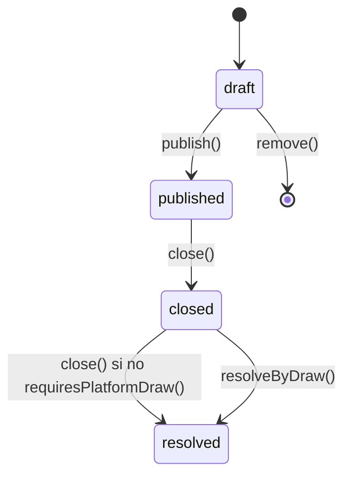
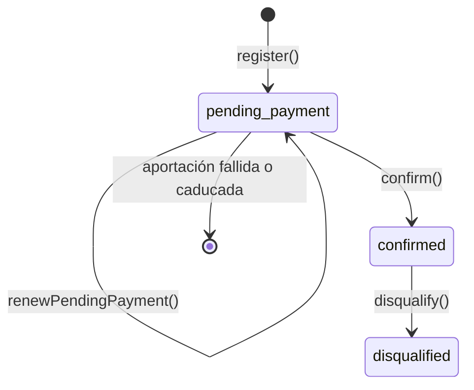
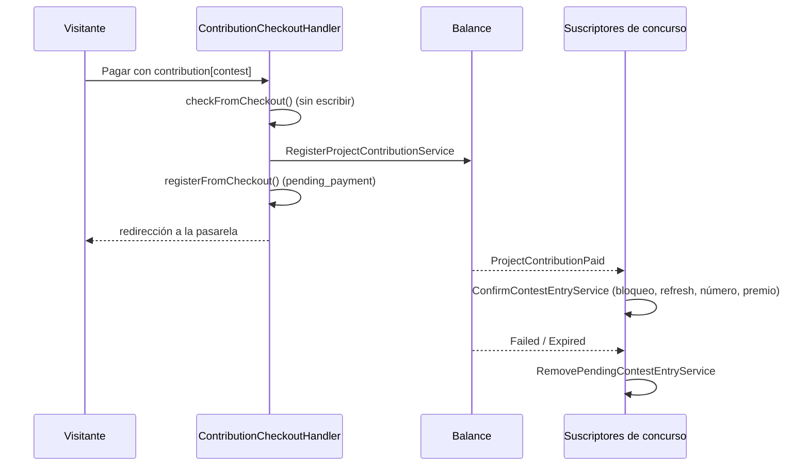

# Concursos asociados a las encuestas y calculadoras públicas — manual técnico

- **Plan:** `plan.md` (misma carpeta) · **Revisión:** `review.md` · **Implementado:** 2026-11-27 (correcciones de review hasta 2026-11-28)
- **Bounded Contexts:** `CarbonFootprint` (principal), `Security` (funcionalidad de cuenta), `Shared` (menú, planificador). De `Balance` solo se escuchan eventos; de `DataExchange` se usa el framework de exportación.

## Qué hace y por qué

Una cuenta publica concursos ligados a una o varias de sus calculadoras públicas (encuesta de asistentes de un evento, calculadora de una propiedad, calculadora de viajes de la cuenta). Quien completa el cálculo, o la compensación, puede apuntarse; el premio se reparte por sorteo, a los X primeros o a todos. La plataforma recoge configuración, inscripciones con prueba de consentimiento, lista exportable y, opcionalmente, el sorteo. El organizador y responsable es el cliente.

El modelo son dos agregados: `Contest` (configuración traducible, hijas `ContestHost` y `ContestAllowedCountry`) y `ContestEntry` (inscripción, crece sin límite y se lista paginada). `Balance` no conoce los concursos: la inscripción por compensación se confirma o elimina con suscriptores síncronos a `ProjectContributionPaid`, `ProjectContributionFailed` y `ProjectContributionExpired`. Las decisiones y su justificación están en la tabla «Decisiones tomadas» de `plan.md`.

## Mapa de piezas

Rutas relativas a `src/CarbonFootprint/` salvo indicación. «N» nuevo, «M» modificado.

| Capa | Fichero | Rol | |
|---|---|---|---|
| Dominio | `Domain/Model/Contest/Contest.php` | Agregado, estados, invariantes, hijas sincronizadas | N |
| Dominio | `Domain/Model/Contest/{ContestHost,ContestAllowedCountry,ContestTranslation,ContestHostReference}.php` | Hijas, traducción y VO `hostType` + `hostId` | N |
| Dominio | `Domain/Model/Contest/{ContestStatus,ContestParticipationMode,ContestAwardMode,ContestHostType}.php` | Enums | N |
| Dominio | `Domain/Model/Contest/{ContestRepository,ContestFilter,ContestLock,ContestPublicationLock,ContestWinnerPicker}.php` | Puertos y filtro | N |
| Dominio | `Domain/Model/ContestEntry/` | Agregado `ContestEntry`, estado, eventos, excepciones, repositorio y filtro | N |
| Dominio | `Domain/Event/Contest/*Subscriber.php` | Tres suscriptores a eventos de `Balance` | N |
| Aplicación | `Application/Contest/{ContestAuthorizer,ContestHostLocator}.php` | Autorización y resolución de calculadoras | N |
| Aplicación | `Application/Contest/{Register,Update,Publish,Close,Draw,PurgePersonalData,Remove,List,View}/` | Casos de uso del Propietario | N |
| Aplicación | `Application/Contest/{GetActiveForHost,CloseExpired}/` | Consulta anónima y cierre programado | N |
| Aplicación | `Application/ContestEntry/{CheckEligibility,Register,Confirm,RemovePending}/` | Flujo público y de sistema | N |
| Aplicación | `Application/ContestEntry/{List,Disqualify,Remove,Export}/` | Gestión de apuntados y filtro de exportación | N |
| Aplicación | `Application/ContestEntry/{ContestEntryConfirmer,ContestPrizeReassigner}.php` | Numerar y premiar; reasignar premios | N |
| Persistencia | `Infrastructure/Persistence/Doctrine/{Mapping,Type,Repository,Lock}/Contest*` | 5 mappings, 4 tipos, 2 repositorios, 2 bloqueos | N |
| Persistencia | `Infrastructure/Persistence/InMemory/{Repository,Lock}/InMemoryContest*` | Adaptadores de test | N |
| Infra | `Infrastructure/Contest/{SecureRandom,InMemory}ContestWinnerPicker.php` | Sorteo (`\Random\Engine\Secure`) y doble determinista | N |
| UI privada | `Infrastructure/UI/Web/Contest/` | 11 controladores, `ContestFormData`, `ContestCountries` | N |
| UI privada | `Infrastructure/Symfony/Form/{ContestType,PublishContestType,DisqualifyContestEntryType,ListContestsType,ListContestEntriesType,ContestEntriesExportType}.php` | Formularios | N |
| UI privada | `templates/carbon_footprint/contests/`, `templates/components/List/Action/Disqualify.html.twig`, `assets/controllers/contest_form_controller.js` | Pantallas, acción de fila, Stimulus | N |
| UI pública | `Infrastructure/UI/Web/Public/Contest/{ContestPublicHandler,ContestEntryResult,RegisterContestEntryFormData}.php`, `Infrastructure/Symfony/Form/RegisterContestEntryType.php` | Handler común | N |
| UI pública | `Infrastructure/UI/Web/Public/{AttendeeSurvey,PropertyTrip}/Contest/{Enter,Thanks,Terms}Controller.php` | Rutas públicas | N |
| UI pública | `templates/carbon_footprint/public/contest/{_notice,_result,_checkout,_organizer,enter,thanks,terms}.html.twig` | Vistas públicas | N |
| UI pública | `Infrastructure/UI/Web/ProjectContribution/{ContributionCheckoutHandler,ContributionRoutes}.php`, traits `*ContributionTrait`, `CheckoutController`, `ReturnController`, `ResultController`, `Step/{CityController,TripController}` | Inyectan concurso e inscripción en los flujos existentes | M |
| UI pública | `templates/carbon_footprint/public/_compensate_cta.html.twig`, `project_contribution/{checkout,confirmation}.html.twig`, `public/attendee_survey/step/city.html.twig`, `public/property_trip/step/trip.html.twig` | Puntos de inserción | M |
| Exportación | `Infrastructure/DataExchange/ContestEntriesExportationType.php` | Tipo `contest_entries` | N |
| `Security` | `AccountFeature`, `AccountFeatures`, `AccountFeaturesChanged`, `Account`, mapping `Account.AccountFeatures`, `UpdateAccount{Request,Service,Type}`, `Admin/Account/EditController`, `DoctrineAccountRepository::featureField()`, `templates/security/admin/accounts/edit.html.twig` | Funcionalidad `Contests` | M |
| `Shared` | `Infrastructure/UI/Web/Navigation/NodeLister.php:817`, `Application/CommandBus/CommandSchedule.php:51` | Menú y cierre horario | M |
| Raíz | `config/packages/doctrine.yaml` (4 tipos), `templates/components/List/FilterBar.html.twig`, `migrations/Version20261127143047.php` | Soporte | M/N |

## Modelo de dominio

### `Contest`

Campos relevantes: `accountId`, `participationMode` (`calculation` | `compensation`), `awardMode` (`draw` | `first_entrants` | `everyone`), `winnersCount` (nulo en `everyone`), `platformDraw`, `adultsOnly`, textos traducibles (`name`, `description`, `prizeDescription`, `terms`), datos del organizador, `startsAt`, `endsAt`, `status`, `confirmedEntries`, trazas de publicación, sorteo (`drawnBy`, `drawCandidates`, `redrawnPrizes`) y purga.



| Evento | Se emite en | Payload además de `contestId` |
|---|---|---|
| `ContestRegistered` / `ContestUpdated` | `register()` / `update()` | configuración completa, `hosts` (claves `tipo:id`), `allowedCountries`; el alta incluye `accountId` |
| `ContestTranslated` | `update()` con locale distinto del por defecto | textos y locale |
| `ContestPublished` | `publish()` | `publishedBy` |
| `ContestClosed` / `ContestResolved` | `close()`, `resolveByDraw()` | `drawnBy` y `drawCandidates` (nulos si no hubo sorteo) |
| `ContestEntryCounted` | `countConfirmedEntry()` | `entryNumber` |
| `ContestPrizeRedrawn`, `ContestPersonalDataPurged`, `ContestRemoved` | métodos homónimos | `purgedBy` en la purga |

Invariantes y dónde se validan:

- Configuración (`Contest.php:762`, `guardConfiguration`): nombre no vacío, `endsAt > startsAt`, `winnersCount >= 1` salvo `everyone`, `platformDraw` solo en `draw`, sin calculadoras repetidas. Países ISO alfa-2 sin repetidos (`normalizedCountries`).
- Edición (`Contest.php:798`, `guardEditable`): `draft` todo; `published` textos, `endsAt` (si cambia, posterior a ahora), organizador y calculadoras (mínimo una); `closed` y `resolved`, nada.
- Publicación (`Contest.php:448`): borrador, al menos una calculadora, nombre, premio y bases, nombre, NIF y email del organizador, `endsAt > startsAt`. La descripción no es obligatoria y **no se comprueba que `endsAt` sea futura**.
- `acceptsEntries(now)` (`Contest.php:291`): `published` y `startsAt <= now <= endsAt`.
- `purgePersonalData` solo en `closed`/`resolved` y una sola vez. `remove()` solo en `draft`.
- `termsVersion()` (`Contest.php:318`) es `<id>:<publishedAt YmdHis>`: editar las bases de un concurso publicado no cambia la versión.

Excepciones (todas `\RuntimeException`, código 409): `ContestNotEditableException`, `ContestNotPublishableException`, `ContestHostAlreadyInUseException` (expone `hostName()`), `ContestNotAcceptingEntriesException`, `ContestAlreadyResolvedException`, `ContestNotRemovableException`. Las validaciones de datos lanzan `\InvalidArgumentException`.

`Contest` redefine `recordApplyAndPublish()` (`Contest.php:691`) porque su método de negocio `publish()` choca con el `publish()` del trait `AggregateRoot` (alias `publish as protected publishEvent`). Las hijas se sincronizan con `synchronizedChildren()` (`Contest.php:902`).

### `ContestEntry`



- Toda inscripción nace `pending_payment`; en concursos por cálculo se confirma en la misma transacción.
- Vínculo con el cálculo: `origin` (`ProjectContributionOrigin`) + `originId`; calculadora de procedencia: `hostType` + `hostId`.
- `register()` normaliza email (minúsculas, sin espacios), teléfono y país; exige nombre, email válido y país `^[A-Z]{2}$`.
- `confirm()` no hace nada si ya no está pendiente; `award()` exige `confirmed`; `disqualify()` exige `confirmed`, no purgada y motivo (recortado a 255).
- `purgePersonalData()` vacía nombre, email, teléfono, país, motivo y reduce `ConsentProof` a fecha, versión y locale.
- Elegible (`isEligible()`): `confirmed` y no purgada.
- Eventos: `ContestEntryRegistered`, `PaymentRenewed`, `Confirmed`, `Awarded`, `Disqualified`, `PersonalDataPurged`, `Removed`. Los de alta y renovación llevan datos personales en el payload (ver «Desviaciones y deuda»).

Unicidad (índices): `(contest_id, origin, origin_id)`, `(contest_id, email)`, `(contest_id, entry_number)`. `DoctrineContestEntryRepository::add()` traduce la violación a `ContestEntryAlreadyExistsException`.

## Flujo de una operación

### Inscripción por cálculo

1. `CityController` / `TripController` pasan `contest` a su plantilla y `_notice.html.twig` pinta el aviso. En la encuesta de asistentes está **solo en el paso 2** (`step/city.html.twig`), no en el paso 1 (`intercity`) ni en la landing pública.
2. `ResultController` (ambos flujos) usa `ContestPublicHandler::activeContest()` + `entryFor()` + `viewParameters()`; `_compensate_cta.html.twig` incluye `_result.html.twig` aunque no haya opciones de compensación. En la encuesta de asistentes, una respuesta con `co2eq <= 0` redirige a `…_thanks` (`CityController`), así que nunca llega al resultado ni al concurso.
3. `GET|POST …/result/{id}/contest` → `EnterController` → `ContestPublicHandler::handleEntry()` (`ContestPublicHandler.php:154`): si el concurso no es por cálculo vuelve al resultado; si ya hay inscripción va a «gracias».
4. `RegisterContestEntryService` (en `TransactionalSession::run`) → `CheckContestEntryEligibilityService` (concurso activo, calculadora asociada, funcionalidad de cuenta, consentimiento, mayoría de edad, país, duplicados) → `ContestEntry::register()` → `ContestLock::acquire()` → `ContestEntryConfirmer::confirm()` (número correlativo y premio si `awardsOnConfirmation(countWinners)`).
5. Errores: `ContestNotAcceptingEntriesException` redirige al resultado; duplicado y país se muestran en su campo (`ContestPublicHandler.php:194-211`).

`ContestPublicHandler::hostForTripCalculationLink()` (`:57`) resuelve `property` si el enlace tiene propiedad y `trip_link` si es el de la cuenta.

### Inscripción por compensación



- El handler solo ofrece la casilla si el concurso es por compensación y no hay inscripción confirmada o descalificada desde ese cálculo (`ContributionCheckoutHandler.php`, inicio de `handle()`).
- La elegibilidad se comprueba **antes** de registrar la aportación (`:188`); si falla, hay *flash* y no se cobra. El alta posterior (`:251`) descarta cualquier `\RuntimeException|\InvalidArgumentException` con `DomainEventPublisher::clearPending()` y el pago continúa.
- Reintento desde el mismo cálculo: `RegisterContestEntryService.php:53` llama a `renewPendingPayment()`, que religa la inscripción a la nueva aportación. Un pago de la aportación anterior ya no la confirma.
- El checkout no recoge teléfono; el país del checkout llega en el código del maestro `Country` y `ContestCountries::alpha2()` lo convierte.
- La aportación pendiente caduca a las `app.contribution.reservation_hours` (12, `config/services.yaml`).
- `ConfirmContestEntryService` es idempotente: tras `acquire()` hace `refresh($entry)` (`:37`) y sale si ya no está pendiente. No comprueba el estado del concurso: un pago confirmado tras el cierre confirma la inscripción.
- `ReturnController` añade `confirmationParameters()`; `confirmation.html.twig` reutiliza el bloque `contest_message` de `thanks.html.twig` solo si la aportación está pagada.

### Casos de uso del Propietario

| Ruta | Controlador → servicio | Puntos de decisión |
|---|---|---|
| `/carbon-footprint/contests` (`contests`) | `ListController` → `ListContestsService` | fuerza `accountId` de la cuenta actual |
| `…/register` | `RegisterController` → `RegisterContestService` | cada calculadora: `ContestHostLocator::denyUnlessCanEdit` y misma cuenta |
| `…/{contestId}/edit` | `EditController` → `ViewContestService`, `UpdateContestService` | modo de `ContestType` según estado; si publicado y añade calculadoras, bloqueo + comprobación (`UpdateContestService.php:65`); locale distinto del por defecto ⇒ traducción |
| `…/publish` | `PublishController` → `PublishContestService` | declaración, `ContestPublicationLock` por cuenta (`PublishContestService.php:52`), `findPublishedByHost` |
| `…/close` (GET, CSRF `close`) | `CloseController` → `CloseContestService` | resuelve si no hay sorteo de plataforma |
| `…/draw` (GET, CSRF `draw`) | `DrawController` → `DrawContestWinnersService` | bloqueo, `closed` y `requiresPlatformDraw()`, `min(winnersCount, elegibles sin premio)` |
| `…/purge` (GET, CSRF `purge`) | `PurgeController` → `PurgeContestPersonalDataService` | elimina pendientes, anonimiza el resto, una transacción |
| `…/remove` (GET, CSRF `remove`) | `RemoveController` → `RemoveContestService` | solo borrador |
| `…/entries` (`contests_entries`) | `EntriesController` → `ListContestEntriesService` | completa nombres de calculadoras retiradas |
| `…/entries/{entryId}/disqualify` | `DisqualifyEntryController` → `DisqualifyContestEntryService` | bloqueo, `refresh`, reasignación si era ganadora |
| `…/entries/{entryId}/remove` (GET, CSRF `remove`) | `RemoveEntryController` → `RemoveContestEntryService` | igual |

`ContestPrizeReassigner::reassign()` solo actúa si `reassignsPrizes()`: en `first_entrants` premia a la elegible sin premio de menor número; en `draw` resuelto con sorteo de plataforma sortea una sustituta y llama a `recordPrizeRedrawn()`. En `everyone` nadie hereda.

## Autorización y ámbito

- `ContestAuthorizer`: una sola regla para `Register`, `View`, `List`, `Edit`, `Remove`, `Export`: rol actual `Owner` + cuenta actual igual a la del concurso + `AccountFeature::Contests`. Sin rama de administrador.
- Administrador sin impersonar, `User`, distribuidor y otras cuentas: denegado. Quien impersona (Administrador o consultora) actúa como `Owner`.
- `ContestHostLocator::denyUnlessCanEdit()` delega en `EventAuthorizer`, `PropertyAuthorizer` o `TripCalculationLinkAuthorizer` con `Action::Edit`; el distribuidor nunca puede asociar propiedades adheridas.
- Flujo público: `GetActiveContestForHostService` y la elegibilidad consultan `AccountFeaturesPolicy`. Las rutas quedan bajo prefijos `PUBLIC_ACCESS` ya existentes y usan `PublicFormRateLimiter`.
- `AccountFeature::Contests` es la única funcionalidad **desactivada por defecto** (`AccountFeatures`, último argumento del constructor). `AccountFeaturesChanged` reconstruye eventos antiguos con `contests = false`.

## Persistencia y migración

| Tabla | Contenido | Índices destacados |
|---|---|---|
| `contests` | Agregado | `(account_id, status)`, `(status, ends_at)` |
| `contests_translation` | PK `(locale, contest_id)`, FK en cascada | |
| `contest_hosts` | `host_type`, `host_id` | único `(contest_id, host_type, host_id)`, índice `(host_type, host_id)` |
| `contest_allowed_countries` | `country_iso` (2) | único `(contest_id, country_iso)` |
| `contest_entries` | Inscripción + `ConsentProof` embebido (`consent_*`) | tres únicos citados arriba, `(contest_id, status, winner)`, `(project_contribution_id)` |
| `account` | columna nueva `feature_contests` | |

La migración está creada en `migrations/Version20261127143047.php` (no se ha comprobado en qué entornos está aplicada). Difiere de `migration.sql` en que `feature_contests` se añade `NOT NULL` sin `DEFAULT 0` (efecto equivalente según `review.md`). Sin backfill.

Bloqueos: `DoctrineContestLock` (`FOR UPDATE` sobre la fila del concurso y `refresh` del agregado) serializa numeración, premios, sorteo, descalificación y baja; `DoctrineContestPublicationLock` (`FOR UPDATE` sobre `account`) serializa publicaciones y altas de calculadoras en publicados. SQLite ignora `FOR UPDATE`. La purga y `RemovePendingContestEntryService` no toman bloqueo.

## Configuración y operación

- Sin variables de entorno ni dependencias nuevas. Alias y entornos de repositorios, bloqueos y `ContestWinnerPicker` por `#[AsAlias]` / `#[When]`; los suscriptores se registran por autoconfiguración.
- Planificador: `carbon-footprint:close-expired-contests`, cada hora (`CommandSchedule.php:51`), `CloseExpiredContestsRequest` (`TimedCommand`, prioridad `LOW`). Cierra los `published` con `endsAt` anterior a ahora. Se ejecuta con el planificador general (`make sf c="app:schedule:run <username>"`) y requiere los workers de colas. No hay comando de consola propio.
- Hasta que se cierra, un concurso vencido sigue `published`: no admite inscripciones pero sigue ocupando sus calculadoras.
- Exportación: `path('export', {code: 'contest_entries', contestId})`; asíncrona con correo, formatos del framework (XLSX, CSV, PDF). `ContestEntriesExportationType.php:130` excluye `pending_payment`; incluye descalificadas. Sus fechas se formatean en la zona del servidor (UTC, `frankenphp/conf.d/10-app.ini`), mientras las pantallas usan la zona del navegador.
- Sin correos ni notificaciones propias.
- Países: `ContestCountries` (UI) traduce el maestro `Country` a alfa-2 mediante `CountryRegionCode`; lo usan formularios, vistas, checkout y exportación.
- Traducciones ES, EN y TR; catálogos `contest{Status,AwardMode,ParticipationMode,HostType,EntryStatus}+intl-icu`; plantillas de extracción en `templates/carbon_footprint/translations/` (incluida `contestMessages` para mensajes de excepción).

## Cómo extenderlo

**Un tipo de calculadora nuevo:** 1) caso en `ContestHostType` (cabe en `host_type` de 10 caracteres); 2) ramas en `ContestHostLocator` (`accountId` y `name` usan `match` sin `default`; en `denyUnlessCanEdit`, que usa `if` y trata como evento cualquier tipo no contemplado, hay que añadir la rama explícita); 3) campo en `ContestType::addHosts()` y en `ContestFormData::fromContest()` / `hosts()`; 4) traducción en `contestHostType`; 5) en el flujo público, construir el `ContestHostReference`, ampliar `ContributionRoutes`, crear `Enter/Thanks/Terms` y pasar `contest` a las vistas de primer paso, resultado, checkout y retorno.

**Una modalidad de premio nueva:** caso en `ContestAwardMode`; revisar `needsWinnersCount()`, `awardsOnConfirmation()`, `reassignsPrizes()`, `requiresPlatformDraw()`, `ContestPrizeReassigner` (su rama final asume `draw`), plantillas `thanks`, `_result`, `_checkout`, el controlador Stimulus y `contestAwardMode`.

**Un dato nuevo del participante:** `ContestEntry::register()` y `renewPendingPayment()`, sus eventos, **`applyContestEntryPersonalDataPurged()`**, mapping y migración, `RegisterContestEntryType`, checkout, listado y exportación.

Trampas:

- Cualquier operación que numere o premie debe ir dentro de `TransactionalSession::run` con `ContestLock::acquire()` y refrescar las inscripciones cargadas antes del bloqueo.
- `confirmedEntries` es el último número asignado, no el recuento actual (en pantalla, «Inscripciones recibidas»).
- Los suscriptores son síncronos dentro de `ProjectContribution::pay()`: un fallo del concurso sube a `Balance`.
- El `platformDraw` marcado y oculto por el Stimulus sigue enviándose: al cambiar de `draw` a otra modalidad el dominio lo rechaza.

## Tests

- Unitarios en `tests/Unit/CarbonFootprint/{Domain/Model/Contest,Domain/Model/ContestEntry,Application/Contest,Application/ContestEntry,Infrastructure}` (`ContestMother`, `ContestEntryMother`, `ContestApplicationTestCase`, `PrizeReassignmentTestCase`, `FakeContestPublicationLock`) y ampliaciones en `tests/Unit/Security`.
- Behat: `tests/Acceptance/CarbonFootprint/contest-{register,list,edit,remove,publish,entries,public-calculation,public-compensation}.feature` (45 escenarios) y el escenario de la funcionalidad en `tests/Acceptance/Security/account-edit.feature`. Pasos en `CarbonFootprintContext` y `BalanceContext`.

```bash
make test-unit options="--filter Contest"
make test-acceptance options="tests/Acceptance/CarbonFootprint/contest-publish.feature"
make test-parallel
```

Huecos: el bloqueo real de MySQL no se prueba (SQLite); `ContributionCheckoutHandler` solo se cubre por Behat; no hay escenario de purga previa al sorteo ni del aviso en el paso 1 de la encuesta.

## Desviaciones y deuda

Desviaciones declaradas en `plan.md` → «Implementación»: mapping de `feature_contests`, alias de `publish`, adaptador `ContestCountries` (el maestro guarda alfa-3), `TimedCommand`, validación de la declaración en el servicio, plantillas auxiliares, `services.yaml` sin cambios, pasos Behat distintos y solo ES/EN/TR (no existen catálogos FR, IT ni DE).

`review.md` no deja hallazgos abiertos. Riesgos aceptados:

- **A1:** `RecordedEvent` conserva los payloads con nombre, email, teléfono, país, IP, navegador y motivo; ni la purga ni la eliminación los borran.
- **M2:** la confirmación síncrona puede hacer fallar la confirmación del pago si el concurso falla.

Comportamientos del código actual no recogidos como hallazgo en `review.md`:

- El aviso de la encuesta de asistentes sale en el paso 2, aunque el criterio de aceptación pedía el primer paso.
- «Realizar sorteo» sigue disponible tras purgar un concurso cerrado pendiente de sorteo; al no quedar elegibles, se resuelve sin ganadores (`templates/carbon_footprint/contests/entries.html.twig:107-108`).
- El texto de confirmación al eliminar a un ganador («pasará a la siguiente persona de la lista») se muestra en cualquier modalidad, aunque en `draw` se sortea una sustituta y en `everyone` nadie hereda.
- La publicación no exige fecha de fin futura ni que la calculadora ofrezca compensación en un concurso por compensación.
