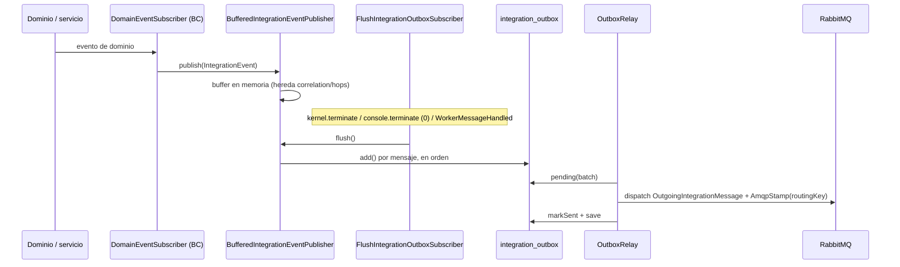

# Eventos de integración entre plataformas (RabbitMQ) — manual técnico

- **Plan:** `plan.md` (misma carpeta) · **Implementado:** 2026-11-19 · **Bounded Contexts:** `Shared` (subsistema `Integration`); `Security` solo como dependencia (`UserRepository`, `LoggedUser`, `LoggedAccount`)

## Qué hace y por qué

Las plataformas Bioscore construidas sobre biohydra necesitan reaccionar a lo que ocurre en las demás. Los webhooks perdían avisos si el receptor estaba caído y obligaban a cada emisor a conocer a cada receptor. Este subsistema entrega **solo la infraestructura** para publicar y consumir **eventos de integración** a través de RabbitMQ de forma fiable, ordenada, idempotente y trazable. No hay todavía eventos de negocio: el único evento incluido es el técnico `platform.pinged` v1 (prueba de extremo a extremo).

Diseño (decisiones en la tabla *Decisiones tomadas* de `plan.md`):

- **Salida:** un `DomainEventSubscriber` de infraestructura traduce un evento de dominio a un `IntegrationEvent` y lo entrega al puerto `IntegrationEventPublisher`. El publisher lo acumula en memoria y solo lo escribe en la tabla `integration_outbox` si la petición, el comando o el mensaje terminan bien. Un *relay* (`integration:outbox:relay`) publica el outbox en RabbitMQ con *publisher confirms*.
- **Entrada:** el consumidor (`messenger:consume integration_in integration_retry`) recibe un sobre JSON, lo deduplica por `id` (inbox), lo ordena por `(source, aggregateId)` (positions), fuerza el usuario de integración y ejecuta los `IntegrationEventHandler` de la plataforma, todo en **una transacción**.
- Nunca viajan eventos de dominio por el broker ni nombres de clase PHP; el contrato es `type` + `version`.
- Todo está desactivado mientras `INTEGRATION_EVENTS_ENABLED=false` (valor por defecto) y `INTEGRATION_TRANSPORT_DSN` vale `in-memory://`, de modo que sin configuración no hay conexiones a ningún broker.

## Mapa de piezas

Todo es nuevo salvo lo marcado como modificado.

| Capa | Fichero | Rol |
|---|---|---|
| Dominio | `src/Shared/Domain/Model/Integration/IntegrationOutboxMessage.php` | Entidad técnica (sin `AggregateRoot`, `#[Exclude]`): mensaje pendiente/enviado; `routingKey()`, `markSent()`, `markFailedAttempt()` (error truncado a 1000) |
| Dominio | `.../IntegrationOutboxRepository.php`, `IntegrationOutboxFilter.php`, `IntegrationOutboxStatus.php` | Puerto: `add`, `save`, `pending(limit)`, `oldestPendingOccurredOn`, `list`, `purgeSentBefore` |
| Dominio | `.../IntegrationInboxMessage.php`, `IntegrationInboxRepository.php`, `IntegrationInboxFilter.php`, `IntegrationInboxStatus.php` | Inbox idempotente: `find`, `has`, `add`, `list`, `purgeReceivedBefore`; estados `processed`, `skipped_stale`, `skipped_unknown_type`, `skipped_hops` |
| Dominio | `.../IntegrationPosition.php`, `IntegrationPositionRepository.php` | Última `sequence` por `(source, aggregateId)`; `advance()` solo avanza con secuencia mayor |
| Aplicación | `src/Shared/Application/Integration/IntegrationEvent.php` | Interfaz del evento saliente (`type()`, `version()`, `aggregateId()`, `accountRef()`, `payload()`) |
| Aplicación | `.../IntegrationEventPublisher.php` | Puerto de publicación |
| Aplicación | `.../IntegrationEventHandler.php` | Interfaz del handler entrante (`supports`, `handle`), con `#[AutoconfigureTag('shared.integration.handler')]` |
| Aplicación | `.../ReceivedIntegrationEvent.php` | Evento recibido; accesores tipados `string`, `nullableString`, `int`, `bool`, `array` que lanzan `\InvalidArgumentException` |
| Aplicación | `.../Ping/PlatformPinged.php` | Evento técnico `platform.pinged` v1 |
| Aplicación | `.../Purge/PurgeIntegrationMessagesService.php` (+ Request/Response) | Purga de enviados/recibidos antiguos, sin authorizer |
| Infraestructura | `src/Shared/Infrastructure/Integration/IntegrationSettings.php` | Flag, plataforma (`^[a-z0-9-]+$`, valida en el constructor) y `maxHops` |
| Infraestructura | `.../IntegrationEnvelope.php`, `MalformedIntegrationEnvelope.php` | Sobre del cable: `fromOutbox`, `fromArray` (valida), `toArray`, `toReceivedEvent` |
| Infraestructura | `.../IntegrationContext.php` | Mensaje entrante en curso (`enter`/`leave`/`current`) |
| Infraestructura | `.../BufferedIntegrationEventPublisher.php` | Adaptador del puerto: buffer en memoria, `flush`/`markFailed`/`discard` |
| Infraestructura | `.../FlushIntegrationOutboxSubscriber.php` | Decide cuándo volcar o descartar el buffer |
| Infraestructura | `.../OutboxRelay.php` | Publica el outbox pendiente por el bus de Messenger |
| Infraestructura | `.../IntegrationUserProvider.php`, `IntegrationUserNotAvailable.php` | Resuelve el usuario `INTEGRATION_USERNAME` (debe ser `Admin` o `SuperAdmin`) |
| Infraestructura | `.../LogPlatformPingedHandler.php` | Handler de `platform.pinged` v1 (log `info`) |
| Infraestructura | `.../IntegrationOutboxHealthIndicator.php` | Indicador `integration_outbox` del health check |
| Infraestructura | `.../Messenger/IntegrationMessageSerializer.php` | Serializer JSON; `decode` nunca lanza |
| Infraestructura | `.../Messenger/OutgoingIntegrationMessage.php`, `IncomingIntegrationMessage.php`, `UndecodableIntegrationMessage.php` | Mensajes de Messenger |
| Infraestructura | `.../Messenger/IncomingIntegrationMessageHandler.php` | Consumidor transaccional |
| Infraestructura | `.../Messenger/UndecodableIntegrationMessageHandler.php` | Manda lo ilegible a reintento/fallidos |
| Persistencia | `src/Shared/Infrastructure/Persistence/Doctrine/Mapping/Integration.{IntegrationOutboxMessage,IntegrationInboxMessage,IntegrationPosition}.orm.xml` | Mappings (el mapping `Shared` de `doctrine.yaml` ya los carga) |
| Persistencia | `src/Shared/Infrastructure/Persistence/Doctrine/Repository/DoctrineIntegration{Outbox,Inbox,Position}Repository.php` | Repositorios Doctrine |
| Persistencia | `src/Shared/Infrastructure/Persistence/InMemory/Repository/InMemoryIntegration{Outbox,Inbox,Position}Repository.php` | Repositorios para tests |
| Persistencia | `migrations/Version20261119140835.php` | Crea las tres tablas |
| Consola | `src/Shared/Infrastructure/UI/Console/{RelayIntegrationOutbox,ListIntegrationOutbox,ListIntegrationInbox,InjectIntegrationMessage,PingIntegration}Command.php` | Relay y herramientas de diagnóstico |
| Config (modificado) | `config/packages/messenger.yaml` | Transportes `integration_out`, `integration_in`, `integration_retry`, `integration_failed`, routing y `when@test` |
| Config (modificado) | `src/Shared/Infrastructure/Symfony/DependencyInjection/services.yaml` (líneas 46-51, 226-245) | Parámetros `shared.integration.*`, argumentos y alias del puerto |
| Config (modificado) | `src/Shared/Application/CommandBus/CommandSchedule.php` | Purga diaria `shared:purge-integration-messages` a las 03:40 |
| Config (nuevo/modificado) | `config/packages/lock.yaml`, `.env`, `.env.test`, `composer.json`, `Dockerfile` (extensión `amqp`), `Makefile` | Lock, variables, dependencias y targets |
| Infra | `infra/rabbitmq/` (`compose.yaml`, `compose.prod.yaml`, `rabbitmq.conf`, `rabbitmq.prod.conf`, `definitions.json`, `README.md`) | Broker local y de producción, topología y guía de contratos |
| Infra (modificado) | `infra/supervisor/hydra-workers.ini`, `infra/supervisor/README.md` | Programas `hydra-integration-consumer` y `hydra-integration-relay` |
| Tests (modificado) | `tests/Acceptance/Shared/health-check.feature` | Añade `"integration_outbox": "ok"` al JSON esperado |

## Modelo de dominio

No hay aggregate ni eventos de dominio: las tres entidades son técnicas para que `RecordEventSubscriber` no las lleve al Registro ni el subscriber de integración reaccione a ellas.

| Tabla | Clave | Columnas relevantes |
|---|---|---|
| `integration_outbox` | `sequence` (INT, autoincremental); único `message_id` | `type`, `version`, `aggregate_id`, `account_ref`, `correlation_id`, `causation_id`, `hops`, `occurred_on`, `payload` (texto con el JSON opaco), `sent_at`, `attempts`, `last_error`; índice `(sent_at, sequence)` |
| `integration_inbox` | `message_id` | `source`, `type`, `version`, `aggregate_id`, `sequence`, `correlation_id`, `causation_id`, `hops`, `status`, `received_at`; índices por `received_at` y `correlation_id` |
| `integration_positions` | `(source, aggregate_id)` | `last_sequence`, `updated_at` |

### Sobre (`IntegrationEnvelope`)

`id`, `type`, `version`, `source`, `sequence`, `occurredOn`, `aggregateId`, `accountRef` (reservado, siempre nulo), `correlationId`, `causationId`, `hops`, `payload`. Ejemplo y reglas por campo en `infra/rabbitmq/README.md` (*Guía de contratos*). Validaciones de `IntegrationEnvelope::fromArray()`: `type` contra `TYPE_PATTERN` (`IntegrationEnvelope.php:13`), `source` contra `IntegrationSettings::PLATFORM_PATTERN`, `version >= 1`, `sequence >= 1`, `hops >= 0`, UUID en `id`/`correlationId`/`causationId`, `occurredOn` en formato ATOM **sin fracciones de segundo** (se admite `Z`); claves desconocidas se ignoran. `toArray()` convierte `occurredOn` a UTC y serializa un payload vacío como `{}`.

### Invariantes del consumidor

Se evalúan en este orden en `IncomingIntegrationMessageHandler`:

1. `source` igual a la propia plataforma: se descarta sin registrar (`:60`, log `debug`).
2. `id` ya en el inbox (`inbox->has`, `:88`): se descarta.
3. `hops > INTEGRATION_MAX_HOPS`: inbox `skipped_hops` (`:95`).
4. Ningún handler soporta `(type, version)`: inbox `skipped_unknown_type` (`:103`).
5. `aggregateId` no nulo y `sequence <= lastSequence`: inbox `skipped_stale` (`:111`).
6. En otro caso se ejecutan los handlers y se registra `processed`; si hay `aggregateId`, la posición avanza.

## Flujo de una operación

### Salida (publicar un evento)



1. `BufferedIntegrationEventPublisher::publish()` (`BufferedIntegrationEventPublisher.php:30`): si el flag está apagado no hace nada. Genera el id con `UuidGenerator::v7()` (`:36`). Con un mensaje entrante en curso hereda su `correlationId`, usa su `id` como `causationId` y `hops + 1`; sin él, `correlationId = messageId`, `causationId = null`, `hops = 0` (`:37-39`). Si `hops > maxHops` registra un `warning` y no acumula (`:41`). El payload se serializa con `json_encode` (`JSON_THROW_ON_ERROR | JSON_UNESCAPED_UNICODE | JSON_UNESCAPED_SLASHES`).
2. `FlushIntegrationOutboxSubscriber::getSubscribedEvents()`: `KernelEvents::EXCEPTION` y `ConsoleEvents::ERROR` marcan el buffer como fallido; `KernelEvents::TERMINATE` hace `flush()` y luego `discard()`; `ConsoleEvents::TERMINATE` descarta si el código de salida no es 0 y vuelca si lo es; `WorkerMessageHandledEvent` vuelca; `WorkerMessageFailedEvent` descarta. Un buffer marcado como fallido se descarta en `flush()`.
3. `OutboxRelay::relay()` (`OutboxRelay.php:10`): para cada pendiente (orden `sequence ASC`) despacha `OutgoingIntegrationMessage` con `AmqpStamp(routingKey, AMQP_NOPARAM, ['content_type' => 'application/json', 'delivery_mode' => 2])` y marca como enviado. Ante `\Throwable` registra el fallo (`attempts`, `lastError`), log `error` y **corta el lote** para no desordenar.
4. `RelayIntegrationOutboxCommand` (`integration:outbox:relay`): obtiene el lock `integration-outbox-relay` (`LockFactory`; si otro lo tiene, espera y reintenta hasta `--time-limit`), llama a `relay($batch)` en bucle, hace `EntityManager::clear()` tras cada vuelta (`:79`, evita acumular entidades en el proceso largo) y duerme `--sleep` ms si no hubo mensajes. Atiende `SIGTERM`/`SIGINT` terminando el lote en curso. Con el flag apagado espera sin trabajar hasta `--time-limit` (o termina al momento con `--once`) para que Supervisor no lo marque como FATAL.
5. `IntegrationMessageSerializer::encode()` produce el cuerpo JSON y las cabeceras `content_type`, `x-integration-type`, `x-integration-version`, `x-integration-source`; rechaza cualquier mensaje que no sea `OutgoingIntegrationMessage`.

### Entrada (consumir un mensaje)

1. `messenger:consume integration_in integration_retry` lee la cola `integration.<plataforma>.inbox`. `IntegrationMessageSerializer::decode()` devuelve `IncomingIntegrationMessage` o, ante cualquier fallo, `UndecodableIntegrationMessage` (nunca lanza, para que el receptor AMQP no rechace y pierda el mensaje). `UndecodableIntegrationMessageHandler` lanza `UnrecoverableMessageHandlingException`: el mensaje va directo a `integration_retry` y de ahí a `integration_failed`.
2. `IncomingIntegrationMessageHandler::__invoke()` (`IncomingIntegrationMessageHandler.php:47`): con el flag apagado (`:49`) solo registra un `warning` y **confirma el mensaje, que se pierde** (hallazgo A2 de la review, descartado por el usuario). Ignora los mensajes de la propia plataforma y envuelve el resto en `entityManager->wrapInTransaction()` (`:67`).
3. Dentro de la transacción, tras superar los descartes de la lista de invariantes: `IntegrationUserProvider::user()`, `LoggedUser::forceUser($user)` (`:117`), `LoggedAccount::reset()`, `IntegrationContext::enter()`, `DomainEventPublisher::instance()->lock()` (`:120`), cada handler (`handle($event, $user)`), `unlock()` (`:126`, corren aquí los subscribers de dominio, incluido el Registro), `publisher->flush()` (outbox dentro de la transacción), avance de la posición y registro en el inbox.
4. Si algo lanza: `DomainEventPublisher::clearPending()` (`:71`), `publisher->discard()`, `ManagerRegistry::resetManager()` si el EntityManager quedó cerrado (`:75`) y se relanza la excepción; rollback completo, de modo que no queda nada en inbox, posiciones ni outbox. En `finally` se limpia el contexto, el usuario forzado (`forceUser(null)`, `:81`) y la cuenta.
5. Reintentos: `integration_in` tiene `max_retries: 0` y `failure_transport: integration_retry` (Doctrine, 5 reintentos, retraso 2 s, multiplicador 3), cuyo `failure_transport` es `integration_failed` (Doctrine, manual). Así Messenger no crea colas de retraso en RabbitMQ, que exigirían permiso de configuración (`config/packages/messenger.yaml`).

### Herramientas de consola

| Comando | Uso |
|---|---|
| `make sf c="integration:ping hola"` | Publica `platform.pinged` (el volcado al outbox lo hace `console.terminate`). Con el flag apagado avisa y devuelve 1 |
| `make sf c="integration:outbox:list --status=pending --type= --limit=20"` | Lista el outbox |
| `make sf c="integration:inbox:list --status= --source= --type= --limit=20"` | Lista el inbox |
| `make sf c="integration:inject fichero.json"` | Decodifica un sobre de un fichero y lo procesa en el acto con el transporte `sync`, mostrando el estado resultante del inbox (ejemplo en `tests/Unit/Shared/Infrastructure/Integration/fixtures/platform-pinged-v1.json`) |
| `make integration-relay` / `make integration-consume` | Relay y consumidor en local |

## Autorización y ámbito

No hay pantallas, API ni `Authorizer`: el subsistema solo se maneja por consola y por procesos. `PurgeIntegrationMessagesService` no autoriza porque solo lo lanza el planificador (`app:schedule:run`).

- Los cambios provocados por un mensaje entrante se ejecutan con el usuario `INTEGRATION_USERNAME` (`IntegrationUserProvider.php`): debe existir y tener rol `Admin` o `SuperAdmin` (se comprueba el rol almacenado con `hasRole`, sin suplantación). Si no, `IntegrationUserNotAvailable` hace fallar el mensaje (reintento y, después, `integration_failed`). Se recomienda un usuario dedicado por plataforma para que el Registro no atribuya cambios a una persona.
- Cuenta: fuera de alcance mientras no exista una identidad única de cuenta. El sobre reserva `accountRef` (nulo). El handler resetea `LoggedAccount` y no fuerza ninguna suplantación; un handler de plataforma que actúe sobre una cuenta debe pasarla explícitamente en la Request del servicio.
- Feature flag: `INTEGRATION_EVENTS_ENABLED`. Apagado: el publisher no acumula, el relay y el consumidor esperan o descartan (ver arriba) y el health check devuelve sano.

## Persistencia y migración

- Migración aplicada por el usuario a partir de `migration.sql`: `migrations/Version20261119140835.php` crea `integration_inbox`, `integration_outbox` e `integration_positions` (sin backfill). `sequence` y `last_sequence` son `INT` (no `bigint`: con DBAL 3 `bigint` se hidrata como string y choca con las propiedades `int`). `payload` es `LONGTEXT`; es una excepción motivada a la regla de no guardar texto serializado (cuerpo opaco de transporte, reenviado byte a byte).
- Las colas `integration_retry` e `integration_failed` usan la tabla `messenger_messages` existente con otro `queue_name`.
- Fechas: se guardan en la zona por defecto de PHP, como el resto del proyecto; solo en el cable (`toArray`/`fromOutbox`) se convierten a UTC (corrección B1 de la review; producción está en UTC+1).
- Retención: `PurgeIntegrationMessagesService` borra los enviados del outbox y los del inbox con más de `INTEGRATION_RETENTION_DAYS` (30). Los pendientes del outbox y `integration_positions` no se purgan.

## Configuración y operación

### Variables de entorno (`.env`, bloque `integration`)

| Variable | Por defecto | Significado |
|---|---|---|
| `INTEGRATION_EVENTS_ENABLED` | `false` | Activa publisher, relay, consumidor e indicador |
| `INTEGRATION_PLATFORM` | `biohydra` | `source`, exchange `integration.<p>` y cola `integration.<p>.inbox` |
| `INTEGRATION_TRANSPORT_DSN` | `in-memory://` | `amqp://` en local, `amqps://` en producción |
| `INTEGRATION_USERNAME` | vacío | Usuario administrador de los cambios entrantes |
| `INTEGRATION_MAX_HOPS` | `5` | Saltos máximos de una cadena |
| `INTEGRATION_RETENTION_DAYS` | `30` | Retención de mensajes enviados/recibidos |
| `INTEGRATION_OUTBOX_MAX_WAIT_MINUTES` | `10` | Espera máxima de un pendiente antes de marcar el health check como `error` |
| `LOCK_DSN` | `flock` | Lock del relay (`symfony/lock`) |

En `.env.test`: `INTEGRATION_EVENTS_ENABLED=true`, `INTEGRATION_PLATFORM=biohydra-test`, `INTEGRATION_USERNAME=admin@dediez.software`, y los cuatro transportes son `in-memory://`.

### Health check

`IntegrationOutboxHealthIndicator` (nombre `integration_outbox`, tag `shared.health_indicator`): sano si está apagado o no hay pendientes; no sano (`outbox messages waiting too long`) si el pendiente más antiguo supera `INTEGRATION_OUTBOX_MAX_WAIT_MINUTES`.

### Topología RabbitMQ (`infra/rabbitmq/definitions.json`)

- vhost `bioscore`; siete plataformas: `biohydra` (solo pruebas), `data-platform`, `balance`, `waste`, `dont-waste-food`, `reporting`, `compliance`.
- Un exchange `topic` durable `integration.<p>` por plataforma y una cola quorum durable `integration.<p>.inbox`, enlazada con routing key `#` a los exchanges de todas las demás. Cada plataforma descarta como `skipped_unknown_type` lo que no maneja, así que empezar a consumir un tipo nuevo no exige tocar RabbitMQ.
- Sin `x-single-active-consumer` (RabbitMQ no admite `basic.get` en colas quorum con esa opción y el receptor AMQP de Messenger lo usa). El orden lo garantizan un único consumidor por plataforma (`numprocs=1`), `integration_positions` y el inbox: **no arrancar más de un consumidor por plataforma**.
- Policy `integration-inbox-retention`: 14 días de TTL y 512 MB por cola con `drop-head`, para que una plataforma sin consumidor no llene el disco del broker. Se pierden los mensajes que superen esos límites; los eventos con `aggregateId` llevan estado completo y el siguiente lo recupera.
- Usuario `integration-<p>` por plataforma: `configure ^$`, `write ^integration\.<p>$`, `read ^integration\.<p>\.inbox$`. Usuario `admin`/`admin` solo para local.
- Las aplicaciones no declaran nada (`auto_setup: false`).

### Supervisor (producción, sin FrankenPHP)

Dos programas por plataforma dentro de su grupo (`infra/supervisor/hydra-workers.ini`): `hydra-integration-consumer` (`messenger:consume integration_in integration_retry --time-limit=3600 --memory-limit=192M --limit=500`, `stopwaitsecs=3600`) y `hydra-integration-relay` (`integration:outbox:relay --time-limit=3600`, `stopwaitsecs=60`), ambos `numprocs=1`. Pueden quedar instalados con el flag apagado. Mensajes fallidos:

```bash
php bin/console messenger:failed:show --transport=integration_failed --env=prod
php bin/console messenger:failed:retry --transport=integration_failed --env=prod
```

`make queues` excluye los cuatro transportes de integración (`Makefile`).

### Instalación de `ext-amqp` en producción

`symfony/amqp-messenger` 7.4 exige `ext-amqp` en `composer install`, **aunque el flag esté apagado**. Debe estar instalada en el PHP CLI y en el FPM de todos los servidores de todas las plataformas antes del merge.

1. Paquetes: `dnf install -y plesk-php84-devel gcc make librabbitmq-devel` (`librabbitmq-devel` desde EPEL).
2. Compilar: `/opt/plesk/php/8.4/bin/pecl install amqp`.
3. Activar: `echo "extension=amqp.so" > /opt/plesk/php/8.4/etc/php.d/40-amqp.ini` (vale para CLI y FPM).
4. Reiniciar: `systemctl restart plesk-php84-fpm` y `supervisorctl restart all`.
5. Comprobar: `/opt/plesk/php/8.4/bin/php -m | grep amqp`, y desde la web (`phpinfo` o el health check).
6. Orden de despliegue: extensión en todos los servidores, merge con `INTEGRATION_EVENTS_ENABLED=false`, broker en producción, activación plataforma a plataforma.
7. Vuelta atrás: poner `INTEGRATION_EVENTS_ENABLED=false` y reiniciar los programas de Supervisor; el outbox conserva lo pendiente. La extensión puede quedarse instalada. Recuérdese que los mensajes que lleguen a un consumidor con el flag apagado se confirman y se pierden.

La imagen de desarrollo ya la instala (`Dockerfile`, `amqp` en `install-php-extensions`).

### Instalación de RabbitMQ con Docker en el servidor Plesk

1. **Requisitos:** sistema compatible con Docker Engine y con la extensión *Docker* de Plesk (`cat /etc/os-release`; Docker no publica paquetes para CentOS 7), 2 GB de RAM libres, espacio para el volumen e IPs públicas de los servidores de las plataformas.
2. **Docker en Plesk:** instalar la extensión *Docker* desde *Extensiones*, `systemctl enable docker`, comprobar `docker version` y `docker compose version`.
3. **Ficheros:** crear `/opt/bioscore-broker/` con `compose.prod.yaml` y `rabbitmq.prod.conf` copiados de `infra/rabbitmq/`, más `data/` (propietario UID/GID 999, el usuario `rabbitmq` de la imagen) y `tls/`. El directorio queda fuera de los despliegues de las plataformas. `compose.prod.yaml` fija `hostname: rabbitmq`, `mem_limit: 1g`, rotación de logs, el puerto `5671` y la UI en `127.0.0.1:15672`; el 5672 no se publica.
4. **TLS:** subdominio de Plesk (p. ej. `mq.<dominio>`) con Let's Encrypt; script diario `/opt/bioscore-broker/renew-tls.sh` que copia certificado, clave y cadena a `tls/cert.pem`, `tls/key.pem` y `tls/chain.pem` (legibles por el UID 999) y ejecuta `docker exec bioscore-broker-rabbitmq-1 rabbitmqctl eval 'ssl:clear_pem_cache().'`, programado con cron o con el hook de renovación de Plesk. `rabbitmq.prod.conf` solo abre el listener TLS 5671 (`verify_none`, autenticación por usuario y contraseña).
5. **Arranque:** desde *Docker → Stacks* con `compose.prod.yaml` o `docker compose -f /opt/bioscore-broker/compose.prod.yaml up -d`. Comprobar `docker ps` (estado `healthy`) y que el hostname es `rabbitmq`.
6. **Cortafuegos:** Docker se salta el Firewall de Plesk y `firewalld`. Restringir el 5671 con reglas persistentes en `DOCKER-USER` (`iptables -I DOCKER-USER -p tcp --dport 5671 ! -s <ips> -j DROP`, o con `ipset`), persistirlas (servicio `iptables`/`nftables` o unidad `systemd` posterior a Docker) y verificar desde fuera que el 5671 solo responde a las IPs permitidas y que el 5672 y el 15672 no responden.
7. **UI de management:** publicada solo en `127.0.0.1:15672`; acceso por un proxy de Plesk en el subdominio (`location / { proxy_pass http://127.0.0.1:15672; }`) con restricción por IP, o por túnel SSH.
8. **Topología y usuarios:** `rabbitmq.prod.conf` no carga definiciones al arrancar, para que reiniciar el contenedor no sobrescriba las contraseñas. Copiar `definitions.json` a un fichero temporal, sustituir las contraseñas locales (también la de `admin`), `docker cp` al contenedor y `docker exec … rabbitmqctl import_definitions /tmp/definitions.json` (aditivo; incluye la policy). Verificar con `rabbitmqctl list_exchanges|list_queues|list_bindings|list_policies -p bioscore` y borrar las copias con contraseñas.
9. **DSN** en el `.env.local` de cada plataforma: `INTEGRATION_TRANSPORT_DSN=amqps://integration-<p>:<pass>@mq.<dominio>:5671/bioscore`.
10. **Operación:** copia diaria de las definiciones (`rabbitmqctl export_definitions -`) fuera del servidor; `/opt/bioscore-broker/data` en las copias de seguridad; logs con `docker logs`; comprobaciones con `rabbitmq-diagnostics status`, `check_local_alarms` y `check_port_connectivity`; alerta por cron si el contenedor no está `healthy`. Rotación de contraseña: `rabbitmqctl change_password integration-<p> '<nueva>'`, actualizar el DSN y reiniciar los dos programas de Supervisor de esa plataforma.
11. **Actualizaciones:** cambiar la etiqueta de la imagen en `compose.prod.yaml` (dentro de 4.x, de una en una versión menor), `docker compose pull` y `up -d` en ventana de mantenimiento. Los outbox acumulan mientras el broker está parado. Vuelta atrás: la etiqueta anterior.
12. **Si el broker cae:** las plataformas siguen funcionando, los eventos se acumulan en los outbox, `integration_outbox` sale `error` en el health check pasados `INTEGRATION_OUTBOX_MAX_WAIT_MINUTES` y todo se envía al volver.
13. **Errores típicos:** contenedor recreado con otro hostname (parece vacío), volumen sin permisos para el UID 999, certificado no legible dentro del contenedor, 5671 abierto a Internet por no aplicar `DOCKER-USER`.

### Entorno local

`make broker-up` / `make broker-down` / `make broker-logs` (compose `infra/rabbitmq/compose.yaml`, proyecto fijo `bioscore-broker`, red externa `bioscore` con alias `rabbitmq.local`, management en `http://localhost:15672`, `admin`/`admin`). Una sola instancia aunque la lancen varios checkouts; si difieren en `definitions.json`, gana el último. Prueba entre dos plataformas: `INTEGRATION_*` en el `.env.local` de cada una (DSN `amqp://integration-<p>:integration-<p>@rabbitmq.local:5672/bioscore`), `make integration-relay` y `make integration-consume` en ambas, `make sf c="integration:ping hola"` en una y `make sf c="integration:inbox:list"` en la otra.

## Cómo extenderlo

**Añadir un evento saliente**

1. Clase que implemente `App\Shared\Application\Integration\IntegrationEvent`, en la capa `Application` del BC emisor (`type()` con el patrón `a.b`, `version()` ≥ 1, `payload()` con ids y lo mínimo imprescindible).
2. `DomainEventSubscriber` en `<BC>/Infrastructure/Integration/` que traduzca el evento de dominio y llame a `IntegrationEventPublisher::publish()`. Nunca publicar eventos de dominio en el broker.
3. Si lleva `aggregateId`, el payload debe contener el **estado completo** relevante (el último gana).
4. Añadirlo al catálogo de `infra/rabbitmq/README.md`.

**Añadir un handler entrante**

1. Clase que implemente `IntegrationEventHandler` (se etiqueta sola con `shared.integration.handler`): `supports()` y `handle()`, leyendo el payload con los accesores de `ReceivedIntegrationEvent` y delegando en un servicio de aplicación con el usuario de integración.
2. Varios handlers pueden soportar el mismo tipo; se ejecutan todos en la misma transacción.

**Trampas conocidas**

- Un handler entrante **no** debe delegar en un `DeferredCommand` trabajo que publique eventos de integración: `IntegrationContext` solo vive dentro del `__invoke`, así que el worker publica con `hops = 0` y `correlationId` nuevo, y un ciclo entre plataformas no se cortaría (hallazgo M1, aceptado como restricción documentada).
- El handler no debe abrir otra conexión ni hacer commit explícito: rompería la atomicidad.
- Un comando de consola largo acumula todos sus eventos y los escribe al terminar; si falla a mitad no publica nada aunque parte de los cambios ya estén guardados.
- En HTTP los repositorios hacen `flush()` en cada `save()` y el outbox se escribe en `kernel.terminate`, en otra transacción: si el proceso muere entre medias el cambio queda y el evento se pierde (ventana aceptada por el usuario).
- `sequence` es el autoincremental del outbox: dos transacciones concurrentes sobre el mismo aggregate podrían confirmarse en orden inverso y la posterior se descartaría como `skipped_stale`.
- Un cambio incompatible en un evento es una versión nueva publicada en paralelo; dentro de una versión solo cambios aditivos.
- Otras plataformas que no usen biohydra (Bioscore *data platform*) deben implementar el sobre según `infra/rabbitmq/README.md`.

## Tests

- **Unitarios** (`tests/Unit/Shared/`): entidades y repositorios InMemory (`Domain/Model/Integration/`), `IntegrationEnvelopeTest` (con el fixture `fixtures/platform-pinged-v1.json`), `IntegrationMessageSerializerTest` (sin nombres de clase en cuerpo ni cabeceras), `BufferedIntegrationEventPublisherTest`, `FlushIntegrationOutboxSubscriberTest`, `OutboxRelayTest`, `RelayIntegrationOutboxCommandTest` (flag apagado, lock ocupado, un lote con `clear()`, liberación del lock), `IntegrationUserProviderTest`, `IncomingIntegrationMessageHandlerTest` (todos los descartes, éxito, rollback, contexto, usuario forzado), `UndecodableIntegrationMessageHandlerTest`, `LogPlatformPingedHandlerTest`, `IntegrationOutboxHealthIndicatorTest`, `IntegrationSettingsTest`, `ReceivedIntegrationEventTest` y `Purge/PurgeIntegrationMessagesServiceTest`. Mothers y dobles: `IntegrationEnvelopeMother`, `ReceivedIntegrationEventMother`, `IntegrationSettingsMother`, `FakeIntegrationMessageBus`, `SpyIntegrationEventHandler`.
- **Aceptación:** solo `tests/Acceptance/Shared/health-check.feature` (el JSON esperado incluye `"integration_outbox": "ok"`); no hay pantallas ni API. El extremo a extremo se probó a mano con RabbitMQ local (`biohydra` → `waste`).
- **Ejecutar:** `make test-unit options="--filter Integration"`, `make test-acceptance options="tests/Acceptance/Shared/health-check.feature"` y `make test-parallel` para todo.

## Desviaciones y deuda

Detalle en `plan.md` (`## Implementación`) y `review.md`; ningún hallazgo queda abierto.

- Sin `x-single-active-consumer` en las colas (decisión del usuario).
- `sequence` y `last_sequence` como `INT` en lugar de `bigint` (decisión del usuario).
- `InjectIntegrationMessageCommand` recibe el serializer como `SerializerInterface` con `#[Autowire(service: IntegrationMessageSerializer::class)]` porque Symfony 7.4 lo decora con `SigningSerializer`.
- Añadida la policy de retención de colas (review M2) y `clear()` del EntityManager en el relay (review M3).
- Aceptado: con el flag apagado el consumidor confirma y pierde los mensajes que reciba (review A2, descartado por el usuario); la protección contra bucles no atraviesa comandos diferidos (review M1, documentado en la guía).
- Deuda previa no corregida: `src/Security/Domain/Event/RecordEventSubscriber.php` importa `UserMother` desde `tests/`.
