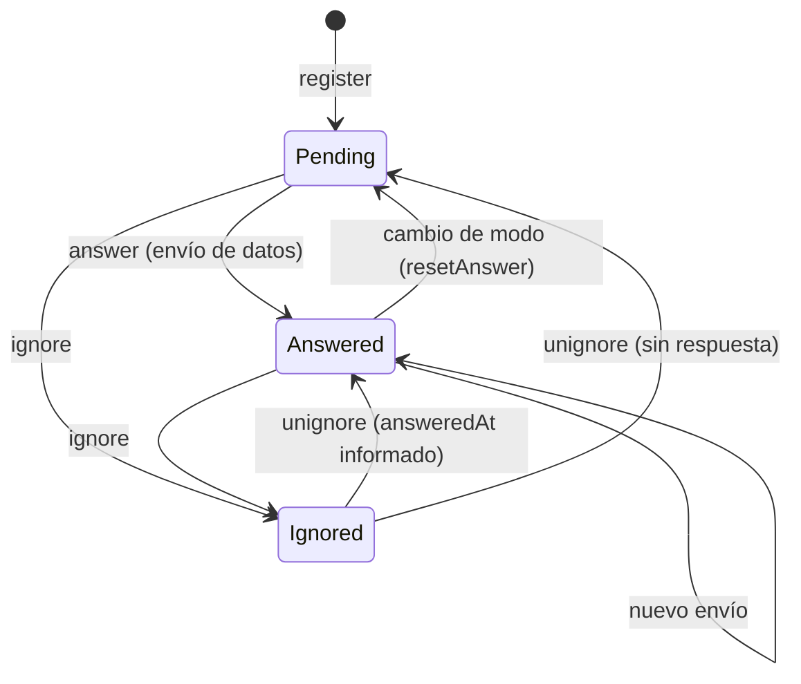

# Invitaciones a franquiciados y gestores arrendados — manual técnico

- **Plan:** `plan.md` (misma carpeta) · **Implementado:** 2026-10-30 · **Bounded Contexts:** `CarbonFootprint`, `Property` (uso puntual de `Security`)

## Qué hace y por qué

Las categorías 13 «Activos arrendados aguas abajo» y 14 «Franquicias» del alcance 3 de la huella de empresa tienen una fila por propiedad no consolidada (régimen `franchised` / `leased_out`). Hasta ahora la cifra salía de la huella de propiedad **completada** del mismo año o se tecleaba a mano. El franquiciado o arrendatario («operador» en el código) no es usuario de la plataforma, así que normalmente no había dato.

Se añade un flujo simplificado: desde el paso Alcance 3 el Propietario invita por correo al operador; este abre un enlace público por token, acepta el consentimiento y aporta sus alcances 1 y 2 (tablas de consumo o «Huella ya calculada»). Esa cifra pasa a ser el origen de la fila, tras la huella de propiedad completada y antes del 0 «Sin datos». El valor manual sigue prevaleciendo sobre todo.

Decisiones clave (tabla «Decisiones tomadas» del plan): agregado propio `OperatorContribution` que **implementa la interfaz `CarbonFootprint`** para reutilizar sin cambios el motor de actividades (`StageSectionsBuilder`, `StageAnswersSynchronizer`, `EmissionsBreakdownBuilder`, componentes `*ActivityTable`); un usuario técnico con rol `Provider` por aportación para poder registrar `Activity`; el contacto del operador vive en `Property` (VO `OperatorContact`); la foto fija de la fila gana un segundo id de origen (`operatorContributionId`), excluyente con el de huella de propiedad.

## Mapa de piezas

### Dominio

| Fichero | Rol | |
|---|---|---|
| `src/CarbonFootprint/Domain/Model/OperatorContribution/OperatorContribution.php` | Agregado; implementa `CarbonFootprint`; sin exclusiones | nuevo |
| `.../OperatorContribution/OperatorContributionActivity.php`, `…ActivityId.php` | Entidad hija (actividad → `scope` + `source`) | nuevo |
| `.../OperatorContribution/OperatorContributionRepository.php`, `…Filter.php` | Puerto y criterios | nuevo |
| `.../OperatorContribution/OperatorContribution{Registered,UserLinked,ConsentGranted,ContactUpdated,MarkedAsPrecalculated,UnmarkedAsPrecalculated,Answered,Ignored,Unignored,NotificationResent,Removed,ActivityAdded,ActivityRemoved}.php` | Eventos de dominio | nuevo |
| `.../OperatorContribution/OperatorContribution{AlreadyExists,Closed,ConsentRequired,Ignored,TokenInvalid}Exception.php` | Excepciones | nuevo |
| `src/CarbonFootprint/Domain/Model/CompanyCarbonFootprint/CompanyCarbonFootprint.php` (`recordNonConsolidatedProperty`, `sameOrigin`) | Segundo id de origen en la fila | modificado |
| `.../CompanyCarbonFootprint/CompanyCarbonFootprintNonConsolidatedProperty.php`, `…NonConsolidatedPropertyRecorded.php`, `.../CarbonFootprint/NonConsolidatedPropertyLine.php` | Campo `operatorContributionId` | modificado |
| `src/Property/Domain/Model/Property/OperatorContact.php`, `InvalidOperatorEmailException.php`, `PropertyOperatorContactUpdated.php` | VO de contacto, excepción y evento | nuevo |
| `src/Property/Domain/Model/Property/Property.php` (`operatorContact()`, `updateOperatorContact()`, `register()`/`update()`) | Contacto embebido | modificado |

### Aplicación (`src/CarbonFootprint/Application/OperatorContribution/`)

| Fichero | Rol |
|---|---|
| `Register/RegisterOperatorContributionService.php` | Invitar (crea usuario técnico y aportación) |
| `Resend/…`, `Ignore/IgnoreOperatorContributionService.php`, `Ignore/UnignoreOperatorContributionService.php`, `Remove/…` | Acciones del Propietario |
| `List/ListOperatorContributionsService.php`, `Show/GetOperatorContributionDetailService.php` | Resumen por propiedad y pantalla «Respuestas» |
| `GetGeneralInfo/…`, `AnswerGeneralInfo/…`, `GetData/…`, `AnswerData/…`, `CalculateEmissions/…` | Casos de uso del flujo público |
| `OperatorContributionAuthorizer.php` | Autorización del Propietario |
| `OperatorContributionAuthenticator.php`, `OperatorContributionAuthentication.php` | Token → aportación + usuario técnico |
| `OperatorContributionEmissionsCalculator.php`, `OperatorContributionSummary.php` | Alcance 1/2/total de una aportación |
| `OperatorContributionActivitiesRemover.php` | Borrado de `Activity` (`removeAll`, `removeDetached`) |
| `src/Property/Application/Property/UpdateOperatorContact/*` | Caso de uso propio de `Property` para guardar el contacto |
| `…/CompanyCarbonFootprint/NonConsolidatedProperty/NonConsolidatedPropertyEmissionsResolver.php`, `…Emissions.php`, `…PropertiesSynchronizer.php` | Origen de la cifra (modificados) |
| `…/CompanyCarbonFootprint/GetScope/GetCompanyCarbonFootprintScopeService.php`, `NonConsolidatedPropertyRow.php` | Datos de la fila (modificados) |
| `src/Property/Application/Property/{Register,Update}/*` | Aceptan `operatorContact` (modificados) |

### Infraestructura

| Fichero | Rol |
|---|---|
| `src/CarbonFootprint/Infrastructure/UI/Web/OperatorContribution/{Invite,Show,Resend,Ignore,Unignore,Remove}Controller.php` | Pantallas y acciones del Propietario |
| `src/CarbonFootprint/Infrastructure/UI/Web/Public/OperatorContribution/{Entry,General,Data,CalculateEmissions,Answered}Controller.php` + `OperatorContributionPublicControllerTrait.php` | Flujo público |
| `src/CarbonFootprint/Infrastructure/Symfony/Form/InviteOperatorType.php` | Formulario de invitación |
| `src/Property/Infrastructure/Symfony/Form/Type/OperatorContactType.php` (+ `RegisterPropertyType`, `UpdatePropertyType`) | Subformulario de contacto en la propiedad |
| `src/CarbonFootprint/Infrastructure/Notification/OperatorContributionNotifier.php` | Correo al operador |
| `…/Persistence/Doctrine/Mapping/OperatorContribution.{OperatorContribution,OperatorContributionActivity}.orm.xml`, `CompanyCarbonFootprint.CompanyCarbonFootprintNonConsolidatedProperty.orm.xml`, `src/Property/.../Mapping/Property.OperatorContact.orm.xml` | Mappings |
| `…/Persistence/Doctrine/Repository/DoctrineOperatorContributionRepository.php`, `…/InMemory/Repository/InMemoryOperatorContributionRepository.php`, `…/Doctrine/Type/OperatorContribution{,Activity}IdType.php` | Repositorios y tipos |
| `src/CarbonFootprint/Infrastructure/UI/Web/OrganizationalCarbonFootprint/View/NonConsolidatedPropertiesView.php` | Filas con `originType`, contacto, estado y acciones |
| `src/CarbonFootprint/Infrastructure/Tcpdf/CarbonFootprintReportFiguresTrait.php:484` | Origen «Aportación del franquiciado o arrendatario» en el PDF |
| `src/Property/Infrastructure/UI/Api/{Property/PropertyResponse*,PropertyRegister/*}` | API: `operatorEmail`, `operatorName`, `operatorLocale` |
| `templates/carbon_footprint/organizational_carbon_footprints/_scope_3_sections.html.twig`, `templates/property/{,admin/}properties/_form.html.twig` | Columna «Franquiciado / arrendatario» y campos de contacto |
| `templates/carbon_footprint/company_carbon_footprints/operator_contributions/{invite,show}.html.twig`, `templates/carbon_footprint/public/operator_contribution/*`, `templates/carbon_footprint/emails/operator_contribution_requested.html.twig` | Vistas |
| `config/packages/security.yaml:75`, `config/packages/doctrine.yaml:98-99` | `PUBLIC_ACCESS` del prefijo y tipos DBAL |

## Modelo de dominio

`OperatorContribution` (`OperatorContribution.php`) guarda huella de empresa, cuenta, propiedad, `Source` (`Franchises` o `DownstreamLeasedAssets`), año, grupo de factores, snapshot del contacto (email, nombre, idioma), `userId` técnico, `token`, `ProviderContributionStatus` (reutilizado), marca `precalculated`, `ConsentProof` embebido, fechas y baja lógica `removed`. Sus actividades son `OperatorContributionActivity` (tabla propia, sin JSON).

Eventos: `Registered`, `UserLinked`, `ConsentGranted`, `ContactUpdated`, `MarkedAsPrecalculated`/`UnmarkedAsPrecalculated`, `Answered`, `Ignored`/`Unignored`, `NotificationResent`, `Removed`, `ActivityAdded`/`ActivityRemoved`.

Invariantes y dónde se validan:

- `register()` (`OperatorContribution.php:201`): la fuente debe estar en `Scope::Scope3->companyOnlySources()`; email no vacío y válido; token no vacío; nombre ≤ 255 (`assertValidContactName`).
- `sectionsFor()` (`:192`): solo `Scope1` y `Scope2`; delega en `Scope::sectionsFor($precalculated)`.
- `addActivity()` (`:390`): solo etapas Scope1/Scope2, fuente dentro de las secciones del modo vigente, sin proveedor, propiedad ni empleados en el `ActivityPlacement`; idempotente por `activityId`.
- Exclusiones: `excludeSource/includeSource/excludeStage/includeStage` lanzan `\LogicException` (`:462` y siguientes); `exclusionsFor()`/`allExclusions()` devuelven `[]`; `isCompleted()` es siempre `false`.
- Cambiar el modo (`markAsPrecalculated` `:281`, `unmark…`) elimina todas las actividades y, vía `resetAnswer()` (`:555`), devuelve `Answered` a `Pending` y anula `answeredAt` (corrección B4 de `review.md`). Una descartada sigue `Ignored`.
- `unignore` devuelve `Answered` si `answeredAt` no es nulo y `Pending` en otro caso (`:613`).
- `resendNotification()` lanza `\LogicException` si está descartada.

`OperatorContact` (VO de `Property`): email, nombre e idioma opcionales; `from()` normaliza, valida el email (`InvalidOperatorEmailException`) y el largo del nombre. Embebido en `Property`, fuera de `PropertyInfo`.

Foto fija: `CompanyCarbonFootprint::recordNonConsolidatedProperty()` recibe `?PropertyCarbonFootprintId` y `?OperatorContributionId`; si llegan ambos lanza `\InvalidArgumentException`; la idempotencia compara ambos orígenes con `sameOrigin()`.

## Flujo de una operación

### Invitar

`GET|POST /company-carbon-footprints/{id}/operators/{propertyId}/invite` (`InviteController`, ruta `company_carbon_footprints_operators_invite`) → `denyAccessUnlessGranted(Edit)` sobre la huella → si está completada, aviso y vuelta al Alcance 3 → formulario `InviteOperatorType` precargado con `Property::operatorContact()` (idioma por defecto: el de la sesión) → `RegisterOperatorContributionService`:

1. Comprueba `Edit` con `CompanyCarbonFootprintAuthorizer` y `Register` con `OperatorContributionAuthorizer` (Owner de la cuenta actual).
2. Huella no completada (`OperatorContributionClosedException`) y propiedad no consolidada de la empresa (`CompanyProperties::nonConsolidated`).
3. Rechaza si hay aportación activa para huella + propiedad (`OperatorContributionAlreadyExistsException`, `RegisterOperatorContributionService.php:85`).
4. Si el contacto difiere del de la propiedad, `UpdatePropertyOperatorContactService` (el contacto se guarda en `Property`, nunca desde el agregado de otro BC).
5. Crea el usuario técnico con `RegisterUserService` (`welcome: false`, usuario `<propiedad>-operator[-n]`, contraseña UUID) y `GrantRoleService(Role::Provider)`, ambos con el actor de sistema (`SystemActorResolver`); solo después construye el agregado, `register()`, `linkUser()` y un único `add()` (corrección A1: un fallo en el alta del usuario no deja invitación ni correo).
6. El evento `OperatorContributionRegistered` lo recoge `OperatorContributionNotifier`, que envía el correo en el idioma del contacto con la marca de la cuenta (`BrandingResolver`). Sin notificación interna.

### Flujo público

Prefijo `/carbon-footprint/operator-contribution/{token}` (`PUBLIC_ACCESS`, `security.yaml:75`). Todos los controladores aplican los limitadores `provider_contribution_token` / `provider_contribution_invalid_token` (`config/packages/rate_limiter.yaml`) a través de `ProviderContributionPublicControllerTrait`.

| Ruta | Controlador | Comportamiento |
|---|---|---|
| `…/{token}` | `EntryController` | Redirige a `general` o, con consentimiento dado, a `data`. Token inválido/borrado/descartado: 404 (`invalid.html.twig`) y penaliza el limitador. Huella completada: 409 (`closed.html.twig`) |
| `…/general` | `GeneralController` | POST con CSRF `operator_contribution_general_{token}`; exige `consent_accepted`; `AnswerOperatorContributionGeneralInfoService` registra `ConsentProof`, actualiza el nombre y, si cambia `precalculated`, `removeAll()` + (un)mark |
| `…/data` | `DataController` | GET pinta tablas de `ScopeStepView`; POST (CSRF `operator_contribution_data_{token}`) → `AnswerOperatorContributionDataService`: exige consentimiento, valida con `StageAnswersProcessor::validate(..., $contribution->sectionsFor(...))`, sincroniza con `StageAnswersSynchronizer` usando el usuario técnico, retira las actividades desasociadas (`removeDetached`) y llama a `answer()` |
| `…/data/calculate` | `CalculateEmissionsController` | Cálculo en línea (POST) |
| `…/answered` | `AnsweredController` | Resumen alcance 1/2/total; si no está contestada redirige a `public_operator_contribution` (corrección B3) |

`OperatorContributionAuthenticator` (`authenticate`, `locateCompanyCarbonFootprint`, `ensureEditable`) encapsula token, estado y cierre.

### Origen de la cifra de la fila

`NonConsolidatedPropertyEmissionsResolver::resolve()`: por cada propiedad no consolidada, 1) huella de propiedad completada del año y misma cuenta (`origin()`, `:66`); 2) si no, aportación activa en estado `Answered` (`:48`) con `OperatorContributionEmissionsCalculator::scope1And2` (`EmissionsBreakdownBuilder::build($contribution, [Scope1, Scope2])`); 3) si no, `Emissions` vacías. Las pendientes y descartadas no cuentan. `NonConsolidatedPropertiesSynchronizer` (`:41-45`) pasa a `recordNonConsolidatedProperty` el id de la aportación solo si `fromOperatorContribution`. Se refresca al guardar el paso Alcance 3 y al completar la huella; con la huella completada `GetCompanyCarbonFootprintScopeService` lee las filas guardadas y solo añade el resumen vivo de la aportación (`ListOperatorContributionsService`).

### Acciones del Propietario

Rutas `GET` `/company-carbon-footprints/{id}/operators/{contributionId}/{resend|ignore|unignore|remove}` (nombres `company_carbon_footprints_operators_*`) y `…/{contributionId}` (`show`). Las cuatro con efectos llevan `#[CsrfProtected('resend'|'ignore'|'unignore'|'remove')]`, el id fijo que añaden los componentes `List:Action:*`. Todas exigen huella no completada (`OperatorContributionClosedException`). `Remove` borra las `Activity` (`removeAll`) y marca `removed`.

## Autorización y ámbito

- Propietario: `CompanyCarbonFootprintAuthorizer` (`Edit` o `View`) más `OperatorContributionAuthorizer`: `Register`/`List` sobre la huella y `Edit`/`View`/`Remove` sobre la aportación exigen rol `Owner` y que la cuenta actual (`currentAccountId()`, respeta impersonación) coincida con la de la huella o aportación.
- Admin y User no acceden a las acciones (cubierto por «An admin cannot invite the franchisee»).
- Flujo público: solo el token; el usuario técnico (rol `Provider`, `accountId` de la huella) es quien pasa `ActivityAuthorizer::canEdit()`.
- Contacto de la propiedad: `UpdatePropertyOperatorContactService` exige `Edit` sobre la propiedad (`PropertyAuthorizer`).

## Persistencia y migración

- Tablas nuevas `operator_contributions` (únicos `UNIQ_oc_token`; índices `IDX_oc_footprint`, `IDX_oc_account_property`; consentimiento con prefijo `consent_`) y `operator_contribution_activities` (FK en cascada a la aportación).
- `company_carbon_footprint_non_consolidated_properties.operator_contribution_id` (nulo).
- `properties.operator_email`, `operator_name`, `operator_locale` (nulos).
- No hay índice único por huella+propiedad (la baja es lógica): la unicidad la garantiza el servicio.
- Migración creada por el usuario: `migrations/Version20261030110757.php` (referencia: `migration.sql` de esta carpeta). Sin backfill.

## Configuración y operación

- Sin variables de entorno, colas, comandos de consola ni tareas programadas nuevas. Los repositorios se cablean con `#[AsAlias]`/`#[When]`; `services.yaml` no cambia.
- Correo: asunto «Aporta los consumos de {year} de {property} para la huella de {company}», plantilla `emails/operator_contribution_requested.html.twig`; se envía directamente con `EmailSender`, sin cola.
- Prefijo público registrado en `security.yaml`; el token no caduca.

## Cómo extenderlo

- **Admitir otra fuente o categoría:** añadir su `Source` a `Scope::Scope3->companyOnlySources()` y a la resolución de `Scope::sourceForOperatingRegime()`; `OperatorContribution::register()` lo aceptará por esa lista. Si requiere secciones propias, `sectionsFor()` solo admite Scope1/Scope2 y debe ampliarse.
- **Nuevas secciones de alcance 1/2:** se declaran en `Scope::sections()` / `precalculatedSections()`; el agregado, el controlador público y `_tables.html.twig` (plantilla compartida por `data` y `show`) las toman de ahí, aunque `_tables.html.twig` enumera las cuatro tablas a mano.
- **Aviso al Propietario al contestar:** crear un `DomainEventSubscriber` sobre `OperatorContributionAnswered`; hoy no existe, como en proveedores y empleados.
- Trampas: no crear `OperatorContribution` ni `User` sin sus servicios; el cambio de modo borra datos y devuelve la aportación a «Pendiente»; la `Activity` solo se borra vía `OperatorContributionActivitiesRemover` (no hay suscriptor a `OperatorContributionActivityRemoved`).

## Tests

- Unitarios: `tests/Unit/CarbonFootprint/Domain/Model/OperatorContribution/` (dominio, repositorios, Mothers), `tests/Unit/CarbonFootprint/Application/OperatorContribution/` (un test por servicio, autorizador, calculadora), `tests/Unit/CarbonFootprint/Infrastructure/Notification/OperatorContributionNotifierTest.php`, `tests/Unit/Property/Domain/Model/Property/OperatorContactTest.php`, `tests/Unit/Property/Application/Property/UpdateOperatorContact/`.
- Behat: `tests/Acceptance/CarbonFootprint/company-carbon-footprint-operator-invitations.feature` (invitar, duplicado, origen de la fila, prevalencia de la huella de propiedad, descartar/reactivar, eliminar, reenviar, respuestas, Admin denegado) y `operator-contribution-public.feature` (enlace, consentimiento, tablas, envío, modo precalculado, cambio de modo, 404, 409, modificar datos); más escenarios de contacto en `tests/Acceptance/Property/property-{register,edit,list}.feature`.
- Ejecución (Makefile): `make test-unit options=tests/Unit/CarbonFootprint/Application/OperatorContribution`, `make test-acceptance options=tests/Acceptance/CarbonFootprint/operator-contribution-public.feature`, o `make test-parallel`. No existe `test-this`.
- Hueco conocido: la vista previa de cálculo público no usa el país de la propiedad (`ActivityEmissionsResolver` no admite país; el guardado sí, vía `CarbonFootprintCountryResolver`).

## Desviaciones y deuda

Ver `## Implementación` en [`plan.md`](plan.md) y [`review.md`](review.md) (todos los hallazgos corregidos; sin abiertos).

- Desviación aceptada: el alta de la invitación usa el actor de sistema solo para crear el usuario técnico (A1), lo que el plan descartaba como autor de actividades.
- Deuda de `plan.md`: `PropertyUpdated::rebuildFromPayload` reconstruye un evento antiguo sin claves `operator*` con contacto vacío en lugar de nulo; `tests/Acceptance/Balance/legacy-import.feature:148` es intermitente en ejecución paralela (comparte `redirects.txt`).
- Las deudas «Activity huérfanas» y «consultora impersonando no puede invitar» listadas en `plan.md` están resueltas por B1 y A1.
