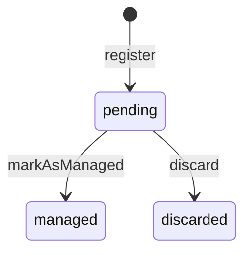

# Mensaje de contacto cuando no hay créditos para compensar — manual técnico

- **Plan:** `plan.md` (misma carpeta) · **Implementado:** 2026-11-20 · **Bounded Contexts:** `Balance`, `CarbonFootprint` (flujo público), `Shared` (menú)

## Qué hace y por qué

Tras un cálculo de huella público (encuesta de asistentes, calculadora de propiedad o calculadora de viajes de cuenta), la pantalla de resultado solo ofrecía «Compensar mi huella» si había opciones de compensación. Sin proyectos o sin crédito suficiente el visitante no veía nada y Bioscore no sabía que había demanda sin cubrir.

Ahora, si la cuenta del cálculo tiene la funcionalidad `Compensation` activa y `ListContributionOptionsService` no devuelve ninguna opción, el mismo bloque y botón llevan a una página de contacto con un aviso y un formulario. El envío crea (o actualiza) un agregado nuevo, `ContactRequest`, y avisa a los Administradores. Las solicitudes se gestionan en el panel de administración (`Proyectos > Solicitudes de contacto`). La decisión «ofrecer contacto» se centraliza en `ListContributionOptionsResponse::offersContact()` (`src/Balance/Application/ProjectContribution/Options/ListContributionOptionsResponse.php:20`). Decisiones y justificaciones: tabla «Decisiones tomadas» de `plan.md`.

## Mapa de piezas

| Capa | Fichero | Rol | Estado |
|---|---|---|---|
| Dominio | `src/Balance/Domain/Model/ContactRequest/ContactRequest.php` | Agregado (trait `AggregateRoot`) | nuevo |
| Dominio | `.../ContactRequest/{ContactRequestId,ContactRequestStatus,ContactRequestRepository,ContactRequestFilter}.php` | Id, estados (`style()` para el badge), puerto, filtro | nuevo |
| Dominio | `.../ContactRequest/{ContactRequestRegistered,ContactRequestContactDataUpdated,ContactRequestManaged,ContactRequestDiscarded}.php` | Eventos de dominio | nuevo |
| Dominio | `.../ContactRequest/{ContactRequestAlreadyResolvedException,ContactRequestAlreadyExistsException}.php` | Excepciones | nuevo |
| Aplicación | `src/Balance/Application/ContactRequest/ContactRequestAuthorizer.php` | Solo `Admin`/`SuperAdmin` | nuevo |
| Aplicación | `.../ContactRequest/Register/RegisterContactRequest{Request,Response,Service}.php` | Alta anónima (sin `User`) | nuevo |
| Aplicación | `.../ContactRequest/List/*`, `MarkAsManaged/*`, `Discard/*` | Listado y resolución | nuevo |
| Aplicación | `.../ContactRequest/ContactRequestNotAvailableException.php` | Se lanza si ya no procede ofrecer contacto | nuevo |
| Aplicación | `src/Balance/Application/ProjectContribution/Options/ListContributionOptions{Response,Service}.php` | `compensationEnabled` y `offersContact()` | modificado |
| Persistencia | `src/Balance/Infrastructure/Persistence/Doctrine/Mapping/ContactRequest.ContactRequest.orm.xml`, `Type/ContactRequestIdType.php`, `Repository/DoctrineContactRequestRepository.php`, `config/packages/doctrine.yaml` (tipo `contact_request_id`) | Mapping y repositorio | nuevo / modificado |
| Persistencia | `src/Balance/Infrastructure/Persistence/InMemory/Repository/InMemoryContactRequestRepository.php` | Repositorio de tests | nuevo |
| Persistencia | `migrations/Version20261120102740.php` | Crea `contact_requests` | nuevo |
| Notificación | `src/Balance/Infrastructure/Notification/ContactRequestRegisteredNotifier.php`, `templates/balance/notification/contact-request-registered.{notification,email}.html.twig` | Aviso a Administradores | nuevo |
| UI admin | `src/Balance/Infrastructure/UI/Web/Admin/ContactRequest/{ListController,ViewController,MarkAsManagedController,DiscardController,GetContactRequestFromIdTrait}.php` | Pantallas de administración | nuevo |
| UI admin | `src/Balance/Infrastructure/Symfony/Form/ListContactRequestsType.php`, `templates/balance/admin/contact-requests/{list,view}.html.twig`, `templates/components/List/Action/{MarkAsManaged,Discard}.html.twig`, `templates/balance/translations/{contactRequestStatus,projectContributionOrigin}.html.twig` | Filtro, plantillas, acciones de fila, traducciones de enums | nuevo |
| UI admin | `src/Shared/Infrastructure/UI/Web/Navigation/NodeLister.php` (nodo «Proyectos») | Entrada de menú | modificado |
| UI pública | `src/CarbonFootprint/Infrastructure/UI/Web/ProjectContribution/{ContributionContactHandler,ContributionContactResult,ContributionCountries}.php` | Lógica común de la página de contacto | nuevo |
| UI pública | `src/CarbonFootprint/Infrastructure/UI/Web/Public/{AttendeeSurvey,PropertyTrip}/Contribution/{ContactController,ContactThanksController}.php` | Rutas públicas | nuevo |
| UI pública | `src/Balance/Infrastructure/Symfony/Form/{RegisterContactRequestType,RegisterContactRequestFormData}.php`, `templates/carbon_footprint/project_contribution/{contact,contact_thanks}.html.twig` | Formulario y pantallas | nuevo |
| UI pública | `ContributionRoutes.php` (`contact`, `contactThanks`), `ContributionCheckoutHandler.php` (usa `ContributionCountries`), `*ContributionTrait.php`, `*/ResultController.php`, `*/Contribution/ChooseController.php`, `templates/carbon_footprint/public/{_compensate_cta,attendee_survey/result,property_trip/result}.html.twig` | Enlace del botón y redirecciones | modificado |

## Modelo de dominio

`ContactRequest` (`ContactRequest.php`) guarda cuenta, propiedad opcional, origen (`ProjectContributionOrigin`) e id del origen, nombre del origen, huella en kg, datos de contacto (nombre, email, teléfono, país ISO, es empresa, razón social, NIF, comentario), idioma, estado, fecha de solicitud y, si está resuelta, fecha y usuario.

| Método | Efecto | Evento |
|---|---|---|
| `register()` (`:150`) | Valida datos (`\InvalidArgumentException` con nombre/email vacío, email mal formado o `co2eqKg < 0`); queda `pending` | `ContactRequestRegistered` |
| `updateContactData()` (`:197`) | Solo si `pending`; mismas validaciones; no toca `requestedAt`, cuenta, origen ni huella | `ContactRequestContactDataUpdated` |
| `markAsManaged()` (`:227`) / `discard()` (`:240`) | Solo si `pending`; fijan `resolvedAt` y `resolvedBy` | `ContactRequestManaged` / `ContactRequestDiscarded` |

`managed` y `discarded` son terminales: `guardPending()` (`:303`) lanza `ContactRequestAlreadyResolvedException`. La unicidad (`origin`, `originId`) la impone el índice `uq_contact_request_origin`; el repositorio Doctrine traduce `UniqueConstraintViolationException` en `ContactRequestAlreadyExistsException` (`DoctrineContactRequestRepository.php:31-35`) y el InMemory la lanza si otra solicitud con distinto id comparte origen (`InMemoryContactRequestRepository.php:25-33`).

`ContactRequestFilter`: `resolved` (`null` todas, `false` pendientes, `true` gestionadas y descartadas; aplicado en `DoctrineContactRequestRepository.php:75`), `accountId`, `search` (nombre o email), orden por `requestedAt` descendente por defecto.

## Flujo de una operación

**1. Mostrar el botón.** `AttendeeSurvey/ResultController.php:69-89` y `PropertyTrip/ResultController.php:71-94` llaman a `ListContributionOptionsService` y pasan `hasContributionOptions` y `offersContact` a la plantilla. `ListContributionOptionsService.php:33` devuelve la respuesta con `compensationEnabled: false` si la funcionalidad está desactivada; `offersContact()` = `compensationEnabled && isEmpty()`. `_compensate_cta.html.twig:4` pinta el bloque si hay opciones o procede contacto; el `href` es `contribution_path` o `contact_path`.

**2. Página de contacto (GET/POST).** `ContactController` (uno por flujo; la de propiedad atiende los prefijos `property-trip` y `trip`) aplica `PublicFormRateLimiter`, resuelve el token con el trait del flujo, construye un `ContributionContext` y delega en `ContributionContactHandler::handle()`:
1. Pide opciones (`ContributionContactHandler.php:34-39`). Si no procede contacto: con compensación activa redirige a `routes->choose` (hay opciones); con compensación desactivada, a `routes->result` (`:41-46`).
2. Crea `RegisterContactRequestType` con la lista de países de `ContributionCountries`.
3. Con el formulario válido invoca `RegisterContactRequestService` (sin `User`) y redirige a `routes->contactThanks`. `ContactRequestNotAvailableException` → redirige a `choose`. `ContactRequestAlreadyExistsException` (doble envío simultáneo) → `DomainEventPublisher::instance()->clearPending()` y agradecimiento, para no publicar `ContactRequestRegistered` de una solicitud que no se guardó (`:77-80`; hallazgo A1 de `review.md`).
4. Si no, devuelve `form`, `routes`, `co2eqKg` y `token` para `contact.html.twig`. Con datos no válidos responde 200 con los errores.

**3. `RegisterContactRequestService`** (`src/Balance/Application/ContactRequest/Register/RegisterContactRequestService.php`): vuelve a calcular las opciones (con `allowSharedCredit: true`) y lanza `ContactRequestNotAvailableException` si `!offersContact()`. Busca `findOneByOrigin`: si existe y está `pending` actualiza datos (`created: false`, sin notificación); si está resuelta la devuelve intacta; si no existe, `new ContactRequest(id: ...)` + `register()` + `add()` (`created: true`). El controlador no distingue los tres casos: siempre agradece.

**4. Notificación.** `ContactRequestRegisteredNotifier` (suscrito a `ContactRequestRegistered`) busca `UserFilter(role: Admin, excludeRole: SuperAdmin, limit: 0)` y emite por cada uno un `SystemNotification` `Internal` y otro `Email`, con `accountId` del administrador. Todos los parámetros externos se escapan con `| e` en las plantillas (hallazgo C1).

**5. Administración.** `ListController` fija por defecto `ListContactRequestsRequest(resolved: false)` (`ListController.php:40`); `MarkAsManagedController` y `DiscardController` son GET con `#[CsrfProtected('contact_request_manage' | 'contact_request_discard')]`, redirigen al listado con flash `success`, o `warning` si ya estaba resuelta; `UnauthorizedActionException` → 403. `ViewController` pasa `countryName` (resuelto con `CountryRepository::findByIso`, o el ISO si no existe).

## Autorización y ámbito

- `ContactRequestAuthorizer`: `List`, `View` y `Edit` para quien tenga `SuperAdmin` o `Admin` (vía `userHasRole`, respeta impersonación); `Register` y `Remove` siempre `false`. Marcar y descartar usan `Action::Edit`.
- El listado es global: no se filtra por cuenta actual; `accountId` es solo un filtro opcional.
- El alta pública no pasa por `Authorizer`: la protección es el token del enlace, `PublicFormRateLimiter`, el CSRF del formulario y `offersContact()` revalidado en el servicio.
- Notificación: solo `Admin` sin `SuperAdmin`. Propietarios y Usuarios no ven ni reciben nada.
- Feature flag: `AccountFeature::Compensation` de la cuenta del cálculo (no del distribuidor).

## Persistencia y migración

Tabla `contact_requests` (mapping `ContactRequest.ContactRequest.orm.xml`), creada por `migrations/Version20261120102740.php:22-47` (aplicada por el usuario según `review.md`). Índices `idx_contact_request_status (status, requested_at)`, `idx_contact_request_account (account_id)` y única `uq_contact_request_origin (origin, origin_id)`. `contact_country` es `VARCHAR(3)` (el ISO del maestro `Country` se guarda tal cual). Sin backfill.

## Configuración y operación

- Sin variables de entorno, colas ni comandos nuevos. El alta de la solicitud es síncrona; las notificaciones siguen el canal habitual de `SystemNotifier`.
- `services.yaml` de `Balance` y `config/routes.yaml` cubren las clases y rutas nuevas por autoconfiguración; solo se añadió el tipo `contact_request_id` en `config/packages/doctrine.yaml`.
- Rutas públicas (acceso `PUBLIC_ACCESS`): `public_carbon_footprint_attendee_survey_contribution_contact[_thanks]`, `public_carbon_footprint_property_trip_contribution_contact[_thanks]` y `public_carbon_footprint_trip_contribution_contact[_thanks]`. Rutas admin: `admin_contact_requests`, `_view`, `_manage`, `_discard`.
- Traducciones en `translations/messages+intl-icu.{es,en,tr}.xlf` y los dominios `contactRequestStatus` y `projectContributionOrigin`.

## Cómo extenderlo

- **Ofrecer contacto en otro flujo público:** informar `contact` y `contactThanks` en el `ContributionRoutes` del trait del flujo, añadir `ContactController` y `ContactThanksController` que reutilicen `ContributionContactHandler`, pasar `offersContact` y `contact_path` al CTA, y añadir la redirección en su `ChooseController`. El origen debe existir en `ProjectContributionOrigin`. `OwnerContributionTrait` deja `contact` a `null`: ninguna plantilla compartida debe usarlo sin comprobar.
- **Nuevo estado o acción:** método en `ContactRequest` con `guardPending()`, evento con su `apply...`, servicio con `Action::Edit` y componente `List:Action:*`.
- **Trampa:** el dominio de eventos se encola durante la petición (`DomainEventPublisher` bloqueado hasta `kernel.response`); si se captura una excepción tras un `add()` fallido hay que llamar a `clearPending()`.
- El texto del aviso habla de «el proyecto seleccionado» y firma «Equipo Supply Bioscore» incluso con marca blanca: es una decisión aceptada del plan.

## Tests

- Unitarios: `tests/Unit/Balance/Domain/Model/ContactRequest/` (agregado, repositorio abstracto + InMemory, Mothers), `tests/Unit/Balance/Application/ContactRequest/` (authorizer, Register, List, MarkAsManaged, Discard), `tests/Unit/Balance/Application/ProjectContribution/Options/ListContributionOptionsServiceTest.php` (`offersContact`), `tests/Unit/Balance/Infrastructure/Notification/ContactRequestRegisteredNotifierTest.php` y `ContactRequestRegisteredTemplatesTest.php` (escape de HTML con Twig real).
- Behat: `tests/Acceptance/Balance/contact-request-{list,view,manage,discard}.feature` y `tests/Acceptance/CarbonFootprint/{attendee-survey,property-trip}-contact-request.feature`; pasos nuevos en `tests/Acceptance/Balance/BalanceContext.php`. Los seis escenarios previos que afirmaban «no se ofrece compensar» se reescribieron en `attendee-survey-contributions.feature`, `project-contributions.feature` y `shared-credit-distributor.feature`.
- Ejecución (`Makefile`): `make test-unit options=<ruta>`, `make test-acceptance options=<ruta>`, `make test-parallel`. No existe `make test-this`.
- Hueco: ningún escenario ejerce «país inexistente» (lo rechaza el `ChoiceType`); ver «Notas sobre el plan» de `review.md`.

## Desviaciones y deuda

- Desviaciones declaradas en `## Implementación` de `plan.md`: paso Behat adicional para el filtro «Terminada», tests sin data providers, correo con teléfono y cálculo, y `removeLegacyRedirectsFile()` limitado a la feature en curso.
- El plan prescribía capturar `UniqueConstraintViolationException` en el handler; se corrigió con `ContactRequestAlreadyExistsException` y `clearPending()` (A1 en `review.md`). El plan no se ha actualizado.
- `review.md`: 0 hallazgos abiertos; B2 (guarda `is_authorized` en las acciones de gestión) descartado por el usuario.
