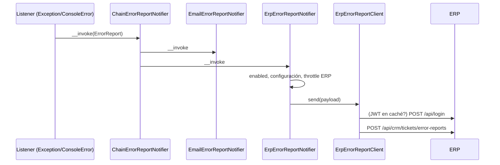

# Reporte de errores al ERP — manual técnico

- **Plan:** `plan.md` (misma carpeta) · **Implementado:** 2026-11-17 · **Bounded Contexts:** `Shared` (subsistema de reporte de errores)

## Qué hace y por qué

Antes, un error 500 o un fallo de comando de consola solo producía un correo (`EmailErrorReportNotifier`). Ahora el puerto `ErrorReportNotifier` (`src/Shared/Domain/Model/ErrorReport/ErrorReportNotifier.php`) se resuelve a un `ChainErrorReportNotifier` que invoca dos canales: email y ERP. El canal ERP hace `POST /api/crm/tickets/error-reports` en `dediez-erp`, que crea un ticket automático del proyecto o acumula una ocurrencia si ya hay uno abierto con la misma huella.

Decisiones clave (tabla «Decisiones tomadas» del plan): dos interruptores independientes (`ERROR_NOTIFICATIONS_ENABLED` solo gobierna el email; `ERROR_NOTIFICATIONS_ERP_ENABLED` el ERP, `false` por defecto), envío síncrono (el transporte Messenger es Doctrine y se perdería justo en errores de base de datos), throttle propio por canal y aislamiento de fallos entre canales. Los listeners (`ExceptionListener.php:37`, `ConsoleErrorListener.php:31`) y el dominio no cambian.

## Mapa de piezas

| Fichero | Rol | Estado |
|---|---|---|
| `src/Shared/Infrastructure/ErrorReport/ChainErrorReportNotifier.php` | Notificador compuesto; cada canal en su `try/catch` (`:23-33`) | nuevo |
| `src/Shared/Infrastructure/ErrorReport/Erp/ErpErrorReportNotifier.php` | Canal ERP: interruptor, configuración, throttle, envío, log de fallos | nuevo |
| `src/Shared/Infrastructure/ErrorReport/Erp/ErpErrorReportClient.php` | Login, caché del JWT, `POST` del informe, reintento tras 401 | nuevo |
| `src/Shared/Infrastructure/ErrorReport/Erp/ErpErrorReportPayload.php` | `ErrorReport` → array del contrato del ERP, con recortes | nuevo |
| `src/Shared/Infrastructure/ErrorReport/CacheErrorReportThrottle.php` | Tercer argumento `$keyPrefix = 'error_report'` (`:15`, clave en `:25`) | modificado |
| `src/Shared/Infrastructure/Symfony/DependencyInjection/services.yaml` | Parámetros (`:12-17`), servicios (`:114-145`), `when@test` (`:270`) | modificado |
| `.env` | Seis variables `ERROR_NOTIFICATIONS_ERP_*` | modificado |
| `.claude/ARCHITECTURE.md` | Fila «Reporte de errores» (`:111`) | modificado |
| `tests/Unit/Shared/Infrastructure/ErrorReport/` | `ChainErrorReportNotifierTest`, `ErrorReportNotifierWiringTest`, `Erp/*Test`, dobles `SpyLogger` y `ThrowingErrorReportNotifier`; `CacheErrorReportThrottleTest` ampliado | nuevo / modificado |

## Modelo de dominio

Sin cambios. El informe es `ErrorReport` con `ErrorReportException`, `ErrorReportContext` y `ErrorReportRequest` (`src/Shared/Domain/Model/ErrorReport/`), ya saneado por `ErrorReportFactory` (claves sensibles a `***`, cabeceras en lista blanca, valores a 500 caracteres). No hay agregados, eventos ni migración.

## Flujo de una operación

1. El listener construye el informe con `ErrorReportFactory` y llama al puerto (solo HTTP ≥ 500 o cualquier error de consola).
2. `ChainErrorReportNotifier::__invoke` (`ChainErrorReportNotifier.php:21`) recorre `[Email, Erp]` en ese orden. Una `\Throwable` de un canal se registra como `error` y no impide el siguiente.
3. `ErpErrorReportNotifier::__invoke` (`ErpErrorReportNotifier.php:23-48`): sale en silencio si `!$enabled` (`:25`); si falta URL, usuario, token o proyecto escribe un `warning` y sale; consulta el throttle (`shouldNotify` marca la huella al consultar); construye el payload y llama a `send`. Cualquier excepción se registra como `error` con incidente y motivo; nunca se propaga.
4. `ErpErrorReportClient::send` (`ErpErrorReportClient.php:42-60`): usa el JWT de `cache.app` o hace login (`:74-89`, `username` + API token como `password`, espera `{"token": …}`). Si el reporte devuelve 401 **y** el JWT venía de caché, lo olvida, hace login y reintenta una vez (`:49-53`). Cualquier estado distinto de 200/201 lanza `\RuntimeException` con el cuerpo recortado a 500 caracteres (`:58`). El API token no entra en ningún mensaje.
5. Límites: como máximo 3 peticiones por error (reporte + login + reporte); `timeout` y `max_duration` de 5 s por petición (`:17,19`), techo de 15 s síncronos añadidos a la página de error.

## Autorización y ámbito

No aplica `Authorizer` ni roles: es un subsistema técnico sin UI. La autenticación es contra el ERP, con el usuario y API token configurados; el ERP exige que el proyecto sea del cliente de la cuenta de ese usuario (422 en caso contrario). La impersonación no interviene, salvo que el contexto del informe la refleja (`impersonated`, `impersonator_*`).

## Persistencia y migración

Ninguna migración ni tabla. Solo `cache.app`: JWT en `error_report_erp_jwt_<sha1(url|usuario|token)>` durante 600 s (`ErpErrorReportClient.php:21,134`; el ERP emite JWT de 15 minutos) y throttle en `error_report_erp_<huella>`, disjunta de la del email `error_report_<huella>`. Los fallos de caché se ignoran (se hace login; el throttle deja pasar).

## Configuración y operación

| Variable (`.env`) | Defecto | Uso |
|---|---|---|
| `ERROR_NOTIFICATIONS_ERP_ENABLED` | `false` | Activa el canal ERP |
| `ERROR_NOTIFICATIONS_ERP_URL` | vacío | URL base, sin ruta (`/` final tolerado) |
| `ERROR_NOTIFICATIONS_ERP_USERNAME` | vacío | Usuario del ERP |
| `ERROR_NOTIFICATIONS_ERP_API_TOKEN` | vacío | API token (poner solo en `.env.local`) |
| `ERROR_NOTIFICATIONS_ERP_PROJECT_ID` | vacío | UUID del proyecto del ERP |
| `ERROR_NOTIFICATIONS_ERP_THROTTLE_MINUTES` | `15` | Ventana por huella; `0` = sin límite |

- Los valores reales van en el `.env.local` de cada plataforma; tras cambiarlos, `make cc` (o redeploy) en el entorno correspondiente.
- Los fallos quedan en el canal de log `error_report` (los tres servicios llevan el tag `monolog.logger`, `services.yaml:135,143`). No hay fallback a email ni cola de reintento.
- `when@test` fuerza `error_report.erp.enabled: false` (`services.yaml:270`), porque `compose.yaml` inyecta `.env.local` en el contenedor y `TEST_CONT` no lo neutraliza (hallazgo M1 de `review.md`).
- Contrato del payload en snake_case (`project_id`, `incident_id`, `status_code`, `occurred_at`, `exception`, `previous`, `context`, `request`, `command`); recortes y límites en constantes de `ErpErrorReportPayload.php:12-52` (p. ej. traza 60 000, traza de previas 5 000, máx. 5 previas, 20 roles, 2 000 entradas de mapa) para no ser rechazado con 422. El texto pasa por `mb_scrub` porque la traza llega recortada por bytes y un carácter partido rompería el JSON.

## Cómo extenderlo

Para añadir otro canal (p. ej. Slack): 1) implementar `ErrorReportNotifier`, respetando el patrón: salir si está desactivado, throttle propio con `CacheErrorReportThrottle` y otro `$keyPrefix` (definido como servicio con `class:`, como `error_report.erp_throttle`, `services.yaml:114-119`), capturar y loguear excepciones; 2) añadirlo a `$notifiers` de `ChainErrorReportNotifier` (`services.yaml:137-143`); 3) tag `monolog.logger` canal `error_report`. Trampas: compartir clave de throttle entre canales hace que el segundo nunca envíe; si cambia el contrato del ERP (límites o campos) hay que ajustar `ErpErrorReportPayload`; el orden de la cadena es email primero.

## Tests

Unitarios en `tests/Unit/Shared/Infrastructure/ErrorReport/`: `Erp/ErpErrorReportClientTest` (login, caché, 401 con reintento único, límite de 5 s por petición, sin filtrar el token), `Erp/ErpErrorReportNotifierTest` (desactivado, sin configurar, throttle, errores sin propagar, niveles de log), `Erp/ErpErrorReportPayloadTest` (contrato, recortes, UTF-8, mapas vacíos), `ChainErrorReportNotifierTest` (aislamiento), `CacheErrorReportThrottleTest` (prefijos) y `ErrorReportNotifierWiringTest` (la cadena es el servicio del puerto y el ERP está apagado en test). No hay Behat: el cliente de aceptación desactiva la captura de excepciones. Ejecutar: `make test-unit options="--filter ErrorReport"`.

## Desviaciones y deuda

- Desviación declarada en `plan.md` (`## Implementación`): lectura/escritura del JWT repartida en `cachedJwt()`/`freshJwt()`/`forgetJwt()`; sin cambio de comportamiento.
- Código posterior al plan por la review (`review.md`, 0 hallazgos abiertos): `max_duration` de 5 s en lugar de 10 s (B2), `error_report.erp.enabled: false` en `when@test` aunque el plan decía no tocar nada (M1), y tests de log/payload/cableado (B1, B3). El plan no refleja M1 ni B2.
- Sin deuda abierta.
