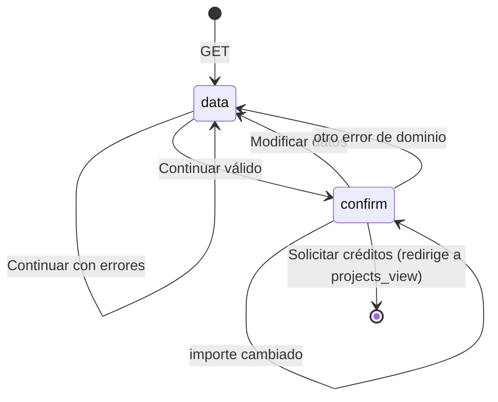

# Solicitud de créditos con importe, datos de facturación y aceptación de condiciones — manual técnico

- **Plan:** `plan.md` (misma carpeta) · **Revisión:** `review.md` · **Implementado:** 2026-11-26 · **Bounded Contexts:** `Balance` (principal), `Payments` y `Property` (solo lectura)

## Qué hace y por qué

La solicitud de créditos de CO2 (`/projects/{projectId}/credits/request`) pedía solo las toneladas. Ahora recoge además los datos de facturación, muestra en un segundo estado de la misma pantalla el desglose base / IVA / total y exige marcar una casilla de aceptación. La solicitud guarda una foto fija del importe aceptado (`CreditPurchaseQuote`) y de la facturación (`CreditPurchaseBilling`); el Administrador la ve al validar, ambos perfiles la ven en el detalle del crédito y el solicitante recibe un correo de resumen.

El importe es `toneladas × Project::costPerTonne()` más el IVA de `App\Payments\Domain\Model\Vat\VatCalculator`, asumiendo siempre empresa. La plataforma no cobra ni genera factura en este flujo. Las decisiones (dos estados sin sesión ni JavaScript, precio usado, texto de la casilla, proyecto sin coste, origen del pre-relleno) están en la tabla «Decisiones tomadas» de `plan.md`.

## Mapa de piezas

| Capa | Fichero | Rol | |
|---|---|---|---|
| Dominio | `src/Balance/Domain/Model/CreditPurchase/CreditPurchaseBilling.php` | Value object de facturación | nuevo |
| Dominio | `src/Balance/Domain/Model/CreditPurchase/CreditPurchaseQuote.php` | Value object base / tipo / IVA / motivo | nuevo |
| Dominio | `src/Balance/Domain/Model/CreditPurchase/CreditPurchaseQuoteChangedException.php` | `\DomainException` (código 409) si el total aceptado ya no coincide | nuevo |
| Dominio | `src/Balance/Domain/Model/CreditPurchase/CreditPurchase.php` | 11 campos planos, `requestedQuote()`, `billing()`, `purchasedQuote()`, `request()` ampliado | modificado |
| Dominio | `src/Balance/Domain/Model/CreditPurchase/CreditPurchaseRequested.php` | Evento con presupuesto y facturación | modificado |
| Dominio | `src/Balance/Domain/Model/CreditPurchase/CreditPurchaseRepository.php` | `latestWithBillingFor()` | modificado |
| Aplicación | `src/Balance/Application/CreditPurchase/Request/CreditPurchaseQuoter.php` | Cálculo del presupuesto | nuevo |
| Aplicación | `src/Balance/Application/CreditPurchase/Request/CreditPurchaseBillingDefaults.php` y `CreditPurchaseBillingDefaultsResponse.php` | Pre-relleno de facturación | nuevos |
| Aplicación | `src/Balance/Application/CreditPurchase/Request/RequestCreditPurchaseRequest.php` | 9 propiedades nuevas | modificado |
| Aplicación | `src/Balance/Application/CreditPurchase/Request/RequestCreditPurchaseService.php` | Aceptación, facturación, presupuesto y comparación del total | modificado |
| Persistencia | `src/Balance/Infrastructure/Persistence/Doctrine/Mapping/CreditPurchase.CreditPurchase.orm.xml` | 11 columnas nulables | modificado |
| Persistencia | `.../Doctrine/Repository/DoctrineCreditPurchaseRepository.php`, `.../InMemory/Repository/InMemoryCreditPurchaseRepository.php` | Consulta nueva | modificados |
| Persistencia | `migrations/Version20261126115542.php` | Migración | nueva |
| UI | `src/Balance/Infrastructure/UI/Web/CreditPurchase/RequestController.php` | Máquina de dos estados | modificado |
| UI | `src/Balance/Infrastructure/UI/Web/CreditPurchase/BillingCountries.php` | Lista ISO => nombre | nuevo |
| UI | `src/Balance/Infrastructure/Symfony/Form/RequestCreditPurchaseType.php` | Campos, tres botones y grupos de validación | modificado |
| Twig | `templates/balance/credits/request.html.twig` | Estados `data` y `confirm` | modificado |
| Twig | `templates/balance/credits/_allocations.html.twig` | Importe solicitado, importe de la compra y facturación en el detalle | modificado |
| Twig | `templates/balance/admin/credits/validate.html.twig` | Importe solicitado y facturación | modificado |
| Twig | `templates/balance/credits/list.html.twig`, `templates/balance/admin/credits/list.html.twig`, `templates/balance/projects/view.html.twig` | Celda «Importe» con IVA | modificados |
| Notificaciones | `src/Balance/Infrastructure/Notification/CreditPurchaseRequestedNotifier.php` | Total a Administradores y correo al solicitante | modificado |
| Notificaciones | `src/Balance/Infrastructure/Notification/CreditPurchaseResolvedNotifier.php` | Importe con IVA al validar | modificado |
| Notificaciones | `templates/balance/notification/credit-purchase-requested-requester.email.html.twig` | Correo de resumen | nuevo |
| Notificaciones | `templates/balance/notification/credit-purchase-{requested,validated,partially-validated}.{email,notification}.html.twig` | Total, desglose, «(IVA incluido)» y formato del importe | modificados |
| i18n | `translations/messages+intl-icu.{es,en,tr}.xlf`, `translations/validators.{es,en,tr}.xlf`, `templates/balance/translations/creditPurchaseErrors.html.twig` | Claves nuevas | modificados |

## Modelo de dominio

### Value objects

**`CreditPurchaseBilling`** (`final`): `legalName`, `taxId`, `street`, `postalCode`, `city`, `country`, `email`. El constructor recorta cada valor, rechaza vacíos con `\InvalidArgumentException`, pasa el país a mayúsculas y valida el email con `filter_var` (`CreditPurchaseBilling.php:23-43, 80-89`). Las propiedades son `readonly` declaradas fuera del constructor porque se normalizan antes de asignarse.

**`CreditPurchaseQuote`** (`final`): `taxableAmount`, `vatRate`, `vatAmount`, `vatReason` (`VatExemptionReason`). No admite negativos; `totalAmount()` es `round(base + IVA, 2)` y no se persiste; `matchesTotal()` tolera menos de 0,005 (`CreditPurchaseQuote.php:11-50`).

### Agregado `CreditPurchase`

- Estado nuevo: `requestedAmount`, `requestedVatRate`, `requestedVatAmount`, `requestedVatReason` y siete `billing*`, todos `null` por defecto (`CreditPurchase.php:42-52`).
- `request(AccountId, ProjectId, UserId, float $tonnes, ?CreditPurchaseQuote $quote = null, ?CreditPurchaseBilling $billing = null)` (`CreditPurchase.php:283-306`). Los dos últimos son opcionales para los fixtures existentes; el servicio pasa siempre `billing`.
- `requestedQuote()` (`:162`) reconstruye el value object si `requestedAmount` no es nulo.
- `billing()` (`:176`) reconstruye el value object si `billingLegalName` no es nulo.
- `purchasedQuote(?float $costPerTonne)` (`:193-211`), consulta sin evento: base = `round(purchasedTonnes × coste, 2)`, IVA = `round(base × requestedVatRate / 100, 2)`, con el motivo congelado. Devuelve `null` si falta el coste, las toneladas compradas, el tipo o el motivo.

Invariantes:

- Solicitud creada por `RequestCreditPurchaseService`: `billing` siempre presente; `requestedQuote` presente si y solo si el proyecto tenía coste por tonelada (un coste `0` produce presupuesto de 0,00).
- Solo `applyCreditPurchaseRequested` escribe esos once campos (`:604-628`). `validate()`, `reject()`, `cancel()` y `transfer()` no los tocan; los créditos nacidos con `assign()` o `receive()` no los tienen.
- `amount` («Coste del lote») es un dato distinto, informado por el Administrador; no se rellena con el importe solicitado.

### Evento `creditPurchaseRequested`

`payload()` añade `requestedAmount`, `requestedVatRate`, `requestedVatAmount`, `requestedVatReason` y las siete claves `billing*` (`CreditPurchaseRequested.php:73-93`). `rebuildFromPayload()` solo construye cada value object si su clave principal (`requestedAmount`, `billingLegalName`) está presente y no es nula, así que los eventos antiguos se reconstruyen sin ellos (`:95-128`). Los datos de facturación quedan en el registro de auditoría.

## Flujo de una operación

### Solicitar (GET y POST sobre la misma URL)



1. **Cortes previos** (`RequestController.php:53-68`): proyecto inexistente → 404; proyecto que no es `ProjectType::EmissionCompensation` → 404; sin cuenta actual (`LoggedAccount`) → 403; cuenta sin `AccountFeature::Compensation` → 403.
2. **Pre-relleno** (`:70-84`): `BillingCountries::countries()` y `CreditPurchaseBillingDefaults`. El país del pre-relleno se descarta si no está en la lista. Las toneladas arrancan en `0.0`.
3. `CreditPurchaseBillingDefaults` (`CreditPurchaseBillingDefaults.php:29-76`) autoriza `Register` (por eso el GET ya devuelve 403 sin permiso) y resuelve, por orden:
   1. `latestWithBillingFor($accountId)`: la solicitud más reciente de la cuenta con facturación, de cualquier proyecto y estado (se copian los siete datos, email incluido);
   2. el `Payee` de tipo `Account`: razón social (o nombre de la cuenta si está vacía), NIF, dirección, país recortado y en mayúsculas, y email = `username` del usuario conectado;
   3. nombre de la cuenta y `username`; el resto vacío.
4. **Formulario** (`RequestCreditPurchaseType.php`): `validation_groups` es `['Default', 'confirm']` solo si se pulsó `request` (`:113-117` dentro de `configureOptions`), de modo que `IsTrue` sobre `termsAccepted` no actúa en «Continuar». `modify` lleva `validation_groups: false`.
5. **Transiciones** (`RequestController.php:89-119`). Con el formulario inválido se vuelve a `confirm` solo si se pulsó `request` y todos los errores son de `termsAccepted` (`onlyTermsAreInvalid`, `:145-161`); en otro caso, `data`.
6. **Presupuesto mostrado** (`:124-126`): solo en `confirm`, con `CreditPurchaseQuoter`. En `confirm` los campos de datos viajan dentro de un `d-none` y `acceptedTotal` se escribe a mano como `<input type="hidden">` (`request.html.twig:23-32, 97`).
7. **Servicio** (`RequestCreditPurchaseService.php:41-101`):
   1. autoriza `Register` sobre un `CreditPurchase` de la cuenta del request;
   2. carga el proyecto y exige que sea de compensación (`ProjectNotCompensableException`);
   3. `\InvalidArgumentException` si `!termsAccepted`;
   4. construye `CreditPurchaseBilling`;
   5. recalcula el presupuesto en servidor;
   6. `CreditPurchaseQuoteChangedException` si la presencia de presupuesto y de `acceptedTotal` no coincide, o si el total difiere;
   7. adhiere el proyecto a la cuenta si no lo estaba (después de todas las validaciones);
   8. `request()` y `add()`.
8. **Respuesta**: éxito → flash «Solicitud de créditos enviada correctamente» y redirección a `projects_view`. `CreditPurchaseQuoteChangedException` → flash `warning`, estado `confirm` y `resetConfirmation()` (`:169-183`), que recrea el formulario desde el DTO con la casilla desmarcada y `acceptedTotal` nulo. `\DomainException`, `\InvalidArgumentException` o `ProjectNotCompensableException` → flash «Error inesperado» y estado `data`.

### Cálculo del IVA

`CreditPurchaseQuoter` (`CreditPurchaseQuoter.php:17-29`) devuelve `null` sin coste o con toneladas `<= 0`; si no, llama a `calculate($base, $country, true, $taxId)`. Reglas de `VatCalculator` (país propio `ESP`, `config/packages/tax.yaml`):

| Caso | Tipo | Motivo |
|---|---|---|
| País no encontrado, dado de baja o fuera de la UE | 0 % | `outside_eu` |
| `ESP` | tipo del maestro `Country` | `standard` |
| Otro país UE con NIF-IVA de formato válido | 0 % | `reverse_charge` |
| Otro país UE sin formato válido | tipo del país de destino | `oss_destination` |

`VatNumberFormatValidator` comprueba solo el formato (ignora espacios, guiones y puntos); no consulta ningún censo. Un país sin tipo de IVA informado en el maestro calcula al 0 %.

### Validación y consulta

- `purchasedQuote(project.costPerTonne)` alimenta la columna «Importe» de los tres listados y el bloque «Importe de la compra» del detalle. Sin presupuesto calculable, las celdas muestran la base sin IVA (`toneladas × coste`) o `-`, sin la marca «IVA incl.».
- `validate.html.twig:33-78` muestra lo solicitado y la facturación; `_allocations.html.twig:44-58, 86-99, 126-153` hace lo propio en el detalle, que comparten Propietario y Administrador.
- En el detalle y en la validación el país aparece como código ISO; en el estado `confirm`, como nombre.
- Los listados solo enlazan al detalle de créditos validados. El detalle de una solicitud pendiente se alcanza por URL, por ejemplo desde el botón del correo de resumen.

### Notificaciones

| Evento | Destinatario | Canal | Cambio |
|---|---|---|---|
| `CreditPurchaseRequested` | `SuperAdmin` y `Admin` | Interna y correo | Parámetro `requestedTotal`; frase «Importe aceptado por el solicitante…» si hay presupuesto |
| `CreditPurchaseRequested` | Usuario de `requestedBy` | Correo | Nuevo, «Hemos recibido su solicitud de créditos» (`CreditPurchaseRequestedNotifier.php:77-112`); no se envía si el usuario no existe |
| `CreditPurchaseValidated` | Usuario de `requestedBy` | Interna y correo | `amount` = total con IVA de lo comprado si hay presupuesto; `taxableAmount`, `vatRate`, `vatAmount`, `vatReason` (`CreditPurchaseResolvedNotifier.php:49-79`) |

Las cuatro plantillas de validación formatean `{amount}` a dos decimales salvo cuando llega `'-'`. El correo de resumen va al usuario solicitante, no al email de facturación; escapa `{project}` y `{email}` con `| e` porque `` no escapa parámetros.

## Autorización y ámbito

`CreditPurchaseAuthorizer` no cambia:

| Quién | Solicitar | Ver detalle y listado |
|---|---|---|
| `Owner` de la cuenta actual con «Compensación» | Sí | Sí, los de su cuenta |
| `Admin` / `SuperAdmin` sin impersonar | No (403) | Sí |
| `Admin` impersonando una cuenta con «Compensación» | Sí (`CurrentRoles` le da `Owner` y `User`) | Sí, como Propietario |
| `User` | No | No |

La cuenta sale de `LoggedAccount` (respeta impersonación), pero `requestedBy` es el usuario conectado. Al solicitar impersonando, el correo de resumen y los avisos de resolución van a quien impersona, y su `username` es el email por defecto cuando no hay solicitud anterior.

## Persistencia y migración

Tabla `credit_purchases`, once columnas nulables sin índices nuevos ni backfill:

| Columna | Tipo |
|---|---|
| `requested_amount`, `requested_vat_rate`, `requested_vat_amount` | `DOUBLE PRECISION` |
| `requested_vat_reason` | `VARCHAR(30)` (`VatExemptionReason`) |
| `billing_legal_name`, `billing_city`, `billing_email` | `VARCHAR(255)` |
| `billing_tax_id` | `VARCHAR(50)` |
| `billing_street` | `VARCHAR(512)` |
| `billing_postal_code` | `VARCHAR(20)` |
| `billing_country` | `VARCHAR(10)` |

La migración `migrations/Version20261126115542.php` existe, coincide con `migration.sql` y está sin commitear; no se ha comprobado si está aplicada. Se aplica con `make migrate`.

`latestWithBillingFor` filtra por `accountId` y `billingLegalName IS NOT NULL`, ordena por `requestedAt DESC, id DESC` y devuelve uno (`DoctrineCreditPurchaseRepository.php:288`, `InMemoryCreditPurchaseRepository.php:267`).

## Configuración y operación

Sin variables de entorno, servicios declarados a mano, comandos ni tareas programadas nuevos: el BC se carga por recurso con autowiring. El cálculo depende de los datos del maestro de países de `Property` (ISO, tipo de IVA y pertenencia a la UE): un país sin ISO no aparece en el selector (`BillingCountries.php`).

## Cómo extenderlo

**Añadir un dato de facturación:**

1. Propiedad, validación y getter en `CreditPurchaseBilling`.
2. Campo `billing<Nombre>` en el constructor de `CreditPurchase`, asignación en `applyCreditPurchaseRequested` y lectura en `billing()`.
3. `payload()` y `rebuildFromPayload()` del evento, tolerando la ausencia de la clave.
4. Mapping XML con columna nulable; la migración se escribe a mano (nunca `make migration`).
5. `RequestCreditPurchaseRequest`, `CreditPurchaseBillingDefaultsResponse` y las tres ramas de `CreditPurchaseBillingDefaults`.
6. Form type, constructor del DTO en `RequestController`, los dos estados de `request.html.twig`, `validate.html.twig`, `_allocations.html.twig`, los parámetros de `notifyRequester` y el correo de resumen.
7. `make translation` y completar EN y TR.

**Cambiar la fórmula del importe:** tocar `CreditPurchaseQuoter` y `CreditPurchase::purchasedQuote()` a la vez; son dos implementaciones independientes de la misma regla.

**Trampas:**

- `purchasedQuote()` usa el coste **vigente** del proyecto y el tipo de IVA **congelado**. `UpdateProjectService` solo impide cambiar el coste cuando quedan créditos validados sin consumir (`UpdateProjectService.php:68-79`); las solicitudes pendientes no lo bloquean, así que el «Importe de la compra» puede no coincidir con el «Total solicitado».
- `purchasedQuote()` parte de `purchasedTonnes`: un crédito del que se han transferido toneladas conserva su importe original, y los lotes recibidos no tienen importe con IVA.
- Cualquier lectura de `billing()` valida el value object: una fila con `billing_legal_name` y otra columna `billing_*` vacía (por ejemplo, tras un backfill manual) lanza `\InvalidArgumentException`.
- El formulario valida el email con `Assert\Email` y el value object con `filter_var`. Si alguna dirección pasara la primera y no la segunda, el envío acabaría en «Error inesperado».
- `RequestController` no usa `RegisterTrait`: una excepción nueva del servicio que no sea `\DomainException`, `\InvalidArgumentException` o `ProjectNotCompensableException` produce un 500.
- Un botón de envío nuevo en el formulario necesita decidir su grupo de validación y su rama en la máquina de estados.

## Tests

| Fichero | Cubre |
|---|---|
| `tests/Unit/Balance/Domain/Model/CreditPurchase/CreditPurchaseBillingTest.php`, `CreditPurchaseQuoteTest.php` | Invariantes de los value objects |
| `tests/Unit/Balance/Domain/Model/CreditPurchase/CreditPurchaseTest.php` | `request()`, payload nuevo y antiguo, `purchasedQuote()` |
| `tests/Unit/Balance/Domain/Model/CreditPurchase/CreditPurchaseRepositoryTest.php` | `latestWithBillingFor` (adaptador InMemory) |
| `tests/Unit/Balance/Application/CreditPurchase/Request/` | Quoter, pre-relleno, autorización, aceptación y total cambiado |
| `tests/Unit/Balance/Infrastructure/Notification/CreditPurchaseRequestedNotifierTest.php`, `CreditPurchaseResolvedNotifierTest.php` | Parámetros y destinatarios |
| `tests/Acceptance/Balance/credit_purchase_request.feature` | Flujo completo, casilla, importe cambiado, 404, campos obligatorios, modificar, inversión del sujeto pasivo, pre-relleno, proyecto sin coste, validación y correo |
| `tests/Acceptance/Balance/credit_purchase_validate.feature` | Importe con IVA en correo y «Mis créditos de CO2» |

Mothers: `CreditPurchaseBillingMother`, `CreditPurchaseQuoteMother`, `CreditPurchaseMother::pendingWithBilling()`. Paso Behat nuevo en `BalanceContext.php:287`: `credit purchase :id for account :accountId and project :projectId requesting :tonnes tonnes billed to :legalName with vat :vatRate exists`.

```bash
make test-unit options=tests/Unit/Balance/Application/CreditPurchase/Request
make test-unit options=tests/Unit/Balance/Domain/Model/CreditPurchase
make test-acceptance options=tests/Acceptance/Balance/credit_purchase_request.feature
make test-acceptance options=tests/Acceptance/Balance/credit_purchase_validate.feature
make test-parallel
```

Huecos: en la aceptación de la solicitud no hay un escenario con impersonación.

## Desviaciones y deuda

Declarado en `## Implementación` de [`plan.md`](plan.md) y en [`review.md`](review.md):

- `CreditPurchaseBilling` no usa promoción de constructor.
- El mensaje de la casilla se extrae desde `creditPurchaseErrors.html.twig` y aparece también en `validators.*.xlf`.
- Posterior al plan (revisión): 404 para proyectos que no son de compensación y captura de `ProjectNotCompensableException` (M1); `{amount}` a dos decimales en las plantillas de validación (B1); escenario de importe cambiado (B2). Los tres hallazgos constan como corregidos y no queda ninguno abierto.
- Deuda anterior no corregida: 44 claves TR de la Biblioteca ausentes; `CLAUDE.md` documenta `make test-this`, que no existe en el `Makefile`; `form.amount` («Coste del lote») no se pinta explícitamente en `validate.html.twig` y lo emite `form_end`.
- `BillingCountries` repite la lógica de `ContributionCountries` (decisión del plan).
